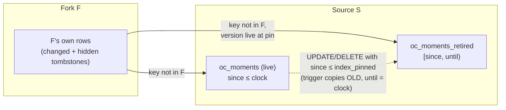

# Revision history as rows, read-through forks and change summaries over large timelines

Copyright (c) 2026 Athan Clark. SPDX-License-Identifier: GPL-3.0-only

OpenChronology keeps every saved revision of a timeline without storing any revision as a whole document, lets a fork or duplicate of a timeline of any size open at once without copying either its history or its query index, and compares two revisions at a cost that follows what changed between them rather than the timeline's size. Three mechanisms do this inside PostgreSQL. Each entity version is a row valid over a half-open range of revision numbers, so reading revision _n_ is a query. A copy records the revision it was copied from as its base and reads through to it, keeping per-entity overrides only for what it changes, up to a bounded number of levels. The live query index (tree nodes, moments, relationships, search rows) is versioned by a per-timeline clock, with triggers that keep an old row version only while a fork's pin can see it, so a fork reads its source's index as it was when forked; a fork's walks of its persistent trees look each node up level by level, starting where the parent was found. Comparisons, pull request change summaries, merges and rebases are built on these rows. Disclosed at commit [`007091c`](https://github.com/openchronology/timeline-app/tree/007091ce62fdb402346c0712b0c420eac0a29dff); first public disclosure: see [below](#first-public-disclosure).

## Field and problem

A timeline can hold hundreds of thousands or millions of moments (point events), durations and relationships, and is edited continuously: a collaborator, a log receiver or an import may save every few seconds. The application keeps every save as a revision, supports forks and duplicates, pull requests with a summary of their changes, rebases, syncs and three-way merges. The obvious ways to do this fail at that size:

- **Whole-document snapshots per revision.** Storage grows with (revisions × timeline size). A 200,000-moment timeline saved a thousand times holds two hundred million moment copies. Writing each snapshot also costs time proportional to the timeline (the project measured about 2 s per full snapshot at 100,000 moments before it moved to rows; see [Benchmarks](#benchmarks)).
- **Snapshots plus patches (deltas).** Storage follows the changes, but reading revision _n_ means loading a snapshot and replaying every patch after it. Pruning old revisions has to rewrite the chain. Comparing two revisions means building both documents.
- **Copying on fork.** Copying a timeline's history and index on every fork costs time and storage proportional to the source: the project measured 37 MB of copied history and about 30 s to copy the index of a 200,000-moment timeline, and about 2 minutes to rebuild it from the document before that.
- **Database snapshots or branching at the storage layer** (file-system clones, MVCC snapshots held open) either need operator-level infrastructure or keep old row versions for the whole database, not just for what a fork reads.
- **Comparing revisions by diffing documents** costs a full read of both documents, so a pull request summary on a large timeline costs the same whether it changes one moment or all of them.
- **A naive copy-on-write index for forks** (a fork reads its source's current rows, plus its own changes) breaks as soon as the source saves again: the fork then sees the source's later edits. Keeping every old row version in the source for ever fixes that but makes every timeline's index grow with every save, forked or not.

## Summary of the mechanism

1. **History as rows.** Every version of a moment, duration, relationship or the timeline's settings is a row with a `since` revision number and an `until` revision number (null while current). Revision _n_ is the rows with `since ≤ n < until`. A save ends the current versions of entities it changed and inserts new versions only for those, so history grows with the changes. A database trigger lets a version be changed only by setting its `until`, once. Pruning deletes versions that no remaining revision falls inside.
2. **Shared history for copies.** A fork or duplicate records the revision it was copied from (`oc_history_bases`) and reads through to it. When the copy first saves an entity that differs from what it reads through to, an override row records the copy's revision number from which it keeps its own versions of that entity; an override with no version means the copy removed it. A copy of a copy reads each level in turn. Statements resolve "which level holds this entity" with one `DISTINCT ON (key)` over a union of per-level branches ordered by depth.
3. **Versioned index rows.** The live index tables carry a `since` clock. Each timeline has an `index_clock` advanced by every transaction that writes its index, and an `index_pinned` clock: the highest clock a fork reads it at. Before a row is updated or deleted, a trigger copies it into a `_retired` twin table with `until` set to the current clock, but only when a pin can see the row (`since ≤ index_pinned`). An unforked timeline therefore writes exactly as before. A fork's index is its own rows, then each level's rows at that level's clock whose key no nearer level has, with tombstone (`hidden`) rows for what it removed. Pins are recomputed and unreachable versions released when a fork is deleted, rewritten whole or compacted.
4. **Bounded depth.** A fork reads through at most four index levels. A deeper fork copies what it reads of the nearest levels (its source's own rows) and reads through to the rest, at once when that is small, or in the background after answering when it is 20,000 or more rows. A fork that has rewritten half its moments is compacted in the background. Shared history allows at most four levels, the copy included; past that a copy starts its own history.
5. **Comparing revisions by what changed.** `differences` walks both revisions' lineages, finds the level where they meet, and takes as candidate keys only the entities the levels above that point saved, plus what the meeting timeline saved between the two revision numbers (found by indexes on `since` and `until`). Only those candidates are compared. Pull request summaries, three-way merges (entity by entity, field by field) and rebases (a revision that reads through to the upstream head and stores only the merge's patch) are built on it.

## Detailed description

### Data structures: history tables

Four version tables, none with a foreign key to `oc_timelines`, so a deleted timeline's versions stay while copies read them ([`schema.sql` L1394-L1424](https://github.com/openchronology/timeline-app/blob/007091ce62fdb402346c0712b0c420eac0a29dff/server/schema.sql#L1394-L1424)):

| Table                      | Key                                                | Value columns                                  |
| -------------------------- | -------------------------------------------------- | ---------------------------------------------- |
| `oc_history_moments`       | `(timeline_id, id, since)`                         | `time` (exact rational, `mpq`), `event` jsonb  |
| `oc_history_durations`     | `(timeline_id, id, since)`                         | `definition` jsonb                             |
| `oc_history_relationships` | `(timeline_id, a_kind, a_id, b_kind, b_id, since)` | none: the row is the link's presence           |
| `oc_history_settings`      | `(timeline_id, since)`                             | `settings` jsonb (the document minus entities) |

Every table also has `until bigint` (null while current) and `CHECK(until > since)`, so no version has an empty range.

Indexes and what uses them:

- The primary key `(timeline, key, since)` reads one entity's versions, and reading a revision in key order needs no sort.
- A partial unique index per table on `(timeline, key) WHERE until IS NULL` (`*_current`). It enforces one current version per entity, and saves find the current version by it.
- `(timeline_id, since)` and partial `(timeline_id, until) WHERE until IS NOT NULL` indexes. Comparisons find what a timeline saved between two revision numbers with them.

`oc_revisions` gains `history_rows boolean` (the revision's content is rows) and `stored_bytes` (what it is charged). A `CHECK` allows at most one of snapshot, patch or rows. `oc_timelines.history_since` is the first revision number a timeline keeps as rows.

**Immutability.** A `BEFORE UPDATE` trigger on each version table (`oc_history_immutable`) raises an error unless the update sets `until` on a current version and changes nothing else ([L1448-L1465](https://github.com/openchronology/timeline-app/blob/007091ce62fdb402346c0712b0c420eac0a29dff/server/schema.sql#L1448-L1465)):

```
reject UPDATE unless  OLD.until IS NULL
                 and  NEW.until IS NOT NULL
                 and  (NEW minus until) = (OLD minus until)   -- compared as jsonb
```

Deletes are allowed (pruning, retention, deletion). Base and override rows are insert-or-delete only (a trigger refuses every update).

### Algorithm: recording a save

`recordHistory(client, timeline, n, settings, touched)` runs in the save's transaction, with the timeline row locked ([`history.mjs` L129-L146](https://github.com/openchronology/timeline-app/blob/007091ce62fdb402346c0712b0c420eac0a29dff/server/history.mjs#L129-L146)). `touched` names the keys the save may have changed (moment IDs, duration IDs, relationship key tuples). The live index rows have already been changed.

1. If `history_since` is null, set it to `n` (history starts here). A copy starting this way records only its settings and returns, because it starts out identical to its base.
2. Settings: `UPDATE … SET until=n WHERE until IS NULL AND settings IS DISTINCT FROM $new`, then insert a new version only if none is current ([L415-L433](https://github.com/openchronology/timeline-app/blob/007091ce62fdb402346c0712b0c420eac0a29dff/server/history.mjs#L415-L433)).
3. For each kind, with the keys from `touched` (or all keys, paged), run `recordKeys` in pages of `PAGE = 20000` keys. Each page is three statements, with the keys passed as one `text[]` per key column and unnested in a CTE ([L443-L503](https://github.com/openchronology/timeline-app/blob/007091ce62fdb402346c0712b0c420eac0a29dff/server/history.mjs#L443-L503)):

```sql
-- 1. End changed or removed versions (the only update the trigger allows)
UPDATE hist h SET until = n FROM k
 WHERE h.timeline_id = T AND h.until IS NULL AND h.key = k.key
   AND NOT EXISTS (live row with key k and the same value);
-- 2. Copies only: an override for each key with none yet whose presence or value
--    now differs from what the copy's levels give (visible(levels[1..]))
INSERT INTO overrides(timeline_id, key, since)
SELECT T, k.key, n FROM k
  LEFT JOIN LATERAL (live row)       l ON true
  LEFT JOIN LATERAL (inherited row)  i ON true
 WHERE NOT EXISTS (override of k) AND (present(l) <> present(i) OR l.value IS DISTINCT FROM i.value);
-- 3. A new version for each key with a live row and no current version
--    (in a copy: only keys it overrides)
INSERT INTO hist(timeline_id, key, since, values…)
SELECT T, l.key, n, l.values… FROM k CROSS JOIN LATERAL (live row) l
 WHERE NOT EXISTS (current version of k) [AND EXISTS (override of k)];
```

Each statement returns the bytes it wrote, and the revision is charged their sum. The live-row lookup is written as a correlated subquery fenced with `OFFSET 0`, so it stays one index lookup per key even when the planner's statistics still count a freshly written timeline as empty ([L103-L112](https://github.com/openchronology/timeline-app/blob/007091ce62fdb402346c0712b0c420eac0a29dff/server/history.mjs#L103-L112)).

Without `touched` (a save rebuilt from a document, a merge or a sync rebuilt whole), `recordAll` pages through every live key in key order with a keyset cursor, and then through every key each level still sees that has no live row (removals), passing each page to `recordKeys` ([L514-L547](https://github.com/openchronology/timeline-app/blob/007091ce62fdb402346c0712b0c420eac0a29dff/server/history.mjs#L514-L547)). A timeline starting history copies its live rows page by page in one `INSERT … SELECT` per page (`copyAll`), and runs `ANALYZE` on the version tables when it wrote more than a page. No statement grows with the timeline.

**Starting and stopping history.** Migration starts history for every timeline that keeps it with one `INSERT … SELECT` per table across all of them (`startHistory`, [L593-L627](https://github.com/openchronology/timeline-app/blob/007091ce62fdb402346c0712b0c420eac0a29dff/server/history.mjs#L593-L627)). A timeline can turn saved history off (`stopHistory` in `store.mjs`). Its revisions then forget their content (the one update the revision trigger allows), except those still read (`STILL_READ`): bases of copies, fork points, other timelines' heads, pull request revisions, and the revisions their patches depend on. `pruneHistoryRows` and `endHistory` then remove versions no kept revision sees and end the rest after the last revision. Turning history on again records a `baseline` revision.

### Algorithm: reading revision _n_

Reading a revision is one query per kind ([`historyParts` L663-L687](https://github.com/openchronology/timeline-app/blob/007091ce62fdb402346c0712b0c420eac0a29dff/server/history.mjs#L663-L687)):

```sql
SELECT key, values FROM hist
 WHERE timeline_id = T AND since <= n AND (until IS NULL OR until > n)
```

A level read at `CURRENT` (the largest bigint) uses `until IS NULL` instead, which the partial unique index serves ([`seen` L357-L360](https://github.com/openchronology/timeline-app/blob/007091ce62fdb402346c0712b0c420eac0a29dff/server/history.mjs#L357-L360)). A settings version must exist at _n_, so its absence means the revision is not kept as rows. For streaming export, each part is ordered by its key, which the primary key provides without a sort.

### Data structures: shared history for copies

- `oc_history_bases(timeline_id PRIMARY KEY, base_revision_id)`: the revision a copy was made from ([L1466-L1475](https://github.com/openchronology/timeline-app/blob/007091ce62fdb402346c0712b0c420eac0a29dff/server/schema.sql#L1466-L1475)). It is indexed by `base_revision_id` so retention and `STILL_READ` can tell whether a revision is still someone's base.
- `oc_history_{moment,duration,relationship}_overrides(timeline_id, key, since)`, primary key `(timeline_id, key)` ([L1476-L1486](https://github.com/openchronology/timeline-app/blob/007091ce62fdb402346c0712b0c420eac0a29dff/server/schema.sql#L1476-L1486)). An override says: from the copy's revision `since` on, the copy keeps its own versions of this entity. An override with no current version of its own is an entity the copy removed.

The **lineage** of revision _n_ of timeline _T_ is the list `[(T, n), (T₁, n₁), (T₂, n₂), …]`. It follows `oc_history_bases` to the base revision, whose `oc_revisions` row gives the next level's timeline and number. One recursive CTE computes it, with a depth bound of 64 that only guards against a cycle ([`lineage` L332-L351](https://github.com/openchronology/timeline-app/blob/007091ce62fdb402346c0712b0c420eac0a29dff/server/history.mjs#L332-L351)). The IDs and numbers are validated (UUID and digits only) and written into the SQL as literals. The planner then sees which timeline each branch reads and uses that timeline's indexes.

**Visible versions over a lineage** ([`visible` L374-L386](https://github.com/openchronology/timeline-app/blob/007091ce62fdb402346c0712b0c420eac0a29dff/server/history.mjs#L374-L386)):

```sql
SELECT key, values FROM (
  SELECT DISTINCT ON (key) * FROM (
      SELECT 0 AS depth, false AS override, key, values FROM hist h WHERE seen(h, level0)
    UNION ALL
      SELECT 0, true, key, NULL… FROM overrides o WHERE o.timeline_id = T0 AND o.since <= n0
    UNION ALL
      SELECT 1, false, … level1 …   UNION ALL   SELECT 1, true, … level1 overrides …
    …
  ) v ORDER BY key, depth, override
) v WHERE NOT override
```

For each key, this keeps the nearest level's row, and at that level the version before the override. A level that has an override and no version is a removal. Its override row wins `DISTINCT ON` and is then filtered out, which hides deeper levels' versions. An override counts only from its `since`: before that revision the copy still read the entity through.

**Creating a copy** (`shareHistory`, [L394-L408](https://github.com/openchronology/timeline-app/blob/007091ce62fdb402346c0712b0c420eac0a29dff/server/history.mjs#L394-L408)): if the source revision is kept as rows and its lineage has fewer than `SHARED_LEVELS = 4` entries, insert the base link. The copy's own lineage then has at most four levels, itself included. Otherwise the copy's first revision copies its whole state (`copyAll`). A new copy is charged only its settings.

**Pruning** (`pruneHistoryRows`, [L697-L729](https://github.com/openchronology/timeline-app/blob/007091ce62fdb402346c0712b0c420eac0a29dff/server/history.mjs#L697-L729)), after retention, turning history off, or deletion:

1. Delete each version for which no revision of the timeline that is still kept as rows has a number in `[since, until)`. While the head is kept as rows only ended versions need checking, because the head sees every current one.
2. Delete overrides with `since` later than every kept revision.
3. Once the timeline has no kept revision, delete its base link, returning the base's timeline so the caller can prune that one in turn. A deleted source's history may have been kept only for this copy.

### Data structures: versioned index rows

The live index is six tables: `oc_moments`, `oc_nodes` (moment tree), `oc_duration_nodes` (duration interval tree), `oc_edge_nodes`, `oc_relationships` and `oc_entity_search` (`VERSIONED_TABLES`, [`index-versions.mjs` L25-L32](https://github.com/openchronology/timeline-app/blob/007091ce62fdb402346c0712b0c420eac0a29dff/server/index-versions.mjs#L25-L32)). The trees are persistent balanced trees with summaries, described in [persistent interval index](persistent-interval-index.md). This mechanism adds:

- `oc_timelines.index_clock bigint` (starts at 0), `index_pinned bigint` (null when unpinned), `index_bases uuid[]` and `index_clocks bigint[]` (a fork's levels, nearest first, and the clock each is read at), with a partial GIN index on `index_bases` for "who reads through to timeline X" ([L1521-L1530](https://github.com/openchronology/timeline-app/blob/007091ce62fdb402346c0712b0c420eac0a29dff/server/schema.sql#L1521-L1530), [L1606-L1617](https://github.com/openchronology/timeline-app/blob/007091ce62fdb402346c0712b0c420eac0a29dff/server/schema.sql#L1606-L1617)).
- On each index table: `since bigint` defaulting to `current_setting('oc.clock')::bigint`, so an insert outside a versioned write fails rather than going unversioned. Also `hidden boolean`, a fork's tombstone ([L1531-L1539](https://github.com/openchronology/timeline-app/blob/007091ce62fdb402346c0712b0c420eac0a29dff/server/schema.sql#L1531-L1539)).
- A `<table>_retired` twin with every column of the live table plus `until bigint NOT NULL`, indexed by `(timeline_id, until)`, by `(timeline_id, key…, until)`, and by a non-unique copy of every other index of the live table ([L1620-L1641](https://github.com/openchronology/timeline-app/blob/007091ce62fdb402346c0712b0c420eac0a29dff/server/schema.sql#L1620-L1641)). The foreign key from index rows to `oc_timelines` is dropped, so rows outlive their timeline while forks read them.

### Algorithm: writing a versioned index

`beginIndexWrite(client, T)` ([L43-L62](https://github.com/openchronology/timeline-app/blob/007091ce62fdb402346c0712b0c420eac0a29dff/server/index-versions.mjs#L43-L62)) must precede any change to T's index in a transaction:

1. `UPDATE oc_timelines SET index_clock = index_clock + 1 WHERE id = T RETURNING index_clock, index_pinned`. The row lock serializes writers of one timeline's index.
2. Set transaction-local settings `oc.clock`, `oc.timeline = T` and `oc.pinned` (empty when unpinned). They end with the transaction, so a pooled connection never carries them over.

Per table, generated triggers ([L1540-L1600](https://github.com/openchronology/timeline-app/blob/007091ce62fdb402346c0712b0c420eac0a29dff/server/schema.sql#L1540-L1600)):

```
BEFORE UPDATE:  NEW.since := oc.clock
                if OLD.timeline_id = oc.timeline and coalesce(OLD.since,0) <= oc.pinned:
                    INSERT INTO <table>_retired(all columns of OLD, until = oc.clock)
                    oc.retired += 1
BEFORE DELETE WHEN (OLD.timeline_id = oc.timeline and coalesce(OLD.since,0) <= oc.pinned):
                    INSERT INTO <table>_retired(all columns of OLD, until = oc.clock)
                    oc.retired += 1
```

A row written after the highest pin is invisible to every fork, so it is changed in place with no retired copy. A timeline that is never forked writes exactly as it did before versioning. Its live tables hold only current rows, so reading the current index is unchanged. The triggers are regenerated on every migration from `pg_attribute`, so columns added later are retired too. The `oc.retired` count lets the transaction refresh the retired tables' statistics after 1,000 or more retirements (`ANALYZE_VERSIONS_AFTER`, [`store.mjs` L955-L963](https://github.com/openchronology/timeline-app/blob/007091ce62fdb402346c0712b0c420eac0a29dff/server/store.mjs#L955-L963)).

**The index at clock c** ([`indexAtSql` L71-L77](https://github.com/openchronology/timeline-app/blob/007091ce62fdb402346c0712b0c420eac0a29dff/server/index-versions.mjs#L71-L77)):

```sql
SELECT … FROM T_live    WHERE timeline_id = T AND coalesce(since,0) <= c
UNION ALL
SELECT … FROM T_retired WHERE timeline_id = T AND coalesce(since,0) <= c AND until > c
```

**Invariant.** One pin, the highest, covers every lower one. Every version a lower pin can see has `since ≤ lower pin ≤ highest pin`, so it is retired when changed. Versions of one key at one level never overlap in `[since, until)`, so a key has at most one version per level at any clock.

### Algorithm: forking without copying

`shareIndex(client, from, to, revisionId)` ([`store.mjs` L527-L568](https://github.com/openchronology/timeline-app/blob/007091ce62fdb402346c0712b0c420eac0a29dff/server/store.mjs#L527-L568)), in the fork's transaction (`Versioning.copy`, [`versioning.mjs` L94-L172](https://github.com/openchronology/timeline-app/blob/007091ce62fdb402346c0712b0c420eac0a29dff/server/versioning.mjs#L94-L172)):

1. Refuse (fall back to a rebuild from the document) unless `from`'s index is current and copyable (`copyable`).
2. Pin: `UPDATE oc_timelines SET index_pinned = greatest(index_pinned, index_clock) WHERE id = from`. The row lock also keeps `from`'s clock from moving until commit.
3. Set `to.index_bases = from ‖ from.index_bases` and `to.index_clocks = from.index_clock ‖ from.index_clocks`, and copy `from`'s root IDs, counts, settings and catalogue text columns (`TIMELINE_INDEX`). Nothing else is copied.
4. If the new lineage is no deeper than `INDEX_LEVELS = 4`, the fork is ready at once.
5. Otherwise count `from`'s own `oc_moments` and `oc_duration_nodes` rows, each count stopping at `PREPARE_AFTER = 20000`. Below that, `takeLevels` copies the excess levels now. At or above it, the fork is marked `preparing_revision_id`, the request is answered, and `prepare` copies them after commit in a transaction of its own (`FOR UPDATE SKIP LOCKED`, so one process prepares a copy at a time). Until then `access` answers 409 for its index. The pin keeps `from` as it was forked whatever `from` does meanwhile, and `prepareStale` resumes unprepared copies at startup.

`takeLevels` ([L583-L613](https://github.com/openchronology/timeline-app/blob/007091ce62fdb402346c0712b0c420eac0a29dff/server/store.mjs#L583-L613)) calls `copyLevel` for each excess level, nearest first ([`index-versions.mjs` L282-L302](https://github.com/openchronology/timeline-app/blob/007091ce62fdb402346c0712b0c420eac0a29dff/server/index-versions.mjs#L282-L302)):

```sql
INSERT INTO tbl(timeline_id, cols…, hidden)
SELECT $fork, cols…, hidden FROM (
    SELECT cols…, hidden FROM tbl         WHERE timeline_id = $level AND coalesce(since,0) <= $clock
  UNION ALL
    SELECT cols…, coalesce(hidden,false) FROM tbl_retired
                                          WHERE timeline_id = $level AND coalesce(since,0) <= $clock AND until > $clock) x
WHERE NOT EXISTS (SELECT 1 FROM tbl v WHERE v.timeline_id = $fork AND v.key = x.key)
```

It copies hidden rows too, because they hide deeper levels' keys. Copying nearest first lets a nearer level's copied rows shadow the same keys of the next level, as they did when read through. Then it removes the copied levels from the front of `index_bases`/`index_clocks`. If no level is left it deletes the fork's hidden rows, which now hide nothing, and calls `oc_release_index` on the levels dropped. What is copied is the source's own rows (what the source changed relative to its own levels), not its whole index.

### Algorithm: reading through levels

`indexReader(client, t)` ([L135-L226](https://github.com/openchronology/timeline-app/blob/007091ce62fdb402346c0712b0c420eac0a29dff/server/index-versions.mjs#L135-L226)) returns a function `rows(table)` that writes SQL for the rows a timeline sees. A timeline with no levels reads `WHERE timeline_id = $1`. A fork reads:

```
branch 0: own rows, NOT hidden
for level L = 0 .. depth-1 (nearest first):
   branch: L's live rows    with coalesce(since,0) <= clock_L, NOT hidden,         and not shadowed
   branch: L's retired rows with coalesce(since,0) <= clock_L < until, hidden IS NOT TRUE, not shadowed
   shadowed := key present among own rows (hidden ones included)
               or among the live/retired versions at any nearer level at that level's clock
UNION ALL of all branches
```

The shadow test is chosen by access pattern:

- **Lookups and small reads.** `NOT EXISTS (… v.key = x.key)`, checked per row.
- **Scans** (`{scan: true}`). `x.key NOT IN (SELECT v.key FROM …)`, so PostgreSQL hashes the nearer levels' keys once. They are the fewer rows. The transaction raises `hash_mem_multiplier` to 64 so the hash is used beyond `work_mem`.
- **Lookup by key** (`rows.lookup`). `coalesce((own version), (level 0 live), (level 0 retired), (level 1 live), …)`. Each argument is a scalar subquery ordered by the table's key and limited to one row, so the key's index is used even before statistics count the timeline. `coalesce` evaluates its arguments in order and stops at the first non-null, so the lookup stops at the first level that has a version. A hidden first version yields no row.

The levels are written as literals (validated as UUIDs and digits). Reading through looks costly to the planner, which then JIT-compiles plans that take longer to compile than to run, so the transaction turns `jit` off.

**Removals in a fork** (`removeRows`, [L248-L272](https://github.com/openchronology/timeline-app/blob/007091ce62fdb402346c0712b0c420eac0a29dff/server/index-versions.mjs#L248-L272)) delete the fork's own rows with those keys. For each key that some level still shows, they insert a copy of that row as the fork's own with `hidden = true`. The copy keeps every column so it satisfies the table's constraints.

**Database-side walks.** The tree walks that run inside PostgreSQL (overview, events page, duration overview, recent times, catalogue text) have `_lineage` variants. These are generated at migration from the originals' source text (`pg_get_functiondef`) by string rewrites. `oc_rewrite` raises if a rewrite no longer applies, so a drifted original fails the migration ([L1736-L1923](https://github.com/openchronology/timeline-app/blob/007091ce62fdb402346c0712b0c420eac0a29dff/server/schema.sql#L1736-L1923)). Each original's first statement hands a timeline with non-empty `index_bases` to its variant. Each variant's node lookup is replaced by `oc_lineage_lookup`:

1. Start at the level `hint` where the parent node was found, trying first the version (live or retired) the parent had.
2. Then the other version at that level, then each deeper level, live row before retired. Level 1, the fork itself, has only live rows and is read at the largest clock.
3. Push each child with its level in the bits above 56 and the live/retired choice in bit 55. Node IDs stay below 2⁵⁵ and are masked back with `2⁵⁵ − 1`.

**Why one lookup per step usually suffices.** `PersistentTree` ([`avl.mjs` L330-L336](https://github.com/openchronology/timeline-app/blob/007091ce62fdb402346c0712b0c420eac0a29dff/server/avl.mjs#L330-L336)) writes a changed node and the whole path from the root to it. In a fork those path nodes become the fork's own rows. A moment the fork changes likewise makes its tree node the fork's own. So **a fork's own nodes have only its own nodes above them**, and a node's version is at its parent's level or a deeper one, never a nearer one. A walk that starts each lookup at the parent's level therefore finds most nodes with one indexed lookup, as on an unforked timeline. Below a node the fork never changed, the walk runs entirely at the source's level. The duration overview's range scan of a small subtree is kept for subtrees found at the deepest level, or for a fork reading through one level (its own rows plus that level's). Other subtrees are walked node by node. The variants are created with `jit=off` and `enable_seqscan=off`, because their plans are cached per connection and must never fall back to a whole-table scan as retired rows grow.

The generated SQL functions `<table>_at(tids, clocks, from_level)` give the same visible set inside the database, for up to four levels below the timeline ([L1642-L1675](https://github.com/openchronology/timeline-app/blob/007091ce62fdb402346c0712b0c420eac0a29dff/server/schema.sql#L1642-L1675)).

### Algorithm: releasing what forks no longer read

`oc_release_index(bases uuid[], clocks bigint[])` ([L1676-L1724](https://github.com/openchronology/timeline-app/blob/007091ce62fdb402346c0712b0c420eac0a29dff/server/schema.sql#L1676-L1724)) is called when a timeline stops reading through to levels: deleted (from an `AFTER DELETE` trigger on `oc_timelines`), saved whole, compacted, or its levels taken. For each level _b_, in ID order so concurrent releases cannot deadlock:

1. Take an advisory lock on _b_ and, if _b_ still exists, its row lock.
2. Recompute _b_'s pins from the lineages that remain: the distinct `index_clocks[k]` of every timeline whose `index_bases[k] = b`.
3. If _b_ is alive, set `index_pinned` to the highest remaining pin (null if none).
4. Delete from each `_retired` twin the versions of _b_ that the released clock saw (`since ≤ c < until`, or all versions for a null clock) and that no remaining pin falls inside.
5. If _b_ was deleted, also delete its live rows written after the highest remaining pin, which is all of them once no pin remains.

Every version a level retires is one its highest pin could see when retired, so versions become unreachable only when pins go. This is when they are released.

### Algorithm: compaction

After a save to a fork the transaction sets `client.compact` ([`store.mjs` L1484-L1490](https://github.com/openchronology/timeline-app/blob/007091ce62fdb402346c0712b0c420eac0a29dff/server/store.mjs#L1484-L1490)). After commit, `compact` ([L666-L681](https://github.com/openchronology/timeline-app/blob/007091ce62fdb402346c0712b0c420eac0a29dff/server/store.mjs#L666-L681)) checks `diverged`: whether the fork's own `oc_moments` rows, hidden ones included and counted with `LIMIT ceil(event_count × COMPACT_SHARE)`, reach `COMPACT_SHARE = 0.5` of its moments ([L688-L702](https://github.com/openchronology/timeline-app/blob/007091ce62fdb402346c0712b0c420eac0a29dff/server/store.mjs#L688-L702)). If they do, it repeats `compactStep` ([L710-L747](https://github.com/openchronology/timeline-app/blob/007091ce62fdb402346c0712b0c420eac0a29dff/server/store.mjs#L710-L747)), each step in its own transaction holding the fork's row lock:

1. `beginIndexWrite(fork)`.
2. For each table, insert up to `COPY_PAGE = 50000` rows the fork reads from a level (`timeline_id <> fork`) as its own. If any table copied rows, end the step. The copied rows now shadow their keys, so the next step's read finds the next page.
3. When nothing is left to copy, delete the fork's hidden rows, clear `index_bases`/`index_clocks`, call `oc_release_index` on the old lineage, and request `ANALYZE`.

The copied rows are the same rows the fork already read, so reads return the same result during compaction, and a save waits at most for one page.

### Algorithm: comparing two revisions

`differences(client, fromId, toId)` ([`history.mjs` L740-L752](https://github.com/openchronology/timeline-app/blob/007091ce62fdb402346c0712b0c420eac0a29dff/server/history.mjs#L740-L752)) returns null unless both revisions are kept as rows. Otherwise it is an async iterable of pages of `{kind, key, before, after}`. The settings come first, if they differ, then each kind ([`comparePages` L757-L788](https://github.com/openchronology/timeline-app/blob/007091ce62fdb402346c0712b0c420eac0a29dff/server/history.mjs#L757-L788)).

**Candidate keys** ([`candidates` L802-L831](https://github.com/openchronology/timeline-app/blob/007091ce62fdb402346c0712b0c420eac0a29dff/server/history.mjs#L802-L831)), with `from = [(F₀,a₀),(F₁,a₁),…]` and `to = [(G₀,b₀),…]`:

1. Let _i_ be the first index of `from` whose timeline also appears in `to`, and _j_ its index in `to`. This is where the two lineages meet.
2. `above` is `from[0..i)` together with `to[0..j)`. If they share no timeline, `above` is both lineages whole.
3. Each level in `above` contributes the keys it has versions or overrides of with `since ≤ its number`.
4. If the meeting timeline is read at two different numbers `lo < hi`, add its keys with `since ∈ (lo, hi]` or `until ∈ (lo, hi]`, and overrides with `since ∈ (lo, hi]`. The `(timeline_id, since)` and `(timeline_id, until)` indexes find these.
5. Make each branch distinct, cut it to `PAGE` keys after the cursor in key order, take the union, make it distinct again and cut it to `PAGE`. History rows repeat a key, so each branch is made distinct before cutting. Otherwise the cursor could skip keys it never returned.

**Comparison** (`compareKeys`, [L838-L855](https://github.com/openchronology/timeline-app/blob/007091ce62fdb402346c0712b0c420eac0a29dff/server/history.mjs#L838-L855)): `visible(kind, from)` and `visible(kind, to)`, both restricted to the candidate page, are joined with a `FULL JOIN` on the key. A row is kept where either side is missing or the values are distinct. A relationship's value is `true` where present.

An entity outside the candidates had the same version in both revisions: neither lineage's distinct levels saved it, and the shared timeline did not change it between the two numbers. The work is therefore proportional to what the two revisions saved since their common state, plus the lineage depth, and not to the timeline's size.

**Pull request summaries** (`Collaboration.changes`, [`collaboration.mjs` L510-L565](https://github.com/openchronology/timeline-app/blob/007091ce62fdb402346c0712b0c420eac0a29dff/server/collaboration.mjs#L510-L565)) consume these pages to count added, removed and changed moments, durations and relationships, list changed settings, and keep the first 30 changed moments and durations of each kind with their times formatted for display. A pull request's source is a revision outside any numbered history. It has its own one-revision history (its ID used as `timeline_id`, number 1) that reads through to its base, built by staging the document's entities in temporary tables and recording them against the base (`recordDetached`, [`history.mjs` L237-L291](https://github.com/openchronology/timeline-app/blob/007091ce62fdb402346c0712b0c420eac0a29dff/server/history.mjs#L237-L291)). For a source against its base, the lineages meet at the base's timeline with equal numbers, so the candidates are exactly the source's own rows. Revisions saved before history was kept as rows fall back to a whole-document diff (`documentDifferences`).

### Algorithm: merging entity by entity

`mergeValue(a, b, c, key, fields, conflicts)` ([`merge.mjs` L36-L50](https://github.com/openchronology/timeline-app/blob/007091ce62fdb402346c0712b0c420eac0a29dff/server/merge.mjs#L36-L50)) is a three-way merge of one value, with `a` the base, `b` the other side and `c` the head:

```
if same(a, b): return c
if same(a, c) or same(b, c): return b
if fields and a, b, c are all plain objects:
    return { k: mergeValue(a[k], b[k], c[k], key+"."+k, true) for k in keys(a) ∪ keys(b) ∪ keys(c) }  (undefined dropped)
conflicts.push(key); return c
```

Equality is canonical JSON with sorted keys. Arrays are atomic conflict units.

`mergePatch(client, T, {baseId, otherId, headId})` ([L160-L222](https://github.com/openchronology/timeline-app/blob/007091ce62fdb402346c0712b0c420eac0a29dff/server/merge.mjs#L160-L222)):

1. `pages = differences(baseId, otherId)`: only what the other side changed. Return null if either revision is not kept as rows, and the caller falls back to `rebaseDocument` on whole documents.
2. Settings: the fields in `SETTINGS` merge three ways. Any other changed field is taken only if the head still has the base's value.
3. For each page of one kind, read the head's versions of those keys (`valuesAt(headId, kind, keys)`, a `visible` query restricted to the keys). Merge each entity with `mergeValue`, field by field for moments and durations and as whole values for relationships. Record only results that differ from the head.
4. If there are conflicts, throw 409 listing them.
5. `complete` ([L229-L310](https://github.com/openchronology/timeline-app/blob/007091ce62fdb402346c0712b0c420eac0a29dff/server/merge.mjs#L229-L310)) makes the result what a whole-document merge would give. Durations the head anchors to removed moments are included and keep the moment's last known time (from the other side, the head or the base). Links to removed entities are removed, and added links whose ends are missing are dropped. These lookups use the expression indexes on duration anchors and the relationship key indexes, read through the timeline's levels.
6. Return a patch in the same format a save takes.

**Merge** applies the patch as a save (`applyMerge`: in place when small, rebuilt from the patched document otherwise) with parents `[head, source]`. **Rebase** records the patch as a detached revision whose base is the upstream head (`recordDetachedPatch`, [`history.mjs` L251-L274](https://github.com/openchronology/timeline-app/blob/007091ce62fdb402346c0712b0c420eac0a29dff/server/history.mjs#L251-L274)). It stages only the entities the patch names and records them against that head, so the rebased source reads through to upstream and is charged only what the merge changes ([`collaboration.mjs` L764-L803](https://github.com/openchronology/timeline-app/blob/007091ce62fdb402346c0712b0c420eac0a29dff/server/collaboration.mjs#L764-L803)). **Sync** merges the fork with upstream against their common ancestor the same way.

### Edge cases

- **History rows survive the timeline.** The version and base tables have no foreign key to `oc_timelines`. A deleted source's versions stay until the last copy that reads them is pruned or deleted.
- **Index rows before versioning** have `since` null and count as clock 0 (`coalesce(since,0)`). Retired rows from before the `hidden` column existed have `hidden` null, tested as `IS NOT TRUE`.
- **Statistics after bulk writes.** A freshly forked or compacted timeline may be counted as empty by the planner. Per-key lookups are therefore fenced (`OFFSET 0`) or ordered by the key's index. The server runs `ANALYZE` after 20,000 or more rows written, 1,000 or more retired, or 1,000 or more changes to a fork.
- **Concurrent forks of one source** each pin with `greatest`, under the source's row lock.
- **A crash during preparation** leaves nothing behind (one transaction). The next start resumes it.

### Complexity

Let _N_ be the timeline's entities, _k_ the entities a save changes, _d_ the lineage depth (at most 4 for history, at most 4 index levels below the fork) and _h_ the tree height (O(log _N_)).

| Operation                   | Time                                                          | Space                                                 |
| --------------------------- | ------------------------------------------------------------- | ----------------------------------------------------- |
| Save                        | O(_k_ log _N_) index lookups, ⌈_k_/20000⌉ × 3 statements      | O(_k_) new versions                                   |
| Read revision _n_           | O(_N_ · _d_) rows read, index-ordered                         | none stored per revision                              |
| Fork (≤ 4 levels)           | O(1) rows written                                             | O(1); the source retires O(changed rows) while pinned |
| Fork (> 4 levels)           | O(source's own rows)                                          | same                                                  |
| Fork read, per tree step    | usually 1 lookup; at most 2(_d_+1)                            |                                                       |
| `differences`               | O(_c_ · _d_) for _c_ candidate keys                           | O(PAGE) per page                                      |
| Pull request summary, merge | as `differences` plus O(_c_) head lookups                     | patch of O(changed)                                   |
| Release                     | O(retired rows of released levels) via `(timeline_id, until)` |                                                       |

A pinned source's index grows by about one retired row per row its saves change while a fork reads it.

### Variations

- The revision coordinate may be any totally ordered, monotonically assigned value (timestamps, log sequence numbers, hybrid clocks) instead of integer revision numbers. The half-open `[since, until)` range and the "end once" immutability rule are unchanged.
- The level bounds (`SHARED_LEVELS`, `INDEX_LEVELS`), the compaction share (0.5), the preparation threshold (20,000) and the page sizes are tuning constants. A system may use any bounds, or none at all with on-demand flattening.
- Pins may be kept as a set per level rather than only the highest. With only the highest, retiring is one comparison in the trigger, and the set is recomputed only on release.
- The same versioned-row-with-pins scheme applies to any index of rows keyed within a tenant (B-tree nodes, inverted-index postings, materialized summaries), and to any database with row triggers or a storage layer that can intercept updates and deletes.
- Tombstones may be a separate table instead of a `hidden` flag on a copy of the row. The flag keeps the row satisfying the table's constraints and lets one lookup find either the row or its removal.
- The comparison's candidate selection applies to any pair of lineages sharing a prefix: branches of branches, detached revisions and rebased revisions.
- The field-by-field merge may treat arrays element-wise when elements have stable IDs. Here they are atomic.

## Implementation references

- `server/history.mjs` — module header ([L1-L29](https://github.com/openchronology/timeline-app/blob/007091ce62fdb402346c0712b0c420eac0a29dff/server/history.mjs#L1-L29)); `PAGE`, `SHARED_LEVELS`, `CURRENT` ([L34-L42](https://github.com/openchronology/timeline-app/blob/007091ce62fdb402346c0712b0c420eac0a29dff/server/history.mjs#L34-L42)); `KINDS` ([L58-L98](https://github.com/openchronology/timeline-app/blob/007091ce62fdb402346c0712b0c420eac0a29dff/server/history.mjs#L58-L98)).
- `server/history.mjs` — `recordHistory`, `recordEntities` ([L129-L173](https://github.com/openchronology/timeline-app/blob/007091ce62fdb402346c0712b0c420eac0a29dff/server/history.mjs#L129-L173)): records a save.
- `server/history.mjs` — `recordDetached`, `recordDetachedPatch`, `startDetached`, `stage` ([L237-L321](https://github.com/openchronology/timeline-app/blob/007091ce62fdb402346c0712b0c420eac0a29dff/server/history.mjs#L237-L321)): pull request sources and rebases as one-revision histories over a base.
- `server/history.mjs` — `lineage`, `seen`, `visible` ([L332-L386](https://github.com/openchronology/timeline-app/blob/007091ce62fdb402346c0712b0c420eac0a29dff/server/history.mjs#L332-L386)): levels and the visible versions over them.
- `server/history.mjs` — `shareHistory` ([L394-L408](https://github.com/openchronology/timeline-app/blob/007091ce62fdb402346c0712b0c420eac0a29dff/server/history.mjs#L394-L408)): a copy reads through to its base.
- `server/history.mjs` — `recordSettings`, `recordKeys`, `recordAll`, `copyAll` ([L415-L583](https://github.com/openchronology/timeline-app/blob/007091ce62fdb402346c0712b0c420eac0a29dff/server/history.mjs#L415-L583)): the three-statement page, overrides, keyset paging.
- `server/history.mjs` — `startHistory`, `endHistory` ([L593-L640](https://github.com/openchronology/timeline-app/blob/007091ce62fdb402346c0712b0c420eac0a29dff/server/history.mjs#L593-L640)).
- `server/history.mjs` — `historyDocument`, `historyParts` ([L646-L687](https://github.com/openchronology/timeline-app/blob/007091ce62fdb402346c0712b0c420eac0a29dff/server/history.mjs#L646-L687)): reading a revision.
- `server/history.mjs` — `pruneHistoryRows` ([L697-L729](https://github.com/openchronology/timeline-app/blob/007091ce62fdb402346c0712b0c420eac0a29dff/server/history.mjs#L697-L729)).
- `server/history.mjs` — `differences`, `comparePages`, `candidates`, `compareKeys`, `valuesAt`, `settingsAt` ([L740-L904](https://github.com/openchronology/timeline-app/blob/007091ce62fdb402346c0712b0c420eac0a29dff/server/history.mjs#L740-L904)).
- `server/index-versions.mjs` — `VERSIONED_TABLES`, `beginIndexWrite`, `indexAtSql` ([L25-L77](https://github.com/openchronology/timeline-app/blob/007091ce62fdb402346c0712b0c420eac0a29dff/server/index-versions.mjs#L25-L77)).
- `server/index-versions.mjs` — `INDEX_LEVELS`, `KEYS`, `indexReader` with `lookup` ([L83-L226](https://github.com/openchronology/timeline-app/blob/007091ce62fdb402346c0712b0c420eac0a29dff/server/index-versions.mjs#L83-L226)).
- `server/index-versions.mjs` — `removeRows` ([L248-L272](https://github.com/openchronology/timeline-app/blob/007091ce62fdb402346c0712b0c420eac0a29dff/server/index-versions.mjs#L248-L272)), `copyLevel` ([L282-L302](https://github.com/openchronology/timeline-app/blob/007091ce62fdb402346c0712b0c420eac0a29dff/server/index-versions.mjs#L282-L302)).
- `server/store.mjs` — `STILL_READ` ([L127-L141](https://github.com/openchronology/timeline-app/blob/007091ce62fdb402346c0712b0c420eac0a29dff/server/store.mjs#L127-L141)); `COPY_PAGE`, `COMPACT_SHARE`, `PREPARE_AFTER`, `ANALYZE_VERSIONS_AFTER` ([L231-L248](https://github.com/openchronology/timeline-app/blob/007091ce62fdb402346c0712b0c420eac0a29dff/server/store.mjs#L231-L248)).
- `server/store.mjs` — `shareIndex`, `levels`, `takeLevels`, `prepare`, `prepareNow` ([L527-L659](https://github.com/openchronology/timeline-app/blob/007091ce62fdb402346c0712b0c420eac0a29dff/server/store.mjs#L527-L659)).
- `server/store.mjs` — `compact`, `diverged`, `compactStep`, `prepareStale` ([L666-L758](https://github.com/openchronology/timeline-app/blob/007091ce62fdb402346c0712b0c420eac0a29dff/server/store.mjs#L666-L758)).
- `server/store.mjs` — `stopHistory`, `startHistory` ([L1257-L1333](https://github.com/openchronology/timeline-app/blob/007091ce62fdb402346c0712b0c420eac0a29dff/server/store.mjs#L1257-L1333)); `recordDetached`, `recordDetachedPatch`, `applyMerge` ([L1343-L1398](https://github.com/openchronology/timeline-app/blob/007091ce62fdb402346c0712b0c420eac0a29dff/server/store.mjs#L1343-L1398)).
- `server/versioning.mjs` — `copy` ([L94-L172](https://github.com/openchronology/timeline-app/blob/007091ce62fdb402346c0712b0c420eac0a29dff/server/versioning.mjs#L94-L172)): fork or duplicate, calling `shareHistory` and `shareIndex`.
- `server/schema.sql` — history tables, indexes, `oc_history_immutable` ([L1394-L1465](https://github.com/openchronology/timeline-app/blob/007091ce62fdb402346c0712b0c420eac0a29dff/server/schema.sql#L1394-L1465)); `oc_history_bases`, overrides, comparison indexes ([L1466-L1505](https://github.com/openchronology/timeline-app/blob/007091ce62fdb402346c0712b0c420eac0a29dff/server/schema.sql#L1466-L1505)).
- `server/schema.sql` — `preparing_revision_id` ([L1514-L1520](https://github.com/openchronology/timeline-app/blob/007091ce62fdb402346c0712b0c420eac0a29dff/server/schema.sql#L1514-L1520)); index clock, pin, `hidden`, `_retired` twins and triggers ([L1521-L1600](https://github.com/openchronology/timeline-app/blob/007091ce62fdb402346c0712b0c420eac0a29dff/server/schema.sql#L1521-L1600)).
- `server/schema.sql` — `index_bases`/`index_clocks`, twin indexes, `<table>_at` ([L1606-L1675](https://github.com/openchronology/timeline-app/blob/007091ce62fdb402346c0712b0c420eac0a29dff/server/schema.sql#L1606-L1675)); `oc_release_index` and its delete trigger ([L1676-L1734](https://github.com/openchronology/timeline-app/blob/007091ce62fdb402346c0712b0c420eac0a29dff/server/schema.sql#L1676-L1734)).
- `server/schema.sql` — `oc_rewrite`, `oc_lineage_lookup`, the generated `_lineage` walks and their hand-off ([L1736-L1923](https://github.com/openchronology/timeline-app/blob/007091ce62fdb402346c0712b0c420eac0a29dff/server/schema.sql#L1736-L1923)).
- `server/avl.mjs` — `PersistentTree` ([L330-L336](https://github.com/openchronology/timeline-app/blob/007091ce62fdb402346c0712b0c420eac0a29dff/server/avl.mjs#L330-L336)): a fork's changed node and its path become the fork's own.
- `server/merge.mjs` — `mergeValue` ([L36-L50](https://github.com/openchronology/timeline-app/blob/007091ce62fdb402346c0712b0c420eac0a29dff/server/merge.mjs#L36-L50)), `rebaseDocument` ([L81-L137](https://github.com/openchronology/timeline-app/blob/007091ce62fdb402346c0712b0c420eac0a29dff/server/merge.mjs#L81-L137)), `mergePatch` ([L160-L222](https://github.com/openchronology/timeline-app/blob/007091ce62fdb402346c0712b0c420eac0a29dff/server/merge.mjs#L160-L222)), `complete` ([L229-L310](https://github.com/openchronology/timeline-app/blob/007091ce62fdb402346c0712b0c420eac0a29dff/server/merge.mjs#L229-L310)).
- `server/collaboration.mjs` — `documentDifferences` ([L385-L410](https://github.com/openchronology/timeline-app/blob/007091ce62fdb402346c0712b0c420eac0a29dff/server/collaboration.mjs#L385-L410)), `changes` ([L510-L565](https://github.com/openchronology/timeline-app/blob/007091ce62fdb402346c0712b0c420eac0a29dff/server/collaboration.mjs#L510-L565)), `resolve` rebase and merge ([L748-L847](https://github.com/openchronology/timeline-app/blob/007091ce62fdb402346c0712b0c420eac0a29dff/server/collaboration.mjs#L748-L847)).
- `server/save-merge.mjs` — the same field-by-field merge for edits saved on an older revision, with the editor sending what it saw as the base ([L1-L20](https://github.com/openchronology/timeline-app/blob/007091ce62fdb402346c0712b0c420eac0a29dff/server/save-merge.mjs#L1-L20)).

## Benchmarks

All numbers below are quoted from the repository's documentation. None were run for this document.

- **Fork reads.** "At 200,000 moments, reads on a fork take about 1.2 to 1.5 times as long as on its source, also after both have moved thousands of moments since the fork" ([`docs/architecture.md` L76](https://github.com/openchronology/timeline-app/blob/007091ce62fdb402346c0712b0c420eac0a29dff/docs/architecture.md#L76), measured by [`bench/fork-reads.mjs`](https://github.com/openchronology/timeline-app/blob/007091ce62fdb402346c0712b0c420eac0a29dff/bench/fork-reads.mjs)). The benchmark defaults to 200,000 moments and 5,000 source changes. It compares overview, events page, duration, search, tag and by-ID reads, as a median of seven runs on each side, just after forking, after the source moved moments, and after the fork saved. The documentation states no hardware for this figure.
- **Saving to a new fork** ([`docs/benchmarks.md` L101-L112](https://github.com/openchronology/timeline-app/blob/007091ce62fdb402346c0712b0c420eac0a29dff/docs/benchmarks.md#L101-L112), [`bench/fork-save.mjs`](https://github.com/openchronology/timeline-app/blob/007091ce62fdb402346c0712b0c420eac0a29dff/bench/fork-save.mjs)). At 200,000 moments, on an 8-core virtual machine with PostgreSQL 17, saving 10 moments took 0.16 s right after forking (5.29 s before the statistics fix) and 0.18–0.54 s with current statistics.
- **Forks past four levels and history size** ([`docs/administration.md` L176-L198](https://github.com/openchronology/timeline-app/blob/007091ce62fdb402346c0712b0c420eac0a29dff/docs/administration.md#L176-L198)). At 200,000 moments:
  - A fork used to add 37 MB of history and now adds a few hundred bytes.
  - A copy took about 30 s to copy and, before that, 2 minutes to rebuild. It is now ready at once.
  - A fifth-level copy whose source changed 1,000 moments took 5.5 s, most of it refreshing statistics.
  - One whose source changed 26,000 was answered in 0.4 s and ready in 9 s.
  - Reading one of a copy's saved revisions takes about a third longer than reading the original's (6 s rather than 4.6 s).
- **Catalogue text on forks** ([`docs/benchmarks.md` L114-L127](https://github.com/openchronology/timeline-app/blob/007091ce62fdb402346c0712b0c420eac0a29dff/docs/benchmarks.md#L114-L127), [`bench/fork-text.mjs`](https://github.com/openchronology/timeline-app/blob/007091ce62fdb402346c0712b0c420eac0a29dff/bench/fork-text.mjs)). On a 16-core virtual machine with PostgreSQL 16, rebuilding a fork's text after 100–200 source saves takes 0.25 s at 5,000 moments, 0.60 s at 20,000 and 0.78 s at 50,000. That is 1.95 s, 5.71 s and 7.58 s before the change to sorting moment IDs (#285). At 200,000 moments (walked) it is 3.2 s on the fork against 0.72 s on the source.
- **Saves are flat with history as rows** ([`docs/benchmarks.md` L283](https://github.com/openchronology/timeline-app/blob/007091ce62fdb402346c0712b0c420eac0a29dff/docs/benchmarks.md#L283)). Before history was kept as rows, every 1,000th save wrote a full snapshot, about 2 s at 100,000 moments.

No benchmark measures `differences`, pull request summaries or `mergePatch` directly. The closest is `bench/fork-reads.mjs`, which exercises the same read-through levels.

## First public disclosure

The repository has been public on GitHub since its creation on 2026-10-05; commit dates on `main` are public dates.

| Component                                                                                                                | First commit         | First release tag |
| ------------------------------------------------------------------------------------------------------------------------ | -------------------- | ----------------- |
| History as rows, `[since, until)` versions, `oc_history_immutable` (`server/history.mjs`)                                | `d7a9a23` 2026-10-13 | v0.1.0            |
| Shared history for copies: `oc_history_bases`, overrides, `SHARED_LEVELS`                                                | `5a3b640` 2026-10-13 | v0.1.0            |
| `differences`, pull request change summary from history, detached revisions                                              | `acb0e49` 2026-10-13 | v0.1.0            |
| `mergePatch`, `recordDetachedPatch` (merge, rebase, sync entity by entity)                                               | `bbc9dae` 2026-10-13 | v0.1.0            |
| Versioned index rows: `index_clock`, `index_pinned`, `_retired` twins, triggers (`server/index-versions.mjs`)            | `1d3d85a` 2026-10-13 | v0.1.0            |
| Large copies answered at once and prepared later (`PREPARE_AFTER`, `preparing_revision_id`)                              | `f2c5941` 2026-10-13 | v0.1.0            |
| Forks read through: `index_bases`, `indexReader`, hidden rows, `_lineage` walks, `oc_lineage_lookup`, `oc_release_index` | `a8eb4f4` 2026-10-14 | v0.1.0            |
| Release of unread versions and compaction (`COMPACT_SHARE`, `compactStep`)                                               | `68a524e` 2026-10-14 | v0.1.0            |
| Bounded depth: `takeLevels`, `copyLevel`                                                                                 | `97a3f4a` 2026-10-14 | v0.1.0            |
| Field-by-field merge of saves on an older revision (`server/save-merge.mjs`)                                             | `1c2fa25` 2026-10-15 | v0.1.0            |
| `bench/fork-reads.mjs`                                                                                                   | `a8eb4f4` 2026-10-14 | v0.1.0            |
| `bench/fork-text.mjs` (fork catalogue text sorting IDs, #285)                                                            | `ec47535` 2026-10-25 | v0.8.1            |

v0.1.0 is dated 2026-10-17. The merge primitives (`mergeValue`, `rebaseDocument`) are older: `server/merge.mjs` was created in `6530edf` (2026-10-07). `PREPARE_AFTER` was introduced in `f2c5941` to copy a large fork's whole index after answering. Since `97a3f4a` it decides when a fork deeper than four levels copies its nearest level in the background.

**Note on the documentation.**

- `docs/architecture.md` ("Saved history", L69) says saves that rebuild the index "compare the whole timeline with its current versions in one query". The code pages that comparison `PAGE = 20000` keys per statement (`recordAll` and `recordKeys`, `server/history.mjs` L443-L547).
- `docs/architecture.md` L74 says a copy is prepared later "when that is 20,000 events or more". The code counts the source's own `oc_moments` rows plus its own `oc_duration_nodes` rows, hidden ones included (`shareIndex`, `server/store.mjs` L549-L557).

## Figures



History versions of one moment across a fork (revision numbers on each timeline):

```
Source T:   m1 v1 [1, 5)      m1 v2 [5, ∞)
                ^ base revision 3 of T
Fork  F:   (reads T@3 → m1 v1)   override m1 since 2   m1 v3 [2, ∞)
F@1 → m1 v1 (through base)        F@2 → m1 v3 (own)        T@6 → m1 v2
```
