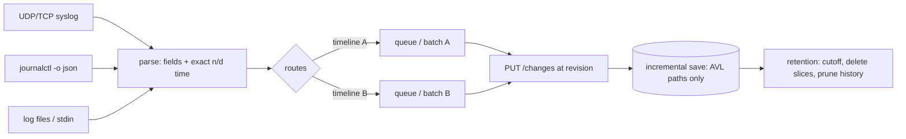

# Log ingestion at exact times, with retention

Copyright (c) 2026 Athan Clark. SPDX-License-Identifier: GPL-3.0-only

OpenChronology turns log entries (syslog over UDP and TCP, the systemd journal, and log files in syslog, Apache, nginx, JSON-lines and custom formats) into timeline moments placed at exact rational times. Every timestamp, including RFC 5424 and journald fractions of a second and epoch numbers in seconds, milliseconds, microseconds or nanoseconds, becomes a reduced fraction `n/d` of Unix seconds without passing through a binary float. Entries are routed to timelines by ordered rules, given deterministic or per-receipt IDs so that resending or re-importing overwrites instead of duplicating, and appended in batches sized so that the server applies each one in place. A timeline can keep only its recent past: on a schedule the server computes an exact cutoff in the timeline's own coordinates and deletes everything before it as a series of small ordinary saves, and prunes saved history from before the window. Disclosed at commit [`007091c`](https://github.com/openchronology/timeline-app/tree/007091ce62fdb402346c0712b0c420eac0a29dff); first public disclosure: see [below](#first-public-disclosure).

## Field and problem

Logs are the densest time-series most people own: a busy host writes thousands of lines a second, many in the same second, and they must land on a timeline in order and without loss.

- **Timestamps lose precision in floats.** `2026-10-09T08:15:01.123456+02:00` is 1791526501.123456 Unix seconds. As an IEEE 754 double that is 1791526501.1234560013 (the nearest double), and as epoch milliseconds (`Date`) it is truncated to `.123`. Nanosecond epoch values such as `1791526501123456789` exceed 2^53 and cannot even be represented as integers in a double. Two log lines 1 µs apart can therefore collapse to one time or swap order. A timeline that stores exact rationals needs a parser that never forms the float.
- **Syslog times are incomplete.** RFC 3164 (BSD) timestamps carry neither a year nor a time zone (`Oct  9 08:15:01`); files written across New Year step back from December to January; zone offsets change with daylight saving time.
- **Retries duplicate.** A receiver that resends a batch after a timeout, or an operator who imports the same log file twice, must not double the timeline. Auto-increment IDs fail; IDs derived from text alone fail for genuinely repeated identical lines.
- **Append cost grows with batch shape.** A server that rebuilds a timeline's index when a save changes most of it (cheaper for small timelines) makes a naive bulk import quadratic: each large batch to a small, growing timeline triggers a rebuild of everything so far.
- **Retention by deleting old rows breaks a versioned store.** Deleting "everything older than 90 days" with one `DELETE` bypasses the revision counter, live viewers, history and derived indexes, and on a million-moment timeline holds locks for minutes. Computing "90 days ago" with floats on a timeline whose coordinates are not seconds (a scaled calendar display) misplaces the cutoff.

## Summary of the mechanism

1. **Exact time readers** (`server/log-time.mjs`). Each timestamp form is split by regular expression into integer calendar fields and a decimal fraction kept as a digit string. The integer fields become whole UTC seconds through `Date.UTC` (exact for whole seconds); the fraction digits are appended exactly with BigInt arithmetic and the result reduced by GCD: `exactSeconds(whole, digits) = (whole·10^k + digits) / 10^k`, reduced. Epoch numbers shift their decimal point textually by the unit's power of ten. Wall-clock times without an offset are resolved in a fixed offset or IANA zone with a two-pass offset lookup. Year-less syslog times take their year from a reference time and step forward at New Year (`YearClock`).
2. **Formats and mapping** (`log-formats.mjs`, `log-mapping.mjs`). A format turns one entry into fields, a severity and an exact time; a mapping turns those into a moment (title, notes, tags and metadata from templates) and, optionally, a duration ending at the entry's time whose length is an exact decimal of a field.
3. **Routing** (`log-routes.mjs`). Ordered rules of field conditions (glob patterns, numeric comparisons, severity thresholds, facility names) choose zero or more timelines: the first matching rule wins unless it says `continue`, and unmatched entries go to a default.
4. **IDs.** Live syslog moments get an ID fixed at receipt (`syslog:<ms>.<run tag>.<sequence>`), so a resent batch overwrites. Imported and journald moments get content-derived IDs (`log:<hash>[.<occurrence>]`), the occurrence counting identical entries at the same exact time, so a re-import or an overlapping live stream overwrites.
5. **Batching into incremental saves** (`moment-ingest.mjs`, `timeline-writer.mjs`, `import-logs.mjs`). Live streams keep one queue per timeline, flushed after a short interval or at once at 500 entries. The importer sizes each batch to at most `max(64, ⌊n/2⌋)` for a timeline of n moments, which is exactly the bound under which the server applies a patch in place instead of rebuilding; batches grow with the timeline. Each save carries the timeline's revision; a 409 refetches and resends. Save size also adapts to measured save time.
6. **Retention** (`retention.mjs`). A period such as `90 days` is parsed in the timeline's own difference units into exact seconds. On a schedule, the server computes the cutoff `origin + (now − period) × scale` exactly, walks the moment tree from the start to collect at most 5,000 moment IDs before it (plus durations ending before it, from the interval index), and deletes them as an ordinary save; it repeats, rereading the revision, for up to ten minutes per run. It then prunes saved revisions from before the window except those still referenced.



## Detailed description

### 1. Exact times

**Representation.** A time is the text of a reduced fraction of Unix seconds, `"n/d"` with `d > 0` and `gcd(n, d) = 1` (for example `27992601580054/15625`). Each reader also returns an integer `ms` (milliseconds, truncated) used only for coarse filters such as `--since` and `--until`; the stored time never derives from it.

**`exactSeconds(whole, digits)`.** `whole` is a BigInt count of Unix seconds; `digits` is the decimal fraction as written (`"123456"`).

```
exactSeconds(whole, digits):
  digits := digits with trailing zeros removed
  d := 10^len(digits)
  n := whole·d + int(digits or "0")
  g := gcd(n, d)
  return (n/g) + "/" + (d/g)
```

For `08:15:01.123456+02:00` on 2026-10-09: `whole = 1791526501`, `digits = "123456"`, `n/d = 1791526501123456/1000000 = 27992601580054/15625`, which is `1791526501 + 1929/15625` exactly. Because `whole` is the floor second (from `Date.UTC`, which for integer fields always yields a multiple of 1,000 ms) and the fraction is non-negative, the formula is also right before 1970: 1969-12-31T23:59:55.5Z is `whole = −5`, `n/d = −45/10 = −9/2`.

**Epoch numbers (`epochSeconds(value, unit)`).** The text must match `^(-?)(\d+)(?:\.(\d+))?$`. For unit scale `s` (`s` 0, `ms` 3, `us` 6, `ns` 9), the decimal point is moved `s` digits left on the digit string, padding with zeros, and the parts passed to `exactSeconds`; a leading minus negates the result. `1791526501123456789` ns becomes `1791526501123456789/1000000000` without any intermediate number. The JSON-lines reader's `auto` mode picks the unit from the integer part's length: 10 digits or fewer seconds, then milliseconds, microseconds and nanoseconds for each further three digits (`⌊(len − 10)/3⌋`, clamped to 0..3).

**Calendar readers.** ISO 8601 (with `T` or space, `.` or `,` before up to nine fraction digits, `Z` or `±hh[:]mm`), Apache access (`10/Oct/2026:13:55:36 -0700`, optional fraction), ctime (`Fri Oct 09 08:15:01.123456 2026`), nginx error (`2026/10/09 08:15:01`) and classic syslog (`Oct  9 08:15:01[.ffffff]`) are each a regular expression capturing integer fields and the fraction digit string. With an explicit offset, `ms = Date.UTC(fields) − offset·60000`; without one, `ms = wallToUtc(zone, fields)`. Then `time = exactSeconds(ms/1000, fraction)`.

**Zones (`parseZone`, `wallToUtc`).** A zone is `UTC`, a fixed offset (`+02:00`, `-0700`) or an IANA name, whose offset is read from `Intl.DateTimeFormat` with `hourCycle: 'h23'`. The offset at a UTC instant is the difference between the zone's wall-clock fields formatted at that instant (as if UTC) and the instant itself. A wall time is converted in two passes so that times next to a daylight-saving change take the offset in force at that moment:

```
wallToUtc(zone, y, mo, d, h, mi, s):
  wall  := Date.UTC(y, mo-1, d, h, mi, s)        # the wall time read as if UTC
  first := wall − offsetAt(zone, wall)·60000
  return   wall − offsetAt(zone, first)·60000
```

For Europe/Berlin, the nonexistent 2026-03-29 02:30 resolves to 01:30 UTC (03:30 summer time) and the repeated 2026-10-25 02:30 to 01:30 UTC (its standard-time occurrence).

**Years for classic syslog (`YearClock`).** A clock has a fixed `year` (optional), a `reference` instant (a file's modification time, or "now" for standard input) and a zone.

```
read(text):
  parse month, day, h:m:s, fraction
  if year unset:
    year := fixed, else the latest year Y ≤ referenceYear+1 with at(Y) ≤ reference
  ms := at(year)
  if last ≠ null and ms < last − 183 days: year := year+1; ms := at(year)
  last := ms
  return exactSeconds(ms/1000, fraction)
```

A line that falls more than half a year before its predecessor is taken to have crossed New Year; lines a little out of order (requests logged as they finish) do not step. The live receiver, which has no file order, instead picks among `year−1`, `year`, `year+1` (by the receipt time's UTC year) the candidate nearest to the receipt instant.

**Syslog parsing (`parseSyslog`).** The priority `<PRI>` (≤ 191; otherwise `user.notice`, 13) gives facility `PRI >> 3` and severity `PRI & 7`. In order:

1. **RFC 5424** (`1 TIMESTAMP HOST APP PROCID MSGID SD MSG`): the timestamp must be `YYYY-MM-DDThh:mm:ss[.1–6 digits](Z|±hh:mm)`; `-` (nil) uses receipt time. Structured data `[id key="value" …]…` is parsed with `\"`, `\\` and `\]` unescaped.
2. **rsyslog ISO lines** (`2026-10-09T08:15:01.123+02:00 host app[pid]: …`), as relays forward them: the ISO reader, in the configured zone when no offset is given.
3. **RFC 3164** (`Mmm dd hh:mm:ss host tag[pid]: msg`): year and zone as above.
4. Otherwise the whole text is kept as the message, at receipt time.

Receipt time is `exactSeconds(⌊received_ms/1000⌋, "")`, whole seconds.

**TCP framing (`syslogFrames`).** RFC 6587 octet counting (`<len> <msg>`, recognised when the buffer does not start with `<`) or newline-terminated; a frame or line over 64 KiB throws, and the receiver counts it invalid and closes that connection. UDP takes one message per datagram up to 64 KiB.

**Journald.** `__REALTIME_TIMESTAMP` is a decimal count of microseconds, read with `epochSeconds(value, 'us')`, so every journal entry keeps its microsecond exactly (denominator a divisor of 10^6). `MESSAGE` given as a byte array (non-UTF-8) is decoded as UTF-8.

**Precision constraints.** Times have no precision limit beyond the input's digits: calendar readers accept up to nine fraction digits, RFC 5424 up to six (its grammar), epoch readers any number. The one value that passes through a JavaScript number is a mapped duration's length (below), which is read with `typed(value, 'number')` and printed back with `String()` before exact conversion; it is exact for decimals of up to 15 significant digits, and a length that JavaScript prints in exponent form (under 10^−6) is not accepted by the exact parser.

### 2. Formats, mappings and moments

A **format** is either built in (`syslog`, `rfc5424`, `apache-common`, `apache-combined`, `nginx-combined`, `apache-error`, `nginx-error`, `jsonl`, `journald`) or configured: a regular expression with named groups, or `json: true` with lists of candidate field names for the time, message and level, plus `time: {field, as}` naming one of the readers above, field `types` (`string`, `int`, `number`, `bool`, `json`), a `derive` step (built-ins only: splitting `"GET /path HTTP/1.1"`, `status_class`, journald's `host`/`app`/`unit`/`facility`), a severity rule and `multiline` rules joining continuation lines (up to 64 KiB per entry). `extends` starts from a built-in.

A **mapping** (`compileMapping`) makes, per entry:

- `title` and `notes` from text templates over the fields (`"{method} {path} → {status}"`, dotted paths into objects, `{{`/`}}` as literal braces); the title is the first line, at most 200 characters; notes at most 16 KiB;
- `tags` from templates, dropped when a referenced field is empty, normalised (NFC, lower case, no commas or control characters, ≤ 64 characters, ≤ 40 tags);
- metadata: every field under `metadata.<format>` and an optional JSON template whose leaves are templates or `{"$field" | "$template" | "$const", "type"}` values;
- severity from the format, or from a field with a name map, or from ordered `contains`/`match` rules;
- optionally a **duration** `{field, unit}`: `start = time − epochSeconds(length, unit)` in exact rational subtraction, `end = time`, ID `<moment id>.d`. An HTTP request time thus becomes a span ending exactly at the log line.

Each built moment (and duration) is validated exactly as the server will validate it (`checkMoment` runs the document validator on a one-moment document), so a malformed entry is refused alone instead of failing its batch.

### 3. Routing

```json
{
  "routes": [
    { "timeline": "<uuid A>", "host": ["web-*", "edge-?"], "severity": "err", "continue": true },
    { "timeline": "<uuid B>", "status": ">=500" },
    { "timeline": "<uuid C>", "app": "sshd", "facility": ["auth", "authpriv"] }
  ],
  "default": "<uuid D>"
}
```

Conditions are compiled once (`compileCondition`) into predicates:

- `severity: L` matches severities at index ≤ index(L) in `emerg … debug` (that level or more severe);
- `facility` matches any of the listed facility names;
- any other field (letters, digits, `_ . @ -`, up to 64 characters; dotted names read nested objects) takes a pattern or list of patterns. A pattern of the form `(>=|<=|!=|>|<|=) number` is a numeric comparison, false for absent or non-numeric values; anything else is a case-insensitive glob (`*`, `?`) anchored at both ends.

```
route(entry):
  targets := []
  for rule in rules (in order):
    if every condition of rule matches entry:
      append rule.timeline to targets unless present
      if not rule.continue: return targets
  if targets empty and default set: targets := [default]
  return targets          # empty: counted as unmatched/unrouted and dropped
```

The syslog receiver allows only `host`, `app`, `msgid`, `severity` and `facility`; the importer and the journald follower allow any field (journald entries expose every journal field, such as `_SYSTEMD_UNIT`). The importer also takes command-line filters (`status>=400`, `host=web-*`, `method!=GET`, `severity>=warning`) built from the same conditions, and a `--since`/`--until` window compared on `ms`. Every timeline a rule can name is known at start-up, so each gets its queue up front.

### 4. ID schemes

| Source          | ID                                                                  | Property                                                                                                                                                                                                         |
| --------------- | ------------------------------------------------------------------- | ---------------------------------------------------------------------------------------------------------------------------------------------------------------------------------------------------------------- |
| Syslog (live)   | `syslog:<receipt ms, base 36>.<4 random bytes, hex>.<seq, base 36>` | Fixed when the message arrives, so any resend of its batch overwrites. The random run tag separates two receivers, or two runs, receiving in the same millisecond; the sequence separates messages within a run. |
| File import     | `log:<first 32 hex of SHA-256(entry text)>[.<occurrence, base 36>]` | The same file imported again yields the same IDs and overwrites; identical lines stay distinct.                                                                                                                  |
| Journald        | as file import, but the hashed text is the entry's `__CURSOR`       | `journalctl -o json` prints fields in varying order, so the line text is unstable; the cursor is not. A live follower and an import of the same entries make the same moments.                                   |
| Mapped duration | `<moment id>.d`                                                     | Follows its moment's ID.                                                                                                                                                                                         |

**Occurrence counting (`EntryIds`).** Identical entries can collide only when they share a time, so the counter is keyed by exact time:

```
next(text, time):
  seen := times[time]  (created empty if absent; times is an LRU of at most W=1024 distinct times)
  move time to most-recent
  h := hex(SHA-256(text))[0:32]
  k := seen[h] or 0;  seen[h] := k+1
  return "log:" + h + (k > 0 ? "." + base36(k) : "")
```

Memory is bounded by the window regardless of log length. The window tolerates interleaving of a little over a thousand distinct times (logs written as requests finish); identical entries further apart than that would share an ID, which does not occur for genuine duplicates because they share a time.

The server's save also skips changes identical to what it already stores, so overwriting with the same content is cheap.

### 5. Batching appends into incremental saves

**Server bound.** A patch is applied in place, walking only the AVL paths it touches, when

```
incremental(t, patch) := index_version ≥ 2 and not a comparison and
                         (count ≥ 200000 or |patch| ≤ max(64, count · 0.5))
```

where `count` is the timeline's moment count and `|patch|` its moment, duration and relationship changes; otherwise the server rebuilds the index from the whole document (cheaper per entry when most of a small timeline changes). See [incremental saves](https://github.com/openchronology/timeline-app/blob/007091ce62fdb402346c0712b0c420eac0a29dff/docs/architecture.md#incremental-saves).

**Importer batch size.** The importer keeps one pending batch per timeline and sends it, waiting for the save (backpressure: memory holds at most one batch per timeline, and a slow server slows reading), whenever adding the next entry would exceed

```
batchLimit(count) = min(4999, max(64, ⌊count / 2⌋))
```

entries (a moment with its duration counts two), or the batch reaches 12 MiB of JSON. `count` is the timeline's moment count as the server last reported it (from the load, then from each save's reply), so batches grow as the timeline does: into an empty timeline they run 64, 64, 64, 96, 144, 216, 324, … entries, each half the moments saved so far (at least 64), and stay at 4,999 from 9,998 moments on. Every save therefore stays under the in-place bound instead of rebuilding a growing timeline per batch. The same batch plan is simulated in a first read-only pass to estimate storage (each batch's bytes, plus a ×1.1 history version per byte when the timeline keeps history, plus one copy of the timeline when its history is first kept as rows) and the import refuses to start when it would exceed the account's quota.

Note on the documentation: [docs/log-import.md](https://github.com/openchronology/timeline-app/blob/007091ce62fdb402346c0712b0c420eac0a29dff/docs/log-import.md#delivery) said import batches grow "up to 5,000 entries"; the code caps them at `BATCH_LIMIT − 1`, 4,999 (`server/import-logs.mjs`, line 258). Live receivers' batches do reach 5,000. The docs were corrected to match the code in #392.

**Live queues (`MomentIngest`).** One queue per timeline. `enqueue` pushes the moment and schedules a flush after `flushMs` (default 1 s; an existing timer is kept), or immediately once the queue holds 500, unless the timeline is backing off. A flush takes up to 5,000 moments from the front (one flush per queue at a time). On a temporary failure (no response, 409 after five refetches, 429, 5xx) the batch returns to the front and the queue backs off 2, 4, 8, 16, then 30 s, or the server's `Retry-After` for a 429; permanent failures (403, 404, 400, quota) drop and count the batch. A queue over `queueLimit` (default 10,000) drops its oldest entries. `drain` on shutdown flushes everything not backing off and waits up to ten seconds.

**Save protocol (`TimelineWriter`).** Each save is `PUT /api/timelines/<id>/changes` with `{revision, settings, changes: [{id, event}], durationChanges?}`; the writer remembers each timeline's revision and settings from the last load or save reply. A 409 forgets them, reloads and resends (up to five times). Saves adapt to measured latency: a save taking ≥ 8 s, or answered 503/504, halves the per-timeline size limit (not below 64; a 503/504 resends the same entries in the halved size); a full save under 2 s grows it by half, up to 5,000. Moments are sent before durations, which may name them.

**Journald resume.** The follower runs `journalctl --follow --output=json` (locally, or over SSH with `BatchMode`, a configured key and `StrictHostKeyChecking=accept-new` against its own known-hosts file), and remembers two cursors: the last entry read and the last one known settled. When every queue is idle, the last read cursor is written to a temporary file and renamed over the cursor file (writes are chained so an older cursor never lands after a newer one). On restart it runs `--after-cursor <saved>`; entries read twice after a crash keep their IDs and only overwrite. When journalctl itself exits it is restarted from the last cursor _read_ (unsent entries are still queued), with backoff 1 s doubling to 60 s for repeated quick failures.

### 6. Retention

**Setting.** `retention_seconds` is stored as exact rational text. It is parsed from the owner's input (`1 year`, `90 days`) with the timeline's own difference parser and divided by the display's scale (stored coordinates per second), so it is exact seconds. It requires a Gregorian (calendar) display, which defines the coordinate of the Unix epoch (`origin`) and the coordinates per second (`scale`), and must lie between one hour and 1,000 years (31,556,952,000 s).

**Schedule.** Every 15 minutes (first run 30 s after start-up) one server process takes a PostgreSQL session advisory lock with `pg_try_advisory_lock` (other processes skip the run), selects up to 100 timelines whose retention was never applied or was last applied over an hour ago (oldest first) and applies each. A failure of one timeline is logged and the rest continue; `retention_applied_at` and `retention_removed` are written whatever happened.

**Exact cutoff.**

```
cutoff = origin + (now_ms / 1000 − retention_seconds) × scale     (exact rationals)
```

`now_ms/1000` is formed as the rational `now_ms/1000`, never as a float.

**Finding what to delete (`deleteWhere`).** Given `lower`/`upper` (inclusive, either open) or `before` (exclusive), and a `limit`:

- _Moments_: `momentsIn` calls the database function `oc_events(timeline, lower, upper ?? before, after_time, after_id, page)`, which walks the timeline's augmented AVL moment tree in order from an exact `(time, id)` cursor, pruning subtrees outside the window, and returns at most `page` moments (5,000 per walk, or one more than still wanted). It stops at the first moment at or past `before`, or when `limit` IDs are collected (reporting `more`). Cost follows the moments found, not the timeline's size.
- _Durations_: those lying wholly inside the range, from the duration interval index, with a B-tree-sized key of each start (`first_key = oc_qkey(first_time)`, monotone in the exact value) narrowing the scan and exact `mpq` comparisons on `first_time` and `last_time` settling each row; at most `limit + 1` rows to learn `more`. With only `before` this is every duration that ended before the cutoff.
- _The deletion_ is one ordinary incremental save at the timeline's current revision: `changes: [{id, event: null}]` and `durationChanges: [{id, duration: null}]`, with the timeline's settings sent back unchanged. The save path makes durations anchored to a deleted moment keep its last time as a fixed endpoint, drops relationships of deleted entities, writes a revision (so history and live viewers see it), and updates indexes only along changed paths.

```
expire(timeline, now):
  prune history before (now − retention)
  cutoff := as above
  repeat until 10 minutes have passed:
    try deleted := deleteWhere(t, owner, t.revision, {before: cutoff}, limit = 5000)
    on 409 (someone saved): reread t; retry (at most 10 conflicts)
    if not deleted.more: stop
    reread t                       # new revision for the next slice
  refresh planner statistics once for the tables the saves touched
```

Each slice is its own transaction holding the timeline's row lock only for that save, so a concurrent writer (a log arriving) waits for at most one slice. A run that does not finish continues on the next schedule.

**Pruning history (`pruneHistory`).** In one transaction, revisions of the timeline created before the window start go, except those still needed: two recursive CTEs collect (a) revisions that other timelines' heads, forks' bases, pull requests (base, source, merged) or other timelines' revisions refer to, with all their ancestors through `oc_revision_parents`; and (b) those, plus revisions inside the window, revisions copies read through to (`oc_history_bases`), and the head, closed under "first parent of a revision stored as a patch" back to a snapshot. The rest are deleted with their parent links, snapshots no remaining revision uses, and entity versions (kept as rows) that no remaining revision sees.

**Quick deletion.** The same `deleteWhere` serves `POST /api/timelines/<id>/delete-range` (`{revision, lower, upper}`, both inclusive, at most 200,000 moments and 200,000 durations per call, `more: true` when the range holds more) and **Delete everything in this view** in the editor; see [exact time mapping and range operations](time-mapping.md#delete-range).

### Complexity

| Step                                | Time                                                                  | Space                  |
| ----------------------------------- | --------------------------------------------------------------------- | ---------------------- |
| Parse one timestamp                 | O(L) BigInt digits for an L-digit input                               | O(L)                   |
| Route one entry                     | O(rules × conditions × patterns)                                      | O(1)                   |
| Occurrence ID                       | O(len(text)) for the hash, O(1) map operations                        | O(W) times, W = 1,024  |
| Import of N entries into a timeline | O(N log n) tree work at the server: every batch stays in place        | one batch per timeline |
| One retention slice of k deletions  | O(k log n) tree walk to find them, O(k log n) rows to delete in place | O(k)                   |

### Edge cases

- Leap second `:60` is accepted by the ISO reader and becomes the next second (as `Date.UTC` treats it).
- A Unix time before 1970 with a fraction is exact (floor second plus a non-negative fraction).
- A classic syslog line written late across New Year (`Dec 31` after `Jan  1`) is placed a year late; `--year` pins the first year.
- A BSD message received live on 1 January about `Dec 31 23:59:59` takes the previous year, being nearer the receipt.
- A queued live entry routed nowhere (no matching rule, no default) settles at once, so the journald cursor can advance past it.
- Retention on a comparison timeline does nothing (it holds no moments of its own); `delete-range` on one is refused with 409.

### Variations

- The fraction may be in any base-10 positional form the reader's regular expression captures; the same construction (integer whole seconds from a calendar library, fraction appended as an exact rational) applies to any base b with denominator b^k, and to any epoch unit 10^−s by shifting the point s places.
- The whole seconds may come from any calendar library that is exact for integer fields (or from integer arithmetic on the fields), since only the integer part passes through it.
- The occurrence key may be any exact value that equal entries necessarily share (time, or time plus source), and the hashed identity any stable per-entry key (a journal cursor, a file offset plus inode).
- The batch bound may be any function that stays at or below the server's in-place threshold; here `max(64, ⌊count/2⌋)` mirrors it exactly.
- The retention cutoff applies to any display whose coordinates are an affine image of physical time (`origin + t × scale`); the delete-in-slices loop applies to any predicate an index can enumerate in order (`lower`/`upper` ranges, as `delete-range` uses).

## Implementation references

- `server/log-time.mjs` — [`exactSeconds`, `epochSeconds`](https://github.com/openchronology/timeline-app/blob/007091ce62fdb402346c0712b0c420eac0a29dff/server/log-time.mjs#L22-L48) — exact reduced fractions from whole seconds and fraction digits; epoch units by moving the decimal point.
- `server/log-time.mjs` — [`parseZone`, `offsetAt`, `wallToUtc`](https://github.com/openchronology/timeline-app/blob/007091ce62fdb402346c0712b0c420eac0a29dff/server/log-time.mjs#L54-L103) — fixed and IANA zones, two-pass wall-time conversion.
- `server/log-time.mjs` — [`isoTime`, `apacheTime`, `ctimeTime`, `nginxTime`](https://github.com/openchronology/timeline-app/blob/007091ce62fdb402346c0712b0c420eac0a29dff/server/log-time.mjs#L104-L158) — calendar readers.
- `server/log-time.mjs` — [`YearClock`](https://github.com/openchronology/timeline-app/blob/007091ce62fdb402346c0712b0c420eac0a29dff/server/log-time.mjs#L160-L195) — years for classic syslog times.
- `server/syslog.mjs` — [`parseSyslog`](https://github.com/openchronology/timeline-app/blob/007091ce62fdb402346c0712b0c420eac0a29dff/server/syslog.mjs#L77-L168) — RFC 5424, rsyslog ISO and RFC 3164 parsing, nearest-year rule; [`syslogFrames`](https://github.com/openchronology/timeline-app/blob/007091ce62fdb402346c0712b0c420eac0a29dff/server/syslog.mjs#L170-L200) — RFC 6587 framing; [`syslogMoment`](https://github.com/openchronology/timeline-app/blob/007091ce62fdb402346c0712b0c420eac0a29dff/server/syslog.mjs#L225-L264) — the moment a message becomes.
- `server/syslog-receiver.mjs` — [`SyslogIngest.accept`](https://github.com/openchronology/timeline-app/blob/007091ce62fdb402346c0712b0c420eac0a29dff/server/syslog-receiver.mjs#L27-L62) — receipt-time IDs; [`listenSyslog`](https://github.com/openchronology/timeline-app/blob/007091ce62fdb402346c0712b0c420eac0a29dff/server/syslog-receiver.mjs#L64-L115) — UDP and TCP listeners.
- `server/log-formats.mjs` — [`BUILTIN_FORMATS`](https://github.com/openchronology/timeline-app/blob/007091ce62fdb402346c0712b0c420eac0a29dff/server/log-formats.mjs#L134-L229) (journald at L207–L228, identity `__CURSOR`); [`compileFormat`](https://github.com/openchronology/timeline-app/blob/007091ce62fdb402346c0712b0c420eac0a29dff/server/log-formats.mjs#L242-L387) — readers, `auto` epoch units (L292–L301), entry reading.
- `server/log-mapping.mjs` — [`EntryIds`](https://github.com/openchronology/timeline-app/blob/007091ce62fdb402346c0712b0c420eac0a29dff/server/log-mapping.mjs#L185-L214) — content IDs with occurrence counts per exact time; [`compileMapping`](https://github.com/openchronology/timeline-app/blob/007091ce62fdb402346c0712b0c420eac0a29dff/server/log-mapping.mjs#L216-L303) — templates and exact durations (L291–L298); [`checkMoment`](https://github.com/openchronology/timeline-app/blob/007091ce62fdb402346c0712b0c420eac0a29dff/server/log-mapping.mjs#L312-L318).
- `server/log-routes.mjs` — [`compileCondition`](https://github.com/openchronology/timeline-app/blob/007091ce62fdb402346c0712b0c420eac0a29dff/server/log-routes.mjs#L39-L89), [`parseFilter`](https://github.com/openchronology/timeline-app/blob/007091ce62fdb402346c0712b0c420eac0a29dff/server/log-routes.mjs#L90-L117), [`compileRoutes`](https://github.com/openchronology/timeline-app/blob/007091ce62fdb402346c0712b0c420eac0a29dff/server/log-routes.mjs#L118-L172) — ordered routing with `continue` and default.
- `server/moment-ingest.mjs` — [`MomentIngest`](https://github.com/openchronology/timeline-app/blob/007091ce62fdb402346c0712b0c420eac0a29dff/server/moment-ingest.mjs#L11-L181) — per-timeline queues, flush timing, backoff, drain.
- `server/timeline-writer.mjs` — [constants and `temporary`](https://github.com/openchronology/timeline-app/blob/007091ce62fdb402346c0712b0c420eac0a29dff/server/timeline-writer.mjs#L10-L34); [`send`, `save`](https://github.com/openchronology/timeline-app/blob/007091ce62fdb402346c0712b0c420eac0a29dff/server/timeline-writer.mjs#L134-L204) — adaptive save size, revision and 409 handling.
- `server/import-logs.mjs` — [`entries`](https://github.com/openchronology/timeline-app/blob/007091ce62fdb402346c0712b0c420eac0a29dff/server/import-logs.mjs#L215-L250) — gzip detection and multi-line joining; [`batchLimit`, `storageEstimate`](https://github.com/openchronology/timeline-app/blob/007091ce62fdb402346c0712b0c420eac0a29dff/server/import-logs.mjs#L252-L275); [`readAll`](https://github.com/openchronology/timeline-app/blob/007091ce62fdb402346c0712b0c420eac0a29dff/server/import-logs.mjs#L372-L429); [`importAll`](https://github.com/openchronology/timeline-app/blob/007091ce62fdb402346c0712b0c420eac0a29dff/server/import-logs.mjs#L575-L660) — backpressured batches.
- `server/journald-receiver.mjs` — [`JournaldIngest`](https://github.com/openchronology/timeline-app/blob/007091ce62fdb402346c0712b0c420eac0a29dff/server/journald-receiver.mjs#L31-L122) — cursor resume and atomic cursor file; [`journalCommand`, `followJournal`](https://github.com/openchronology/timeline-app/blob/007091ce62fdb402346c0712b0c420eac0a29dff/server/journald-receiver.mjs#L124-L208).
- `server/incremental.mjs` — [`REBUILD_UNDER`, `incremental`](https://github.com/openchronology/timeline-app/blob/007091ce62fdb402346c0712b0c420eac0a29dff/server/incremental.mjs#L65-L87) — the in-place bound batches are sized to.
- `server/retention.mjs` — [`calendar`, `parseRetention`](https://github.com/openchronology/timeline-app/blob/007091ce62fdb402346c0712b0c420eac0a29dff/server/retention.mjs#L13-L51); [`momentsIn`](https://github.com/openchronology/timeline-app/blob/007091ce62fdb402346c0712b0c420eac0a29dff/server/retention.mjs#L71-L101); [`deleteWhere`](https://github.com/openchronology/timeline-app/blob/007091ce62fdb402346c0712b0c420eac0a29dff/server/retention.mjs#L102-L161); [`pruneHistory`](https://github.com/openchronology/timeline-app/blob/007091ce62fdb402346c0712b0c420eac0a29dff/server/retention.mjs#L162-L222); [`expire`, `expireDue`, `startRetention`](https://github.com/openchronology/timeline-app/blob/007091ce62fdb402346c0712b0c420eac0a29dff/server/retention.mjs#L223-L338).
- `server/schema.sql` — [`oc_events`](https://github.com/openchronology/timeline-app/blob/007091ce62fdb402346c0712b0c420eac0a29dff/server/schema.sql#L323-L362) — in-order, cursor-paged walk of the moment tree; [`oc_qkey`](https://github.com/openchronology/timeline-app/blob/007091ce62fdb402346c0712b0c420eac0a29dff/server/schema.sql#L988-L1003) — order-preserving bounded key of an exact rational.

## Benchmarks

- **Live delivery.** [docs/benchmarks.md, "Realtime updates"](https://github.com/openchronology/timeline-app/blob/007091ce62fdb402346c0712b0c420eac0a29dff/docs/benchmarks.md#realtime-updates) (`npm run bench:realtime`, `test/syslog-live-postgres.mjs`), measured on an AMD Ryzen 7 7730U laptop (16 threads) with PostgreSQL in Docker, receiver flushing every 200 ms: from sending a syslog message to the open editor's count including it, p50 125 ms / p95 225 ms at 20 messages/s, 128 / 220 ms at 100/s, 151 / 242 ms at 500/s and 177 / 482 ms (max 801 ms) at 1,000/s; every message stored exactly once at every rate.
- **Append cost.** [docs/benchmarks.md, "Save time against timeline size"](https://github.com/openchronology/timeline-app/blob/007091ce62fdb402346c0712b0c420eac0a29dff/docs/benchmarks.md#save-time-against-timeline-size) (`node bench/save-size.mjs`), 8-core virtual machine with PostgreSQL 17, appending after the last moment as log ingestion does: at 200,000 moments, 10 / 1,000 / 5,000 moments in 0.11 / 0.91 / 2.49 s; at 1,000,000 moments, 0.24 / 1.35 / 5.22 s.
- **Deleting in place.** [docs/architecture.md, "Incremental saves"](https://github.com/openchronology/timeline-app/blob/007091ce62fdb402346c0712b0c420eac0a29dff/docs/architecture.md#incremental-saves): at a million moments, deleting 200,000 in place takes about 5 minutes in statements of at most 10 s, where a rebuild took about 10 minutes and over 1 GB of memory.
- No benchmark measures timestamp parsing or a whole retention run directly; `test/retention-postgres.mjs` and `test/log-import.test.mjs` check correctness (for example that `.123456` s becomes `1929/15625`).

## First public disclosure

| Component                                                                                     | First commit       | First release |
| --------------------------------------------------------------------------------------------- | ------------------ | ------------- |
| Syslog receiver, RFC 5424/3164 parsing, routing, receipt IDs                                  | 055e5d6 2026-10-10 | v0.1.0        |
| Exact log time readers, `YearClock`, log importer, `EntryIds`, `batchLimit`                   | 478e0dc 2026-10-11 | v0.1.0        |
| Retention, `deleteWhere`, `pruneHistory`, `delete-range`                                      | 63312b8 2026-10-11 | v0.1.0        |
| Adaptive save size (`SLOW_SAVE`)                                                              | e7023e2 2026-10-14 | v0.1.0        |
| Retention in slices of 5,000 found by walking the moment tree (`RETENTION_SAVE`, `WALK_PAGE`) | 478f8e8 2026-10-14 | v0.1.0        |
| Journald follower, shared `MomentIngest`, cursor-derived IDs                                  | 349e283 2026-10-15 | v0.1.0        |

The repository has been public on GitHub since 2026-10-05, so these commit dates on `main` are public dates.
