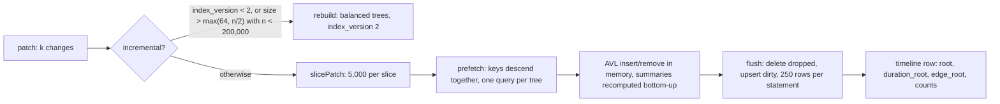

# Augmented AVL indexes for very large timelines, stored as database rows

Copyright (c) 2026 Athan Clark. SPDX-License-Identifier: GPL-3.0-only

OpenChronology stores each timeline's time index as three persistent, augmented AVL trees kept as ordinary rows of a relational database (PostgreSQL on the server, SQLite in the desktop app): a moment tree with one node per distinct exact rational time, and two interval trees, one over durations and one over relationship arcs. Every node has a small, stable integer ID that is the only B-tree key; children are referenced by ID, the timeline row names each tree's root, and each node caches summaries of its subtree (time bounds, counts, extents, height). Viewport queries are stored procedures that walk a tree from its root with an explicit stack, prune subtrees outside the window and consume whole subtrees from their cached summaries when they fit one summary group, so a dense window costs about the number of groups times the tree's height rather than the number of moments. A save of k changes reads the nodes on the k root paths in one batched recursive query, rewrites only those nodes (plus rotations) with recomputed summaries, and so costs O(k log n) rows; very large patches are applied in slices of 5,000 changes, and small timelines changed mostly are rebuilt as perfectly balanced trees instead. Disclosed at commit [`007091c`](https://github.com/openchronology/timeline-app/tree/007091ce62fdb402346c0712b0c420eac0a29dff); first public disclosure: 2026-10-05 (commit `88aea8c`, the moment tree and the overview walk) and 2026-10-08 (commit `61c0f77`, the persistent AVL trees and in-place saves); see [First public disclosure](#first-public-disclosure).

## Field and problem

A timeline can hold a million moments or more (log ingestion, retention batches), and its times are exact rationals of any size (see the rational-time representation used throughout the application). Users look at it through a viewport: a closed window `[lo, hi]` and a grouping threshold derived from the screen width. The server must answer "what is in this window, summarized at this resolution" and "the next page of moments after this exact (time, ID)" quickly at any size, and must accept small edits to a huge timeline quickly too. The obvious approaches fail:

- **Sorting or scanning moments per query.** `SELECT … WHERE time BETWEEN lo AND hi ORDER BY time` reads every moment in the window. A zoomed-out view of a million moments would read a million rows to draw a few hundred groups.
- **B-tree indexes on the time column.** An exact rational can have thousands of digits, larger than a PostgreSQL B-tree entry may be, and a float or epoch-millisecond key loses order and equality for values outside its range or closer together than its precision. Keying a B-tree on the rational itself is therefore either impossible or inexact.
- **`COUNT(*)` per group.** Counting each group's members separately is linear in the window's moments, and repeated per frame.
- **An in-memory interval tree.** Building a tree in application memory from the whole timeline costs about 0.5 ms per moment ([docs/architecture.md](../architecture.md#incremental-saves)), over 1 GB of memory for a million-moment timeline, and must be repeated after every save or kept consistent across server processes.
- **Rebuilding a stored index on every save.** Before in-place saves, every save rebuilt the timeline's derived data: 180 ms at 1,000 moments, 1.6 s at 10,000 and 18.5 s at 100,000 ([docs/benchmarks.md](../benchmarks.md#findings)).
- **A naive interval tree for durations.** A tree ordered only by start, without subtree maxima, cannot find a duration that starts before the window and ends after it without scanning everything that starts before the window. One without count and extent summaries cannot collapse thousands of short durations into a summary without visiting each.
- **Walking the tree once per changed key.** A save of 5,000 appended moments that descends from the root separately for each key issues 5,000 × depth lookups, although the keys share nearly all their paths. Before this was changed, appending 5,000 moments to a million-moment timeline took 21–25 s ([docs/benchmarks.md](../benchmarks.md#save-time-against-timeline-size)).

## Summary of the mechanism

1. **Trees as rows.** Each timeline has three AVL trees stored in tables keyed by `(timeline_id, node_id)`: `oc_nodes` (moments), `oc_duration_nodes` (durations) and `oc_edge_nodes` (relationship arcs). A node row holds its children's IDs, its AVL height, its own key and payload, and summaries of its subtree. The timeline row names the roots (`root`, `duration_root`, `edge_root`). Rationals are stored as exact `mpq` payloads, never as B-tree keys.
2. **Moment tree.** One node per distinct time, holding the sorted IDs of the moments at that time (`moment_ids`); the moments themselves live in `oc_moments`. Each node caches its subtree's first and last time, its leftmost node's ID, its bucket size, its moment count and its distinct-time count.
3. **Interval trees.** One node per duration or arc, ordered by `(start, ID)` so no two keys are equal. Each node caches its subtree's earliest start (`min_time`), latest end (`max_time`), latest start (`max_first`), entry count, and shortest and longest extent. The node also stores the interval's bounded display projection (`band`) and, for durations, its full definition.
4. **Window walks.** Stored procedures walk a tree in order with an explicit stack. They prune subtrees outside the window and take a subtree's cached totals whenever it lies inside the window and fits one anchored-span group. The server raises any requested threshold to at least span/1,024, which bounds the answer to 1,025 groups.
5. **Batched in-place saves.** A save collects the keys it will insert or remove, loads all their root paths (and the paths' children) in one recursive query in which the keys descend together, then applies AVL insertions and deletions in memory, recomputing each touched node's height and summaries from its children, and writes the dirty nodes back in multi-row upserts.
6. **Slices and rebuilds.** Patches are applied 5,000 changes at a time, each slice to the tree as the previous left it, within one transaction and one revision. A patch changing more than half of a timeline under 200,000 moments (and at least 64 entries), a whole-document save, or an index older than `index_version 2` is rebuilt instead as a perfectly balanced tree, which is also a valid AVL tree that later in-place saves continue from.

## Detailed description

### Data structures

#### Moment tree (`oc_nodes`)

| Column           | Meaning                                                                                                   |
| ---------------- | --------------------------------------------------------------------------------------------------------- |
| `timeline_id`    | The owning timeline (UUID); part of the primary key.                                                      |
| `id`             | `bigint` node ID; with `timeline_id`, the primary key. Only these small values enter a B-tree.            |
| `time`           | The node's own time, an exact `mpq`.                                                                      |
| `first_time`     | The earliest time in the subtree (the leftmost node's `time`).                                            |
| `last_time`      | The latest time in the subtree (the rightmost node's `time`).                                             |
| `left_id`        | Left child's ID, or NULL.                                                                                 |
| `right_id`       | Right child's ID, or NULL.                                                                                |
| `first_id`       | The subtree's leftmost node's ID, whose first moment is the subtree's first moment.                       |
| `bucket_count`   | How many moments share this node's time.                                                                  |
| `event_count`    | How many moments the subtree holds.                                                                       |
| `distinct_count` | How many distinct times (nodes) the subtree holds.                                                        |
| `height`         | AVL height (1 for a leaf).                                                                                |
| `moment_ids`     | The IDs of the moments at this time, sorted by code unit ("C" collation).                                 |
| `hidden`         | Tombstone used only by forks reading through to a source timeline (see [forks](#forks-and-history-rows)). |

Invariants, for every node `n` with children `l` and `r` (absent children contribute nothing):

```
in-order times strictly increasing; each time appears in exactly one node
n.first_time   = l ? l.first_time : n.time
n.last_time    = r ? r.last_time  : n.time
n.first_id     = l ? l.first_id   : n.id
n.bucket_count = |n.moment_ids| >= 1
n.event_count  = l.event_count + n.bucket_count + r.event_count
n.distinct_count = l.distinct_count + 1 + r.distinct_count
n.height       = 1 + max(l.height, r.height),   |l.height - r.height| <= 1
```

The timeline row (`oc_timelines`) holds `root` (the root node's ID, NULL when empty), `event_count` (so counts never need `COUNT(*)`) and `index_version`.

Separating moments (`oc_moments`, keyed by `(timeline_id, moment_id)`) from nodes means a metadata edit that does not move a moment writes its `oc_moments` row and search row and no tree node.

#### Interval trees (`oc_duration_nodes`, `oc_edge_nodes`)

| Column                     | Meaning                                                                                                                                               |
| -------------------------- | ----------------------------------------------------------------------------------------------------------------------------------------------------- |
| `id`                       | `integer` node ID; with `timeline_id`, the primary key.                                                                                               |
| `left_id`, `right_id`      | Children.                                                                                                                                             |
| `first_time`, `last_time`  | This interval's own earlier and later endpoint (an interval may be given end-before-start; `first`/`last` are the ordered pair).                      |
| `min_time`                 | The subtree's earliest start (the leftmost node's `first_time`).                                                                                      |
| `max_time`                 | The subtree's latest end: max over the node and both subtrees (ends follow no order).                                                                 |
| `max_first`                | The subtree's latest start (the rightmost node's `first_time`).                                                                                       |
| `subtree_count`            | Entries in the subtree.                                                                                                                               |
| `min_extent`, `max_extent` | Shortest and longest `last_time − first_time` in the subtree.                                                                                         |
| `height`                   | AVL height.                                                                                                                                           |
| `band`                     | What viewports draw: the interval's ID, endpoint times and a bounded projection of its metadata (below).                                              |
| `definition`               | Durations only: the whole duration as saved (`{id, start, end, metadata}`, endpoints possibly anchored to moments). Arcs store `{}` metadata.         |
| `first_key`                | Generated column: an order-preserving numeric sort key of `first_time`, B-tree indexed, used for range scans inside small mixed subtrees (see below). |

Order: by `first_time`, then by `band->>'id'` in "C" collation, so no two keys are equal and insertion of an existing key is an error. Summaries:

```
n.min_time   = l ? l.min_time  : n.first_time
n.max_time   = max(n.last_time, l.max_time, r.max_time)
n.max_first  = r ? r.max_first : n.first_time
n.subtree_count = 1 + l.subtree_count + r.subtree_count
n.min_extent = min(extent(n), l.min_extent, r.min_extent)
n.max_extent = max(extent(n), l.max_extent, r.max_extent)
```

`min_time`/`max_time` decide whether a subtree can intersect a window (the classic interval-tree augmentation, here with the minimum start as well as the maximum end). `max_first`, `subtree_count` and the extent bounds decide when a whole subtree of short intervals collapses into one summary without reading its nodes.

The timeline row names the roots in `duration_root` and `edge_root`. Additional expression indexes find a node by its interval's ID (`band->>'id'`) and, for durations, by the moment a start or end is anchored to; saves use them to find what to remove or move.

A relationship arc is the interval between its two endpoints' positions (a moment's time, or a duration's start), keyed `"m:<id>~d:<id>"`; the arc tree is the same structure and code as the duration tree.

#### Bounded band projection (`durationOverview`)

Each interval node carries `band`, a copy of the interval with its metadata reduced by `durationOverview` so a viewport answer has a bounded size whatever a duration's notes hold: the title (first 512 characters), a description preview (first 2,000), other string fields of at most 256 characters or web addresses (`http://`, `https://`) of at most 1,024, toggles that are `true`, arrays of at most 1,024 characters of JSON, up to 40 tags, and content labels, all within about 4,096 characters. The full metadata stays in `definition` and is read only when a duration is opened by ID.

#### Stable IDs and `index_version 2`

Node IDs are only keys: tree order lives in `left_id`/`right_id`, never in the IDs. A new node takes one past the largest ID the timeline's node table holds (read once per save with `ORDER BY id DESC LIMIT 1` on the primary key, then counted up in memory; the save holds the timeline row lock, so no other transaction allocates concurrently). Rotations re-link nodes without renumbering them, so a save rewrites only nodes whose content or links change. The one exception is deleting a node with two children: the node takes over its in-order successor's key and payload (`copy`), and the successor's row is deleted, so the moved entry's node ID changes.

`index_version` on `oc_timelines` records the index layout. Version 2 means "AVL trees with heights and stable IDs" (schema comment). Older layouts were static: the moment tree was numbered by in-order position, the interval trees in preorder with the root always node 1, and nodes had no `height`. Existing timelines get `index_version 0` when the column is added; `npm run migrate` (`server/migrate.mjs`) calls `rebuildIndexes`, which rebuilds every timeline below version 2 from its document; and `incremental()` refuses in-place saves to any index below version 2. For upgraded interval trees without a stored root, the migration sets `duration_root`/`edge_root` to 1 when node 1 exists, matching the static layout. The desktop file format records the same idea as `index_layout.version = 2` (`LAYOUT` in `native-store/src/intervals.rs`).

### Algorithm: window overview over the moment tree (`oc_overview_v2`)

Input: timeline `tid`, closed window `[lo, hi]`, threshold `θ ≥ 0`. Output: anchored-span groups. A group starts at its first time `a`; each later time `t` with `t − a < θ` joins it; a time exactly `θ` after `a` opens the next group. `θ = 0` gives one group per distinct time. Each group reports its exact first and last time, its moment count (as text, so no float rounding), its distinct-time count, and for a group of exactly one moment, that moment's title, ID and metadata.

The stack holds `(node_id, point)` pairs: `point = false` stands for the node's whole subtree, `point = true` for the node's own time only.

```
stack := [(root, false)]           -- empty tree: no rows
group := none                      -- (a, b, weight, distinct, first_node)
while stack not empty:
  (nid, point) := pop()
  n := read node nid               -- one primary-key lookup
  if not point: visits += 1
  if n.last_time < lo or n.first_time > hi: continue          -- prune
  if point:
    if n.time outside [lo,hi]: continue
    cand := (n.time, n.time, n.bucket_count, 1); whole := true
  else:
    cand := (n.first_time, n.last_time, n.event_count, n.distinct_count)
    whole := n.first_time >= lo and n.last_time <= hi
  if group and cand.a - group.a >= θ:
    emit group; group := none
  if whole and (point or cand.distinct = 1
                or cand.b - (group ? group.a : cand.a) < θ):
    -- consume the cached totals without descending
    if not group: group := (cand.a, _, 0, 0, point ? nid : n.first_id)
    group.b := cand.b; group.weight += cand.weight; group.distinct += cand.distinct
  else:
    push (n.right_id, false) if any
    push (nid, true)
    push (n.left_id, false) if any   -- popped first: in-order
emit group if any
```

Emitting a group of weight 1 reads `moment_ids[1]` of `first_node` and that moment's row: the cached `first_id` makes the singleton lookup two key reads without searching.

Why consuming a subtree is exact: a subtree inside the window whose last time is less than `θ` after the open group's anchor holds only times that would each join that group one by one, so adding its cached `event_count` and `distinct_count` gives the same group. A subtree with one distinct time is a single point. When the candidate's first time is `θ` or more past the anchor, the open group is complete and emitted first, and the candidate is then tested against its own first time. Results therefore depend only on the set of (time, count) pairs, not on the tree's shape; only `visited_nodes` differs between a rebuilt and an incrementally edited tree.

**Server resolution floor.** The HTTP overview raises the requested threshold to `(hi − lo) / 1024` when the span is positive (`store.mjs`, `query`, kind `'overview'`). Groups are anchored and each spans less than `θ` from its anchor, while consecutive anchors are at least `θ` apart, so a window of span `S` holds at most `S/θ + 1 = 1,025` groups. The effective threshold is returned with the answer. The SQL function itself stays exact for `θ = 0` (conformance tests use it).

**Cost.** Each pop is one primary-key lookup. Pruned subtrees and consumed subtrees cost one visit each; only nodes whose subtree straddles a group boundary or the window's edge are expanded. A group boundary or window edge expands at most one root-to-leaf path, so the walk visits about `O((g + 2) · h)` nodes for `g` groups and tree height `h = O(log n)`, independent of how many moments the groups hold. The oracle test builds 5,000 moments within a nanosecond-scale cluster and checks that the whole-window overview reports one group of 5,000 after visiting exactly one node.

### Algorithm: events page with an exact `(time, ID)` cursor (`oc_events`)

Input: window `[lo, hi]` (either bound may be NULL, meaning open), cursor `(after_time, after_id)` (both NULL for the first page), `max_rows` in 1..200,001. Output: moments in `(time, ID "C")` order.

```
same in-order stack walk as above, without groups:
  prune subtree if n.last_time < lo, n.first_time > hi, or n.last_time < after_time
  on a point: skip if n.time outside window or n.time < after_time
    for mid in n.moment_ids (already "C"-sorted):
      e := oc_moments[tid, mid]           -- one primary-key lookup
      if n.time = after_time and e.id <= after_id ("C"): continue
      emit e; if ++emitted = max_rows: return
```

The server asks for `limit + 1` rows; if the extra row arrives, it returns the page's last `(time, id)` as the next cursor. A page costs its rows plus about the tree's height: it never sorts or collects a whole visible cluster, so a single time with 100,000 moments pages correctly and cheaply. The same walk serves retention (expiring moments oldest first) and the catalogue text rebuild.

A third walk, `oc_recent_times`, returns the 8 latest (or earliest) distinct times by an in-order descent from one end of the tree: height plus 8 node reads.

### Algorithm: duration viewport queries

An overview answer has three interval parts, all read in the same repeatable-read transaction as the moment groups.

**Bands (durations at least `θ` long).** A recursive CTE `visible` walks `oc_duration_nodes` from `duration_root`, following children by primary key and keeping a node only if `min_time ≤ hi AND max_time ≥ lo` (the subtree can intersect the window) and, when `θ > 0`, not `max_extent < θ` (the subtree holds no interval long enough to draw as a band). Then:

```sql
matches AS (SELECT band, first_time, last_time FROM visible
            WHERE first_time <= hi AND last_time >= lo
              AND (θ = 0 OR last_time - first_time >= θ)
            LIMIT 10001),                              -- DURATION_COUNT_CAP + 1
kept    AS (SELECT band, first_time FROM matches
            ORDER BY last_time - first_time DESC, first_time, band->>'id' COLLATE "C"
            LIMIT 256)
SELECT band, (SELECT count(*) FROM matches) AS total FROM kept
ORDER BY first_time, band->>'id' COLLATE "C"
```

So the bounded set is: of up to 10,001 matching intervals taken from the walk, the 256 with the largest extent, ties broken by earlier start and then ID; returned in start order. The response carries `durationsTruncated: total > 256` and, when truncated, `durationsTotal = min(total, 10000)` and `durationsTotalMore` when the count passed 10,000. Keeping the longest rather than the first means an era that starts after thousands of short spans is still drawn (#316).

**Collapsed short durations (`oc_duration_overview`).** Durations shorter than `θ` that intersect the window are grouped like moments, keyed by start: a group opens at a start `a` and takes every collapsed duration starting before `a + θ`, tracking the latest end. The walk is the moment walk's analogue on the interval tree, with additional pruning and a bounded range-scan fallback:

```
earliest := lo - θ                 -- a short duration reaching lo starts after this
stack := [(duration_root, subtree, low=NULL, high=NULL)]
pop (nid, point, low, high); n := read node
if point:                          -- the node's own interval
  if it misses [lo,hi] or extent >= θ: continue
  join(n.first_time, n.last_time, 1, n.band)
  continue
prune if n.max_time < lo or n.min_time > hi
      or n.max_first <= earliest     -- every short one ends before lo
      or n.min_extent >= θ           -- nothing short here
fits := (group open and n.min_time < reach) ? reach : n.min_time + θ
if n.max_extent < θ and n.min_time >= lo and n.max_first <= hi and n.max_first < fits:
  join(n.min_time, n.max_time, n.subtree_count, n.subtree_count = 1 ? n.band : none)
elif n.max_extent >= θ and n.subtree_count <= 256:
  -- long and short mixed in a small subtree: one ordered range scan
  scan oc_duration_nodes by (timeline_id, first_key) between key(n.min_time) and key(n.max_first),
       rechecking exact bounds, excluding entries outside this subtree with equal starts
       via the ancestor bounds (low, high) compared by ID,
       keeping those that intersect the window and are shorter than θ, in start order;
  join each
else:
  push (right, subtree, low=nid, high), (nid, point), (left, subtree, low, high=nid)
```

`join` emits the open group when the new start is at or past `reach = anchor + θ`, then opens or extends a group. `(low, high)` carry the IDs of the subtree's nearest ancestors before and after it in `(start, ID)` order, so the range scan's bounds equal the subtree's even when starts tie across its edge. The fallback exists because long durations among short ones defeat the "all short" shortcut; for a subtree of at most 256 entries one ordered index scan over its starts is cheaper than reading it node by node. A short-duration-only timeline costs about groups × height; the browser's in-memory index runs the same walk (`durationSummaries` in `src/durations.ts`) without the range-scan fallback. The server merges these duration groups with the moment groups (`coalesceGroups`).

**Relationship arcs.** The same pruned recursive walk over `oc_edge_nodes` from `edge_root`, with the same window and threshold filters, `LIMIT 257`; the server returns the first 256 and `edgesTruncated` when the 257th exists. Arcs are not ranked by length; the 256 are the first the walk yields.

**Cost.** A band or arc query reads only nodes whose subtrees can intersect the window and hold an interval of at least `θ`. Because the walk stops at 10,001 matches (bands) or 257 (arcs), a dense window costs at most that many matches plus the nodes leading to them.

### Algorithm: incremental writes (`PersistentTree`)

`PersistentTree` (`server/avl.mjs`) is one class parameterized by a spec (`MOMENT_TREE` or `INTERVAL_TREE`) giving the columns, `compare(key, node)`, `create`, `merge` (moment tree: a moment at an existing time joins the bucket; interval tree: none, no two keys are equal), `copy` and `summarize(n, l, r)`. It runs inside the save's transaction and keeps:

- `nodes`: a cache of nodes read or written, by ID (changed nodes are the in-memory truth);
- `dirty`: IDs to write; `dropped`: IDs to delete;
- `next`: the last allocated ID (read once).

**Insert** (recursive, returns the subtree's new root ID):

```
insert(nid, key, payload):
  if nid = null: n := create(newId(), payload); update(n); return n.id
  n := get(nid); c := compare(key, n)
  if c = 0: merge(n, payload) (or error); update(n); return n.id
  if c < 0: n.left  := insert(n.left,  key, payload)
  else:     n.right := insert(n.right, key, payload)
  return balance(n)
```

**Remove** (with an optional `keep(node)` hook: a moment leaving a time that other moments still share shrinks the bucket and keeps the node):

```
remove(nid, key):
  n := get(nid); c := compare(key, n)
  if c < 0: n.left := remove(n.left, key)
  elif c > 0: n.right := remove(n.right, key)
  else:
    if keep(n): update(n); return n.id
    if n.left = null or n.right = null: drop(n); return n.left ?? n.right
    s := leftmost node of n.right; copy(n, s)        -- take successor's contents
    n.right := removeMin(n.right)                    -- drop successor's node
  return balance(n)
```

**Update and balance.** `update(n)` sets `n.height = 1 + max(l.height, r.height)`, calls `summarize(n, l, r)` and marks `n` dirty. `balance(n)` updates `n`, then if one side is two higher rotates: left-left → one right rotation; left-right → left-rotate the left child, then right-rotate `n`; mirrored for the right. Each rotation updates the lower node first, then the node that rises, so every summary is recomputed from up-to-date children. Insertions and deletions touch only the path from the root to the key plus at most the rotated nodes, so each changes `O(log n)` rows.

**Replace in place.** When a duration's definition or band changes but its `(first, last)` do not, `replace(key, update)` walks to the node and rewrites its payload without moving it; summaries are unchanged. A moment edit that keeps its time writes no node at all.

**Batched path prefetch.** Before changing anything, a save calls `prefetch(keys)` once per tree with every key it will insert, remove or replace. The spec's `path` is one recursive SQL query in which the whole key set descends from the root together:

```sql
WITH RECURSIVE path(id, keys) AS (
  SELECT $root, $keys::mpq[]
  UNION ALL
  SELECT c.id, c.keys FROM path p
  CROSS JOIN LATERAL (node p.id) n
  CROSS JOIN LATERAL (VALUES
      (n.left_id,  ARRAY(SELECT k FROM unnest(p.keys) k WHERE k < n.time)),
      (n.right_id, ARRAY(SELECT k FROM unnest(p.keys) k WHERE k > n.time))) c(id, keys)
  WHERE c.id IS NOT NULL AND cardinality(c.keys) > 0
), visited AS (SELECT id FROM path)
SELECT … the visited nodes UNION their left and right children
```

Each node is reached from one parent with the subset of keys that go its way and splits it between its children; a key equal to a node's time stops there. The query therefore reads each distinct node on the union of the paths once, not `keys × depth` times, and also returns each visited node's children, which the in-memory insert/remove needs to recompute summaries and rotate. Moments appended after the last moment share nearly their whole path, so a 5,000-moment append reads a few dozen nodes. For interval trees the keys are `(start, ID)` pairs carried as two parallel arrays filtered together `WITH ORDINALITY`, comparing the ID in "C" collation exactly as `compare` does. Each node is fetched by a lateral lookup by `(timeline_id, id)` rather than a join, which stays one key lookup per node even when planner statistics for a freshly written timeline still count its rows as none. `test/tree-paths-postgres.mjs` checks that, after the prefetch, walking to every key issues no further query.

**Flush.** After every validation that could refuse the save, `flush()` deletes `dropped` rows and upserts `dirty` rows in multi-row `INSERT … ON CONFLICT (timeline_id, id) DO UPDATE` statements of 250 rows, and the save writes the new roots and counts into the timeline row in the same transaction.

**Order of a save** (`applyIncrementally`): validate changes; read the saved versions of the named moments and drop changes identical to them; moment tree (prefetch, removals with `keep`, insertions, owned edits); moment rows; durations that changed or are anchored to a moved or deleted moment (found through the anchor expression indexes), each removed and reinserted, or replaced in place when its interval did not move; relationship rows; arcs of removed links and of links whose endpoints moved, removed and reinserted in the arc tree; search rows; then the three flushes and the row's `root`, `event_count`, `duration_root`, `edge_root`. Entry limits are checked from the roots' cached counts (`size` reads the root's `event_count`/`subtree_count`), never by counting rows.

### Algorithm: slicing and rebuild fallback

```
incremental(t, patch):
  if t.index_version < 2 or t is (or becomes) a comparison: rebuild
  size  := |moment changes| + |duration changes| + |relationship changes|
  count := t.event_count
  in place iff count >= 200000 or size <= max(64, count * 0.5)
```

So a timeline of at least 200,000 moments (`REBUILD_UNDER`) is always changed in place, because building a whole document in memory there is not worth it; a smaller one is rebuilt only when the patch exceeds both 64 entries and half its moment count (`REBUILD_SHARE = 0.5`). Whole-document saves always rebuild.

In-place patches go through `saveIncrementally`, which splits the patch with `slicePatch` into slices of at most `PATCH_SLICE = 5000` changes in a fixed order (moment changes, then duration changes, which may name those moments, then relationship changes, which may link them). Each slice runs `applyIncrementally` against the timeline row as the previous slice left it (its new roots and counts are written and the row re-read between slices), so no statement's size grows with the patch. All slices share one transaction and are recorded as one revision.

A **rebuild** (`Store.replace`) writes all rows from the document: `indexedNodes` (`server/tree.mjs`) builds the moment tree by recursive midpoint splitting of the sorted distinct times, so the halves of every subtree differ in size by at most one; node `mid + 1` is the entry's 1-based in-order position; summaries are computed bottom-up. Interval trees are built the same way by `durationTree` and `edgeTree` (`src/durations.ts`, `src/relationships.ts`) and numbered in preorder by `writeIntervalNodes`, root = node 1. A perfectly balanced tree has subtree heights differing by at most one everywhere, so it is a valid AVL tree and later in-place saves continue from it without conversion; the timeline row gets `index_version = 2`.

### Edge cases

- **Empty trees.** A NULL root means no entries; every walk returns nothing and `size` is 0.
- **Coincident moments.** Any number of moments at one time share a node; the bucket is kept sorted, so pages within one time are ordered by ID and the cursor resumes inside a bucket.
- **Ties between intervals.** `(start, ID)` makes interval keys distinct; the range-scan fallback uses ancestor bounds compared by ID only where starts tie.
- **Reversed intervals.** `first`/`last` are the ordered endpoints; `startTime`/`endTime` keep the given direction in the band.
- **Durations anchored to deleted moments** keep the moment's last saved time.
- **Broken index.** A node a tree names but the table lacks raises `Broken timeline index` (or `Broken duration index`), so a corrupted tree fails loudly rather than returning partial answers.
- **Read consistency.** Viewport queries run in one `REPEATABLE READ` transaction, so the root and every node read come from one revision; saves hold the timeline row lock (`SELECT … FOR UPDATE`), so node IDs are allocated by one writer at a time.

### Numeric and precision constraints

All comparisons of times, extents and thresholds are exact rational comparisons (`mpq` in PostgreSQL, sqlite-rational in SQLite, a rational class in JavaScript). Rationals cross into JavaScript only as `"num/den"` text (`oc_qtext`); counts cross as decimal text. No rational is ever a B-tree key in the moment tree; the interval tree's `first_key` is a bounded-size, order-preserving numeric key used only to find range-scan candidates, each rechecked exactly.

### Complexity

| Operation                           | Rows / node reads                                                                                                                                                                      |
| ----------------------------------- | -------------------------------------------------------------------------------------------------------------------------------------------------------------------------------------- |
| Save of k changes, n entries        | Reads: the distinct nodes on k root paths plus their children, in one query per tree (at most 3·k·h for tree height h = O(log n), far less when paths share). Writes: O(k log n) rows. |
| Overview at threshold θ, g groups   | O((g + 2) · log n) node reads, independent of moments per group; g ≤ 1,025 on the server.                                                                                              |
| Events page of p rows               | O(p + log n) reads (plus nodes skipped before the cursor along one path).                                                                                                              |
| Bands / arcs in a window            | Nodes whose subtrees can intersect the window and hold a long enough interval; stops at 10,001 (bands) or 257 (arcs) matches.                                                          |
| Collapsed short durations, g groups | About g · log n when subtrees are uniformly short; mixed subtrees of ≤ 256 entries cost one range scan each.                                                                           |
| Rebuild                             | O(n log n) time to sort, O(n) rows written; memory proportional to the document.                                                                                                       |
| Space                               | One row per distinct moment time, per duration and per arc, each of constant size apart from its rationals and `band` (≤ about 4 KiB metadata).                                        |

The cost of a save depends on its own timeline only; nothing is shared between timelines' trees.

### Desktop implementation (SQLite)

The desktop store keeps durations and arcs in the same structure in each `.och` file: `duration_intervals`/`duration_nodes` and `edge_intervals`/`edge_nodes`, a node sharing its ID with its interval row's `ord`, the same summaries (`min_time`, `max_time`, `max_first`, `cnt`, `min_extent`, `max_extent`, `height`), and an `interval_roots` table naming each tree's root. `native-store/src/intervals.rs` implements the same insert, remove-with-successor, update and single/double rotation logic with exact comparisons through sqlite-rational. A balanced tree is built in one recursive SQL statement that splits the `ord` range at its midpoints (`build_interval_nodes`), with each node's height set to the bit length of its subrange's size. Its window query (`interval_walk`) uses SQLite's ordered recursive queue (`ORDER BY` in a recursive CTE, keyed by `(start, kind, ID)`, subtrees before nodes at equal starts) as a priority queue, so matches come out in `(start, ID)` order and the walk stops at the 257th; dense duration windows take the first 10,001 matches in that order and keep the 256 longest, as PostgreSQL does. The moment index of `.och` files is a separate structure (a `rational_index` virtual table from sqlite-rational) and is not part of this disclosure.

### Forks and history rows

A fork of a timeline does not copy its trees. Its index rows are read through to its source's at the version it forked (an `indexReader` lookup per node across the fork's levels, live then retired versions), and a save to the fork writes the nodes it changes, and the path from the root to each, as the fork's own rows; nodes it removes from what it reads through are hidden with a `hidden` tombstone. That is why `PersistentTree.replace` and `own` write the whole root path in a fork, and why ID allocation in a fork takes one past every ID any level holds. The versioned row mechanism is described in [history and forks](history-and-forks.md).

### Variations

- **Branching factor.** The same row layout, summaries and batched path query apply to any balanced search tree whose nodes reference children by ID: red-black, weight-balanced or treap rotations, or B-trees with k children per row, where summaries combine over all children.
- **Summaries.** Any associative per-subtree aggregate can be cached and maintained the same way (sum of a numeric field, min/max of any metadata value, tag counts, a hash of the subtree), letting the overview walk consume whole subtrees for other group statistics.
- **Grouping rule.** The anchored-span rule can be replaced by any rule under which "this subtree's cached bounds fit in the open group" is decidable from the bounds, such as fixed grid buckets (`floor(t/θ)` equal at both ends of the subtree).
- **Resolution floor.** The span/1,024 floor may be any span/N, bounding answers to N + 1 groups.
- **Bounded set rule.** The "longest 256" may be any ranking computable per row (most recent, highest priority field) with any cap; the cap 10,001 on candidates may be any bound.
- **Storage.** Any store with primary-key lookups and recursive or procedural queries can hold the trees (PostgreSQL and SQLite are both used); the time type may be any totally ordered exact type (integers, decimals, rationals, tuples).
- **Keys.** The moment tree's buckets may hold any set of entries sharing a key; the interval tree's tie-breaker may be any totally ordered ID that no two entries share.

## Implementation references

Links are to commit `007091c`.

- `server/avl.mjs` — module comment: three trees, roots on the timeline row — [L1-L11](https://github.com/openchronology/timeline-app/blob/007091ce62fdb402346c0712b0c420eac0a29dff/server/avl.mjs#L1-L11)
- `server/avl.mjs` — `upsertRows`: 250-row multi-row upserts on `(timeline_id, id)` — [L51-L73](https://github.com/openchronology/timeline-app/blob/007091ce62fdb402346c0712b0c420eac0a29dff/server/avl.mjs#L51-L73)
- `server/avl.mjs` — `pathNodes`: visited nodes plus their children — [L87-L90](https://github.com/openchronology/timeline-app/blob/007091ce62fdb402346c0712b0c420eac0a29dff/server/avl.mjs#L87-L90)
- `server/avl.mjs` — `MOMENT_TREE`: columns, `compare`, `merge`, `summarize`, batched `path` — [L105-L194](https://github.com/openchronology/timeline-app/blob/007091ce62fdb402346c0712b0c420eac0a29dff/server/avl.mjs#L105-L194)
- `server/avl.mjs` — `intervalPayload`: band with the `durationOverview` projection, and definition — [L201-L208](https://github.com/openchronology/timeline-app/blob/007091ce62fdb402346c0712b0c420eac0a29dff/server/avl.mjs#L201-L208)
- `server/avl.mjs` — `INTERVAL_TREE`: `(start, ID)` order, summaries, two-array batched `path` — [L218-L328](https://github.com/openchronology/timeline-app/blob/007091ce62fdb402346c0712b0c420eac0a29dff/server/avl.mjs#L218-L328)
- `server/avl.mjs` — `PersistentTree`: `get`, `prefetch`, `#newId`, `insert`, `remove`, `replace`, `#update`, `#balance`, rotations, `flush` — [L336-L645](https://github.com/openchronology/timeline-app/blob/007091ce62fdb402346c0712b0c420eac0a29dff/server/avl.mjs#L336-L645)
- `server/tree.mjs` — `indexedNodes`: perfectly balanced moment tree from a document — [L11-L47](https://github.com/openchronology/timeline-app/blob/007091ce62fdb402346c0712b0c420eac0a29dff/server/tree.mjs#L11-L47)
- `server/incremental.mjs` — `REBUILD_UNDER`, `REBUILD_SHARE`, `incremental` — [L64-L87](https://github.com/openchronology/timeline-app/blob/007091ce62fdb402346c0712b0c420eac0a29dff/server/incremental.mjs#L64-L87)
- `server/incremental.mjs` — `PATCH_SLICE`, `slicePatch` — [L89-L113](https://github.com/openchronology/timeline-app/blob/007091ce62fdb402346c0712b0c420eac0a29dff/server/incremental.mjs#L89-L113)
- `server/incremental.mjs` — `applyIncrementally`: moment tree, durations, arcs, flushes and root assignments — [L139-L616](https://github.com/openchronology/timeline-app/blob/007091ce62fdb402346c0712b0c420eac0a29dff/server/incremental.mjs#L139-L616) (moment tree [L220-L246](https://github.com/openchronology/timeline-app/blob/007091ce62fdb402346c0712b0c420eac0a29dff/server/incremental.mjs#L220-L246), durations [L313-L366](https://github.com/openchronology/timeline-app/blob/007091ce62fdb402346c0712b0c420eac0a29dff/server/incremental.mjs#L313-L366), arcs [L488-L536](https://github.com/openchronology/timeline-app/blob/007091ce62fdb402346c0712b0c420eac0a29dff/server/incremental.mjs#L488-L536), flush [L559-L561](https://github.com/openchronology/timeline-app/blob/007091ce62fdb402346c0712b0c420eac0a29dff/server/incremental.mjs#L559-L561))
- `server/schema.sql` — `oc_timelines.root`, `event_count` — [L131-L145](https://github.com/openchronology/timeline-app/blob/007091ce62fdb402346c0712b0c420eac0a29dff/server/schema.sql#L131-L145)
- `server/schema.sql` — `oc_nodes`, `oc_moments`, `moment_ids`, `height`, `index_version` — [L163-L206](https://github.com/openchronology/timeline-app/blob/007091ce62fdb402346c0712b0c420eac0a29dff/server/schema.sql#L163-L206)
- `server/schema.sql` — `oc_overview_v2`: grouped overview walk — [L215-L306](https://github.com/openchronology/timeline-app/blob/007091ce62fdb402346c0712b0c420eac0a29dff/server/schema.sql#L215-L306)
- `server/schema.sql` — `oc_events`: page walk with `(time, ID)` cursor — [L314-L362](https://github.com/openchronology/timeline-app/blob/007091ce62fdb402346c0712b0c420eac0a29dff/server/schema.sql#L314-L362)
- `server/schema.sql` — `oc_recent_times` — [L912-L939](https://github.com/openchronology/timeline-app/blob/007091ce62fdb402346c0712b0c420eac0a29dff/server/schema.sql#L912-L939)
- `server/schema.sql` — `oc_duration_nodes`, summaries, `duration_root`, anchor indexes — [L941-L977](https://github.com/openchronology/timeline-app/blob/007091ce62fdb402346c0712b0c420eac0a29dff/server/schema.sql#L941-L977)
- `server/schema.sql` — `oc_qkey` and `first_key` start index — [L979-L1015](https://github.com/openchronology/timeline-app/blob/007091ce62fdb402346c0712b0c420eac0a29dff/server/schema.sql#L979-L1015)
- `server/schema.sql` — `oc_duration_overview`: collapsed short durations — [L1017-L1135](https://github.com/openchronology/timeline-app/blob/007091ce62fdb402346c0712b0c420eac0a29dff/server/schema.sql#L1017-L1135)
- `server/schema.sql` — `oc_edge_nodes`, `edge_root` — [L1277-L1294](https://github.com/openchronology/timeline-app/blob/007091ce62fdb402346c0712b0c420eac0a29dff/server/schema.sql#L1277-L1294)
- `server/store.mjs` — `replace`: rebuild writing all three trees and `index_version=2` — [L773-L899](https://github.com/openchronology/timeline-app/blob/007091ce62fdb402346c0712b0c420eac0a29dff/server/store.mjs#L773-L899)
- `server/store.mjs` — `save`: in place or rebuild — [L1152-L1196](https://github.com/openchronology/timeline-app/blob/007091ce62fdb402346c0712b0c420eac0a29dff/server/store.mjs#L1152-L1196)
- `server/store.mjs` — `saveIncrementally`: slices in one revision — [L1443-L1514](https://github.com/openchronology/timeline-app/blob/007091ce62fdb402346c0712b0c420eac0a29dff/server/store.mjs#L1443-L1514)
- `server/store.mjs` — `query`, interval `walk` and `pruned` — [L2035-L2099](https://github.com/openchronology/timeline-app/blob/007091ce62fdb402346c0712b0c420eac0a29dff/server/store.mjs#L2035-L2099)
- `server/store.mjs` — overview: span/1,024 floor, 256 longest bands, arcs, collapsed durations, truncation flags — [L2100-L2182](https://github.com/openchronology/timeline-app/blob/007091ce62fdb402346c0712b0c420eac0a29dff/server/store.mjs#L2100-L2182)
- `server/store.mjs` — events page and next cursor — [L2386-L2407](https://github.com/openchronology/timeline-app/blob/007091ce62fdb402346c0712b0c420eac0a29dff/server/store.mjs#L2386-L2407)
- `server/store.mjs` — `writeNodes`, `writeIntervalNodes` (preorder numbering, root 1) — [L2437-L2517](https://github.com/openchronology/timeline-app/blob/007091ce62fdb402346c0712b0c420eac0a29dff/server/store.mjs#L2437-L2517)
- `server/store.mjs` — `rebuildIndexes`: indexes below version 2 — [L2672-L2689](https://github.com/openchronology/timeline-app/blob/007091ce62fdb402346c0712b0c420eac0a29dff/server/store.mjs#L2672-L2689)
- `server/migrate.mjs` — calls `rebuildIndexes` during migration — [L30-L31](https://github.com/openchronology/timeline-app/blob/007091ce62fdb402346c0712b0c420eac0a29dff/server/migrate.mjs#L30-L31)
- `src/durations.ts` — `durationTree` (balanced build), `DURATION_COUNT_CAP`, `durationSummaries`, `durationOverview` — [L185-L234](https://github.com/openchronology/timeline-app/blob/007091ce62fdb402346c0712b0c420eac0a29dff/src/durations.ts#L185-L234), [L275](https://github.com/openchronology/timeline-app/blob/007091ce62fdb402346c0712b0c420eac0a29dff/src/durations.ts#L275), [L518-L586](https://github.com/openchronology/timeline-app/blob/007091ce62fdb402346c0712b0c420eac0a29dff/src/durations.ts#L518-L586), [L601-L630](https://github.com/openchronology/timeline-app/blob/007091ce62fdb402346c0712b0c420eac0a29dff/src/durations.ts#L601-L630)
- `src/relationships.ts` — `edgeTree`: arcs as intervals in the duration tree — [L147-L161](https://github.com/openchronology/timeline-app/blob/007091ce62fdb402346c0712b0c420eac0a29dff/src/relationships.ts#L147-L161)
- `native-store/src/intervals.rs` — SQLite AVL interval tree: `Node`, `update`, rotations, `balance`, `insert`, `remove`, `flush`, `interval_roots`, `LAYOUT` — [L1-L488](https://github.com/openchronology/timeline-app/blob/007091ce62fdb402346c0712b0c420eac0a29dff/native-store/src/intervals.rs#L1-L488)
- `native-store/src/lib.rs` — `build_interval_nodes` (balanced build in one SQL statement) — [L1339-L1370](https://github.com/openchronology/timeline-app/blob/007091ce62fdb402346c0712b0c420eac0a29dff/native-store/src/lib.rs#L1339-L1370)
- `native-store/src/lib.rs` — `duration_window`, `interval_window`, `interval_walk` (ordered recursive queue) — [L1481-L1588](https://github.com/openchronology/timeline-app/blob/007091ce62fdb402346c0712b0c420eac0a29dff/native-store/src/lib.rs#L1481-L1588)
- `test/sql-oracle.mjs` — 5,000-moment cluster answered with one node visit — [L126-L139](https://github.com/openchronology/timeline-app/blob/007091ce62fdb402346c0712b0c420eac0a29dff/test/sql-oracle.mjs#L126-L139), [L272-L278](https://github.com/openchronology/timeline-app/blob/007091ce62fdb402346c0712b0c420eac0a29dff/test/sql-oracle.mjs#L272-L278)
- `test/tree-paths-postgres.mjs` — prefetch finds every node a save then walks — [L1-L6](https://github.com/openchronology/timeline-app/blob/007091ce62fdb402346c0712b0c420eac0a29dff/test/tree-paths-postgres.mjs#L1-L6)
- `test/incremental-postgres.mjs` — incremental vs rebuilt index over random patches; AVL balance, summaries, orphans — [L26-L137](https://github.com/openchronology/timeline-app/blob/007091ce62fdb402346c0712b0c420eac0a29dff/test/incremental-postgres.mjs#L26-L137)
- `bench/save-size.mjs` — save time against timeline size — [L1-L13](https://github.com/openchronology/timeline-app/blob/007091ce62fdb402346c0712b0c420eac0a29dff/bench/save-size.mjs#L1-L13)

## Benchmarks

No new measurements were run for this document; the figures below are quoted from the repository.

**Save time against timeline size** ([docs/benchmarks.md](../benchmarks.md#save-time-against-timeline-size), `node bench/save-size.mjs`, 8-core virtual machine, PostgreSQL 17, median of three saves):

| Moments   | Create | Append 10 | Append 1,000 | Append 5,000 | Change 1,000 spread |
| --------- | -----: | --------: | -----------: | -----------: | ------------------: |
| 200,000   |  126 s |    0.11 s |       0.91 s |       2.49 s |              0.56 s |
| 1,000,000 |  636 s |    0.24 s |       1.35 s |       5.22 s |              0.75 s |

Before the batched path prefetch (#135), appending 5,000 moments took 4.0 s at 200,000 moments and 21–25 s at a million, because a save walked the tree once per key (same source).

**Rebuild versus in place** ([docs/architecture.md](../architecture.md#incremental-saves)): a rebuild costs about 0.5 ms per moment and an in-place change about 1 ms (also the comment on `REBUILD_UNDER` in `server/incremental.mjs`). At a million moments, deleting 200,000 (a retention batch) in place takes about 5 minutes in statements of at most 10 s, where a rebuild took about 10 minutes and over 1 GB of memory.

**Flat saves** ([docs/benchmarks.md](../benchmarks.md#findings), 16 cores, Node 26, PostgreSQL 16 in Docker): creating, updating or deleting one moment through PostgreSQL averaged 4.4 ms at 1,000 moments, 5.0 ms at 10,000 and 4.6 ms at 100,000; before in-place saves, every save rebuilt derived data, 180 ms at 1,000, 1.6 s at 10,000 and 18.5 s at 100,000. The SQLite store, using the interval trees of `intervals.rs`, saved in 2.1 ms at 1,000 and 2.6 ms at 100,000, against 13 ms, 105 ms and 1.2 s when it rebuilt the duration and arc indexes. Viewport queries in the same run: the whole timeline at 100,000 moments in 27 ms (PostgreSQL) and 31 ms (SQLite); a 1% window in 11 ms and 14 ms; a page of 100 moments in 3.6 ms (PostgreSQL).

**Collapsed-duration summaries** (same source): moving summaries of collapsed durations to set-based queries over the start index took PostgreSQL from 99 ms to 27 ms for the whole timeline at 100,000 moments and from 49 ms to 11 ms for a 1% window.

**Node visits** ([docs/architecture.md](../architecture.md#window-summaries), `test/sql-oracle.mjs`): a 5,000-moment cluster inside the window is summarized with one node visit.

## First public disclosure

The repository has been public on GitHub since its creation on 2026-10-05.

| Component                                                                                                                                                      | First commit          | First release tag |
| -------------------------------------------------------------------------------------------------------------------------------------------------------------- | --------------------- | ----------------- |
| Moment tree in `oc_nodes` with cached subtree summaries; grouped overview walk (`oc_overview`), `oc_events`, `indexedNodes`, 5,000-event one-visit oracle test | `88aea8c`, 2026-10-05 | v0.1.0            |
| `oc_overview_v2`                                                                                                                                               | `5929cca`, 2026-10-06 | v0.1.0            |
| Server threshold floor span/1,024                                                                                                                              | `6530edf`, 2026-10-07 | v0.1.0            |
| `durationsTruncated`                                                                                                                                           | `e067a17`, 2026-10-07 | v0.1.0            |
| Persistent AVL trees with stable IDs and heights (`server/avl.mjs`), in-place saves (`server/incremental.mjs`), `index_version`                                | `61c0f77`, 2026-10-08 | v0.1.0            |
| `oc_duration_overview`, interval summaries `max_first`/`subtree_count`/extents                                                                                 | `2412634`, 2026-10-08 | v0.1.0            |
| `oc_edge_nodes` (arc interval tree)                                                                                                                            | `2f57db4`, 2026-10-08 | v0.1.0            |
| SQLite AVL interval trees (`native-store/src/intervals.rs`)                                                                                                    | `41769f1`, 2026-10-08 | v0.1.0            |
| SQLite ordered-queue interval walk (`interval_walk`)                                                                                                           | `69e7df4`, 2026-10-09 | v0.1.0            |
| `first_key` start index and range-scan fallback                                                                                                                | `b91355d`, 2026-10-11 | v0.1.0            |
| Batched path prefetch with keys descending together; `bench/save-size.mjs`; `test/tree-paths-postgres.mjs`                                                     | `e7023e2`, 2026-10-14 | v0.1.0            |
| `slicePatch`, `PATCH_SLICE`, `REBUILD_UNDER`                                                                                                                   | `5f05bd1`, 2026-10-14 | v0.1.0            |
| "256 longest" bands ranking (#316)                                                                                                                             | `fc240cb`, 2026-10-25 | v0.9.4            |

The mechanism evolved after its first disclosure: the static trees of `88aea8c` (in-order or preorder numbering, rebuilt on save) became persistent AVL trees in `61c0f77` (`index_version 2`), the per-key path walk became one batched query in `e7023e2`, and the band cap changed from the first 256 matches to the 256 longest in `fc240cb`.

**Note on the documentation.** [docs/architecture.md](../architecture.md#incremental-saves) said a patch "changing more than half of a timeline under 200,000 moments" is rebuilt; the code (`incremental` in `server/incremental.mjs`) also applies any patch of at most 64 changes in place regardless of size. [docs/durations.md](../durations.md#storage-and-queries) and the OpenAPI description said PostgreSQL ranks "the window's first 10,001 matches in start order"; the PostgreSQL query (`server/store.mjs`, `matches … LIMIT 10001`) takes the first 10,001 rows of a recursive CTE with no `ORDER BY`, which PostgreSQL produces level by level, so the start-order statement holds for SQLite's ordered walk but not for PostgreSQL's when more than 10,001 intervals match. The docs were corrected to match the code in #392; the query keeps its walk order, since sorting before the cap would read every match.

## Figures

Moment tree rows and a grouped overview. Window `[0, 100]`, `θ = 50`:

```
                 id 4  time 40
                 first 10  last 90  events 8  distinct 7
                /                         \
      id 2  time 20                   id 5  time 70
      first 10 last 30                first 60 last 90
      events 3  distinct 3            events 4  distinct 3
      /           \                         /       \
 id 1 t=10    id 3 t=30               id 6 t=60   id 7 t=90 (bucket 2)
```

Walk: the root's subtree spans 10..90 ≥ θ, so it descends. Subtree `id 2` (10..30) lies inside the window and spans 20 < 50: it opens group A = {10..30, 3 moments} without reading nodes 1 and 3. Point `40` joins A (40 − 10 < 50). Subtree `id 5` starts at 60, at least θ after A's anchor 10, so A is emitted; the subtree then lies inside the window and spans 30 < 50, so it opens group B from its cached totals without reading nodes 6 and 7. Result: A = [10, 40], 4 moments, 4 distinct times; B = [60, 90], 4 moments, 3 distinct times, after 3 subtree visits (root, 2 and 5).


