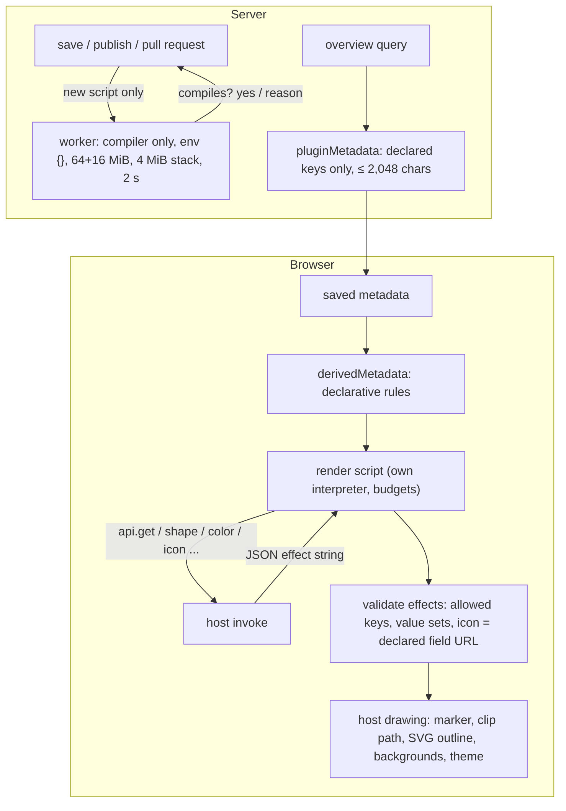

# Restricted interpreter for timeline plugins

Copyright (c) 2026 Athan Clark. SPDX-License-Identifier: GPL-3.0-only

OpenChronology timelines carry their own plugins: versioned JSON manifests that declare editor fields, marker effects, backgrounds, themes and derived metadata, plus an optional `render` script. A plugin travels inside the timeline (JSON export, SQLite file, PostgreSQL snapshot, offline HTML), so every reader's browser runs code chosen by the timeline's author. This document describes how that is made safe to load automatically: the script is written in a small language that the application tokenizes, compiles and evaluates itself, with no route to `eval`, the DOM, the network or imports, and with budgets on steps, calls, text and nesting; the script can only return a JSON effect string that the host validates against a closed set of effects and the plugin's own declared fields; everything visible (markers, shapes, outlines, background images, themes) is drawn by host code; the server never runs a plugin, compiles new scripts only in disposable worker threads with no environment and with memory, stack and time limits, and projects only declared metadata fields for overviews. The same interpreter runs custom time printers and parsers, with a different method table ([exact printers, parsers and rulers](time-presentation.md)). Disclosed at commit [`007091c`](https://github.com/openchronology/timeline-app/tree/007091ce62fdb402346c0712b0c420eac0a29dff); first public disclosure: see [First public disclosure](#first-public-disclosure).

## Field and problem

A timeline editor wants per-timeline customization: a status field that turns a marker into a red diamond, icons on moments, an image behind a war's duration, colors derived from a log's severity tag. The customization has to travel with the timeline, work offline, and be applied when someone else opens the timeline, including anonymous readers of a public timeline. Common approaches fail:

- **JavaScript plugins with `eval`, `new Function` or `<script>`.** The code runs with the page's origin: it can read cookies and storage, call the application's API with the reader's session, change the DOM, and send private notes anywhere with `fetch` or an ``. Hiding globals by shadowing names is not isolation; `({}).constructor.constructor("return this")()` and similar paths recover them.
- **A Web Worker or iframe.** A plain dedicated worker still has `fetch`, WebSockets and IndexedDB. A sandboxed iframe needs a message protocol and a content policy of its own, and code in either can still loop or allocate without bound until something terminates it.
- **Declarative-only manifests.** Safe, but cannot express "if status is blocked, diamond and red".
- **Validating plugin code on the server by running it.** Puts untrusted code into the server process with its environment (database credentials, secrets). Even compiling with a general-purpose parser in the request thread risks pathological inputs blocking the event loop.
- **Letting the plugin produce markup or URLs.** A script that can build an image URL can encode private metadata into it and leak it on load.

## Summary of the mechanism

1. **Own language, own interpreter.** Plugin `render` scripts use a JavaScript/TypeScript-shaped subset: one function, `const` locals, literals, `+` string concatenation, primitive comparisons, `?:`, and `api.method(…)` calls. The application's tokenizer and recursive-descent compiler turn the source into a small expression tree; its tree-walking evaluator runs that tree. Source text never reaches `eval`, `Function`, a script element or a worker in the browser.
2. **Capabilities are a method table.** The compiler accepts only `api` methods that are own properties of the plugin table, with fixed arities: `get`, `shape`, `size`, `color`, `icon`, `card`, `expand`, `outline`, `merge`, `none` and seven string helpers. Unknown names, unknown methods and wrong arities fail at compile time.
3. **Budgets.** Compile: 16,384 characters, 4,096 tokens, 1,024 expression nodes, 32 nesting levels, 128 locals. Run: 4,096 evaluation steps, 64 evaluation depth, 128 API calls, 2,048 characters per string, 32,768 characters of strings produced in total.
4. **Effects are data, validated by the host.** The script returns a string. The host parses it as JSON, accepts only the keys `shape`, `size`, `color`, `icon`, `card`, `expand`, `outline`, checks each value against the host's own value sets, and accepts an `icon` only if it equals a valid HTTPS URL already stored in one of the plugin's declared `image-url` fields. Any error discards that plugin's effects; rendering goes on.
5. **Host-drawn output.** Markers, shapes (CSS clip paths and SVG paths from a fixed table), dashed outlines, duration backgrounds, the timeline backdrop and theme variables are drawn by host code from validated values. Images load with `crossOrigin="anonymous"` and `referrerPolicy="no-referrer"`.
6. **Server: compile only, in a sandbox.** The server compiles a script only when it is new to it (being published, or new to a timeline being created, saved or proposed). It compiles in `worker_threads` workers that load nothing but the compiler, get an empty environment and empty `argv`/`execArgv`, and run under V8 resource limits and a 2 s timer; a worker that fails is terminated and replaced. Results are remembered by SHA-256 of the source. The server never evaluates a script.
7. **Metadata projection without code.** Server overview queries return, for each singleton moment, the enabled plugins' projection of its metadata: declared field keys, marker and background keys, and what derivation rules read. The projection is computed from the manifests, runs no script, and is capped at 2,048 characters of JSON.
8. **Suites** are named, versioned packages of full manifests, validated with the same rules, whose scripts are compiled in the same sandbox when published.

## Detailed description

### One interpreter for plugins and time presentations

`src/custom-time.ts` holds one tokenizer (`tokenize`), one compiler (`compile(source, plugin, methods)`) and one evaluator (`run(body, argument, context, invoke)`). Custom time presentations and plugin scripts differ only in parameters:

| Aspect            | Time presentation (`compileCustom`)                                         | Plugin (`compilePluginScript`)                                                                        |
| ----------------- | --------------------------------------------------------------------------- | ----------------------------------------------------------------------------------------------------- |
| Functions         | `print`, `parse` (required); `printDifference`, `parseDifference`           | `render` (required, exactly once)                                                                     |
| Parameter         | stored time (exact rational) or text                                        | reserved; always the empty string                                                                     |
| `api` annotation  | `TimeAPI`                                                                   | `PluginAPI`                                                                                           |
| Method table      | exact arithmetic, number/timestamp formatting, string helpers, view helpers | `get`, `shape`, `size`, `color`, `icon`, `card`, `expand`, `outline`, `merge`, `none`, string helpers |
| Who answers calls | the interpreter's own `call`                                                | string helpers by `call`; every other method by the host's `invoke` callback                          |
| Result type       | `print`: string; `parse`: exact rational                                    | string (an effect description)                                                                        |

So the language, its limits and its evaluator are shared; exact arithmetic (`api.rational`, `api.add`, `api.timestamp` …) and the view helpers are not available to plugins, because those names are not in the plugin table and the compiler rejects them.

### The language

Tokenizer rules (identical for both uses): whitespace and `//`/`/* */` comments are skipped; strings use `'` or `"` with only `\n \r \t \\ \" \'` escapes, no raw newlines, at most 2,048 characters, and are tagged as literals so their contents are never read as keywords or operators; numbers are JavaScript numbers of magnitude at most 10⁶; the only other tokens are identifiers and `=== !== <= >= { } ( ) , ; : . ? + < > =`. There is no `-` operator. Anything else is an error with its character position.

Grammar accepted for a plugin:

```
program  := 'function' 'render' '(' PARAM [':' 'string'] ',' 'api' [':' 'PluginAPI'] ')' [':' 'string']
            '{' ('const' NAME [':' T] '=' expr ';')* 'return' expr ';' '}'
expr     := binary ['?' expr ':' expr]
binary   := primary (('===' | '!==' | '<' | '>' | '<=' | '>=' | '+') primary)*   // by precedence
primary  := STRING | NUMBER | 'true' | 'false' | '(' expr ')' | NAME | 'api' '.' METHOD '(' [expr (',' expr)*] ')'
```

The compiled form is a map from function name to `{parameter, locals: [{name, expr}], result}`, with `expr` one of five node kinds:

```
literal { value }        name { name }        call { name, args[] }
binary  { op, left, right }                   choice { test, yes, no }
```

Because there is no node for member access, indexing, assignment, function definition, function values, `new`, `this`, `import`, loops or calls to anything but `api.METHOD`, none of those can be expressed. A name must be the parameter or an earlier `const`; locals cannot be redeclared or named `api`, `true` or `false`. Method lookup uses `Object.hasOwn` on the method table, so `api.constructor`, `api.__proto__` and `api.toString` are compile errors. The rational values of time presentations are opaque objects with no accessible properties; plugin scripts never see one.

### Enforcement and budgets

The compiler counts nodes (≤ 1,024) and recursion depth (≤ 32) as it descends, and locals (≤ 128). Compiling therefore takes time linear in the bounded source.

The evaluator:

```
run(body, argument, invoke):
  locals = Map{ body.parameter → bounded(argument) }
  steps = calls = textCost = rationalCost = 0
  for (name, expr) in body.locals: locals.set(name, eval(expr, 0))
  return eval(body.result, 0)

eval(node, depth):
  if ++steps > 4096 or depth > 64: throw "execution budget exceeded"
  switch node.kind:
    literal: v = node.value
    name:    v = locals.get(node.name)
    call:    if ++calls > 128: throw
             v = invoke(node.name, node.args.map(a => eval(a, depth + 1)))
    choice:  t = eval(test); t must be boolean; v = eval(t ? yes : no)      // one branch only
    binary:  l = eval(left); r = eval(right)
             '+'  → both must be strings; v = l + r
             else → same primitive type, no rationals; v = l op r
  bounded(v)                                 // string ≤ 2,048 chars; rational parts ≤ 4,096 bits
  textCost += length of string v  (≤ 32,768) ; rationalCost += bits of rational v (≤ 65,536)
  return v
```

Arguments are evaluated eagerly, but only the chosen branch of `?:` is. There are no loops or recursion, so every evaluation terminates within the step budget. The budgets count operations, not wall-clock time; each host method is itself bounded (string helpers on strings of at most 2,048 characters; `slice` indices are integers within ±2,048; `replace` replaces the first literal match through a function, so `$&` patterns are not interpreted).

`compilePluginScript(source)` compiles with the plugin table and returns a runner. The runner calls `run(body, '', undefined, dispatch)`, where `dispatch` sends `trim`, `upper`, `lower`, `startsWith`, `endsWith`, `slice` and `replace` to the interpreter's string helpers and every other method to the host's `invoke`, and requires the result to be a string.

### The host side: what a script can change

In the browser, `manifestEffects(manifest, metadata)` caches compiled runners by source (at most 64, oldest dropped) and supplies `invoke`:

| Method                         | Host behaviour                                                                                                                                                            |
| ------------------------------ | ------------------------------------------------------------------------------------------------------------------------------------------------------------------------- |
| `get(key)`                     | Only a key the manifest declares as a field or derives, or `title`/`description`; otherwise an error. Returns text (≤ 2,048 chars), a number or boolean as text, or `''`. |
| `shape(name)`                  | `{"shape":name}` if `name` is one of the plugin's shapes (the first twelve plus those its manifest lists in `shapes`), else `{}`.                                         |
| `size(name)`                   | `{"size":…}` for `small`, `medium`, `large`, else `{}`.                                                                                                                   |
| `color(hex)`                   | `{"color":…}` for `#rrggbb`, lower-cased, else `{}`.                                                                                                                      |
| `outline(s)`                   | `{"outline":…}` for `solid` or `dashed`, else `{}`.                                                                                                                       |
| `icon(key)`                    | Only for a declared `image-url` field; `{"icon":url}` if that field holds a valid HTTPS URL under 1,800 characters, else `{}`.                                            |
| `card()`, `expand()`, `none()` | `{"card":true}`, `{"expand":true}`, `{}`.                                                                                                                                 |
| `merge(a, b)`                  | `JSON.stringify({...JSON.parse(a), ...JSON.parse(b)})`.                                                                                                                   |

The script's string result is then validated as if it were untrusted, because a script can return a literal JSON string:

1. Parse as JSON; it must be a plain object whose keys are a subset of `shape`, `size`, `color`, `icon`, `card`, `expand`, `outline`.
2. `size`, `shape`, `color`, `outline` must pass the same value checks as above (`shapeValue` uses the plugin's own shape list).
3. `card` and `expand` must be booleans.
4. `icon` must be a valid HTTPS URL (no credentials, ≤ 4,096 characters) **and** equal to the validated value currently stored in one of the plugin's declared `image-url` fields.
5. Any failure, at compile, run or validation, discards that plugin's effects (`effects = {}`); other plugins and host rendering continue.

Rule 4 is what stops a script from encoding metadata into a URL. A script may read a private description with `get`, but the only image it can make the host load is one whose exact URL the user already typed into an image field.

`scriptEffects(plugins, metadata)` applies enabled plugins in order: first each plugin's declarative marker (`image`, `color`, `shape`, `heading` with an optional `font` field, `outline` from a `toggle`) and `hover` card flag, then its script's effects with `Object.assign`. Later plugins override earlier effects with the same key; missing effects leave earlier ones intact. The result feeds `pluginShape`, `pluginSize`, `pluginOutline`, `pluginHeading` and `pluginMarker`.

What the host draws from those values:

- **Markers** (`renderPluginMarker`): an `` with `crossOrigin="anonymous"`, `referrerPolicy="no-referrer"`, shown only once loaded; otherwise a count. Images resolve through the timeline's embedded copies first (offline builds use only those).
- **Shapes** (`renderPluginShape`): a clip path and SVG outline chosen from a fixed table by shape name; unknown names fall back to a circle.
- **Outlines** (`renderPluginOutline`): a dashed copy of the shape's own outline path.
- **Duration backgrounds** (`pluginBackground`): the last enabled background plugin's valid HTTPS URL from the duration's metadata; the host positions and fades the image across the band. Plugins only name the metadata key; they never draw.
- **Timeline backdrop and theme** (`pluginBackdrop`, `pluginTheme`): values of timeline-wide plugin settings, each validated by kind (HTTPS image URL, `#rrggbb` color, a font-family list matching a strict pattern, a text size 50–200 %), and applied as `--timeline-*` CSS custom properties.
- **Editor fields** (`renderPluginFields`): host-built inputs for twelve field kinds, each bound to one top-level metadata key. Field text is rendered as text, never HTML; the `notes: markdown` component renders a small Markdown vocabulary with the host's own renderer (no HTML, images, embeds or non-HTTPS links).

No effect changes a stored time, a timeline bound, the ordering of moments or saved metadata. Scripts do not write metadata at all.

### Manifests

`validatePluginManifest` accepts only known properties (unknown ones are rejected) and checks:

| Property                    | Rule                                                                                                                                                                                           |
| --------------------------- | ---------------------------------------------------------------------------------------------------------------------------------------------------------------------------------------------- |
| `apiVersion`                | `1`                                                                                                                                                                                            |
| `id`                        | `^[a-z][a-z0-9-]{0,63}$`                                                                                                                                                                       |
| `version`                   | positive safe integer                                                                                                                                                                          |
| `name`, `description`       | non-blank text, ≤ 100 and ≤ 2,000 characters                                                                                                                                                   |
| `fields`                    | ≤ 8; kind among twelve host components; `metadataKey` `^[A-Za-z][A-Za-z0-9_-]{0,63}$`, not `title`, `description`, `durations`, `tags`, `__proto__`, `prototype`, `constructor`; no duplicates |
| `marker`                    | `image`, `color`, `shape`, `heading` or `outline`, bound to one key                                                                                                                            |
| `hover`, `summary`, `notes` | `card`, `radial`, `markdown`                                                                                                                                                                   |
| `background`                | `{kind:'image', metadataKey}` (durations only)                                                                                                                                                 |
| `settings`                  | 1–12 timeline-wide settings of kind `image-url`, `color`, `font`, `text-size`                                                                                                                  |
| `backdrop`, `theme`         | must read the plugin's own settings of the right kind                                                                                                                                          |
| `targets`                   | `moments` and/or `durations`                                                                                                                                                                   |
| `derive`                    | 1–8 rules, 1–16 sources each (a tag name or a dotted path of 1–4 keys), optional map of ≤ 64 values ≤ 256 chars                                                                                |
| `shapes`                    | added shapes (currently `ellipse`)                                                                                                                                                             |
| `source`                    | non-blank text ≤ 16,384 characters (compiled elsewhere; see below)                                                                                                                             |

An installed list (`validateInstalledPlugins`) holds at most 32 plugins with distinct IDs and at most 128 KiB of UTF-8 JSON, and each entry's `settings` must match the manifest's declared settings.

**Derived metadata** (`derive`) is the only computation a plugin can ask the host to do on metadata, and it is declarative: for each rule, take the first source that has a value (a tag `name:value`, or a string/number/boolean at a path that does not cross arrays), optionally map it through a fixed table, and set the rule's key only where the entity has no value yet. `derivedMetadata` applies the rules of enabled plugins in order to a copy; the result is used for drawing and is never saved.

Manifest validation does not compile the script. Validating a document on the server therefore costs no compilation; compilation happens only where described below.

### Where scripts are compiled and run

**Browser and desktop app.** Scripts are compiled and run in the page, by the interpreter above, when markers are drawn. The browser also compiles (`checkPluginScript`) a plugin it is about to install, import or publish, to report compile errors early. The offline HTML build embeds the interpreter and runs saved plugins locally under a content policy that denies network connections.

**Server.** The server never evaluates a script. It compiles a script to refuse ones that do not compile, in these cases only:

- publishing a plugin (`POST /api/plugins/publish`) or a suite (`POST /api/plugins/suites/publish`), via `checkPublished`;
- creating or saving a timeline, or opening or updating a pull request, via `store.checkScripts(plugins, current)`, which skips scripts identical to an official plugin's or to one the timeline already has;
- loading an operator's `PLUGIN_LIBRARY` file at startup.

**The compile sandbox** (`createPluginCompiler`):

```
spawn():
  new Worker(dist/plugin-compile-worker.mjs, {
    env: {}, argv: [], execArgv: [],
    resourceLimits: { maxOldGenerationSizeMb: 64, maxYoungGenerationSizeMb: 16,
                      codeRangeSizeMb: 16, stackSizeMb: 4 },
    stdout: true, stderr: true })            // output captured, not inherited
  worker.unref()

check(source):
  key = sha256(source)
  result = results[key] ?? (results[key] = compile(source))     // ≤ 1,000 remembered, oldest dropped
  {error, broken} = await result
  if broken: delete results[key]                                  // retry next time
  if error: throw error

compile(source):
  worker = idle.pop() ?? (live < 2 ? spawn() : wait for one)
  worker.ref(); start 2,000 ms timer
  post {id, source}
  on reply {id, error}        → finish(error, broken = false); worker back to the pool
  on timer                    → finish("took too long", broken = true)
  on ERR_WORKER_OUT_OF_MEMORY → finish("needed too much memory", broken = true)
  on other error or exit      → finish("could not be compiled", broken = true)
  broken workers are terminated and a waiting job gets a fresh worker
```

The worker module imports only `compilePluginScript` and answers `{id, error}` for each message. It holds no database connection, no configuration and no environment variables. Because the compiler is already bounded, ordinary scripts never reach the worker limits; the limits protect the server against defects in the compiler itself. The request's event loop keeps running while a worker spins, which `test/plugin-sandbox.test.mjs` checks with a stand-in worker (`test/hostile-compiler.mjs`) that loops forever, allocates without end, or reports its environment.

Custom time-presentation source is handled differently: `validatePresentation` compiles it in-process, during document validation, under the same tokenizer and compiler limits, and also never runs it ([time presentation](time-presentation.md#custom-printers-and-parsers-in-a-restricted-language)).

### Metadata projections and query plugins

The server stores each moment's metadata as given, within generic size limits; it does not validate plugin fields. For overview queries it sends each singleton moment's metadata through `pluginMetadata(plugins, metadata)`:

- for each enabled plugin: the string or `true` values of its field, marker and background keys (strings cut to 10,000 characters); arrays for `stack`, `links` and `relationship-arrows` fields; `title`, `description` (≤ 2,000) and HTTPS `sources` (≤ 100) if the plugin has a hover card or a script;
- for each derivation rule: its own key, the tags with the rule's prefix, and the values at its paths (≤ 256 characters), rebuilt at the same nested path;
- the moment's content labels, so images stay blurred where required.

`overviewMetadata` sends the projection only if it is at most 2,048 characters as JSON, else `{}`. A read-only comparison may supply the plugins to project with (`queryPlugins`): at most 256 plugins and 1 MiB, each validated as a manifest, IDs distinct. These query plugins are used only for this field selection; their scripts are not compiled or run. Readers' browsers then run the scripts on the projected metadata, so anonymous viewers see the same effects without downloading the whole timeline.

### Suites

A suite (`PluginSuite`) is `{apiVersion: 1, id, version, name, description, plugins: PluginManifest[]}` with 1–32 distinct plugins and at most 128 KiB serialized, each plugin validated as a manifest. `addSuite(installed, suite)` appends, enabled and in suite order, the suite's plugins whose IDs the timeline lacks, keeps installed ones unchanged (version and enabled state), and refuses if the total would exceed 32. Published suites are namespaced `u-<account>-<slug>`, immutable per version, and their plugins' scripts are compiled in the sandbox before storage. A plugin or suite is "official" only if its JSON equals a bundled definition exactly (`isOfficialPlugin`, `isOfficialSuite`), so changing only an ID does not make a copy official.

### Publication

`POST /api/plugins/publish` requires a signed-in account, a manifest with a `source`, a slug of at most 29 characters (the ID becomes `u-<account without dashes>-<slug>`), at most 32 KiB, a compiling script, fewer than 200 versions for the account (checked under a per-account advisory lock), and a version that does not exist yet. Published versions are immutable; installed timelines keep their pinned snapshot until the user updates them.

### Edge cases

- A script that fails at run time (wrong type, budget exceeded, invalid JSON from `merge`) yields no effects for that plugin only.
- A script returning `{"shape":"diamond","html":"x"}` yields no effects, because `html` is not an allowed key.
- `api.get("undeclared")` throws, so the plugin yields no effects, even if the metadata has that key.
- A shape added after the first twelve (`ellipse`) is unknown to a plugin that does not list it in `shapes`, in fields, markers and `api.shape` alike.
- A stopped worker's refusal is not remembered, so a busy server that timed out compiling a valid script compiles it again on the next request.
- The official plugins' scripts are trusted as shipped and are never compiled on the server; a test compiles them all.

### Complexity

- Compile: O(n) in the source length n ≤ 16,384, with at most 1,024 nodes.
- Run: at most 4,096 node evaluations and 128 host calls per invocation; host calls are O(size of their bounded string arguments) plus one JSON parse for `merge`.
- Effect validation: O(1) keys; the `icon` check scans the plugin's at most eight fields.
- Server compile: one worker message per new distinct script; at most two concurrent compilations; at most 1,000 cached results.

### Variations

- The method table may expose any other pure host function (for example a lookup in a declared table) without changing the compiler or evaluator: a capability exists exactly when it is in the table.
- The effect vocabulary may grow (new keys) as long as each key has a host-side validator and host-side drawing; the script still returns only data.
- The compile sandbox may use any isolation that withholds environment and I/O and enforces memory and time limits (a separate process, a WebAssembly instance), since its only job is to answer "does this compile".
- The same interpreter may run in the server for other purposes only by adding a method table; the evaluator never reaches host objects other than through `invoke`.
- The budgets (steps, calls, text, depth) are parameters; any finite values give the same termination guarantee because the language has no loops or recursion.

## Implementation references

- `src/custom-time.ts` — [`tokenize`](https://github.com/openchronology/timeline-app/blob/007091ce62fdb402346c0712b0c420eac0a29dff/src/custom-time.ts#L76-L157), [`compile`](https://github.com/openchronology/timeline-app/blob/007091ce62fdb402346c0712b0c420eac0a29dff/src/custom-time.ts#L172-L315), [`bounded`](https://github.com/openchronology/timeline-app/blob/007091ce62fdb402346c0712b0c420eac0a29dff/src/custom-time.ts#L324-L335), [`call`](https://github.com/openchronology/timeline-app/blob/007091ce62fdb402346c0712b0c420eac0a29dff/src/custom-time.ts#L363-L456) (string helpers), [`run`](https://github.com/openchronology/timeline-app/blob/007091ce62fdb402346c0712b0c420eac0a29dff/src/custom-time.ts#L466-L538), [`compilePluginScript`](https://github.com/openchronology/timeline-app/blob/007091ce62fdb402346c0712b0c420eac0a29dff/src/custom-time.ts#L586-L624) — the shared interpreter and the plugin method table.
- `src/plugins.ts` — [`PluginManifest`](https://github.com/openchronology/timeline-app/blob/007091ce62fdb402346c0712b0c420eac0a29dff/src/plugins.ts#L25-L60), [`sourceValue`, `derivedValue`, `derivedMetadata`](https://github.com/openchronology/timeline-app/blob/007091ce62fdb402346c0712b0c420eac0a29dff/src/plugins.ts#L332-L383), [`manifestEffects`](https://github.com/openchronology/timeline-app/blob/007091ce62fdb402346c0712b0c420eac0a29dff/src/plugins.ts#L393-L517) (host `invoke` and effect validation), [`scriptEffects`](https://github.com/openchronology/timeline-app/blob/007091ce62fdb402346c0712b0c420eac0a29dff/src/plugins.ts#L518-L553), [`reserved`, `key`, `derivations`](https://github.com/openchronology/timeline-app/blob/007091ce62fdb402346c0712b0c420eac0a29dff/src/plugins.ts#L583-L674), [`validatePluginManifest`](https://github.com/openchronology/timeline-app/blob/007091ce62fdb402346c0712b0c420eac0a29dff/src/plugins.ts#L675-L833), [`checkPluginScript`, `validateInstalledPlugins`](https://github.com/openchronology/timeline-app/blob/007091ce62fdb402346c0712b0c420eac0a29dff/src/plugins.ts#L838-L858), [`imageURL`](https://github.com/openchronology/timeline-app/blob/007091ce62fdb402346c0712b0c420eac0a29dff/src/plugins.ts#L897-L911), [`pluginTheme`, `pluginBackdrop`, `pluginBackground`](https://github.com/openchronology/timeline-app/blob/007091ce62fdb402346c0712b0c420eac0a29dff/src/plugins.ts#L1044-L1083), [`pluginMarker`, `pluginMetadata`, `projectSource`](https://github.com/openchronology/timeline-app/blob/007091ce62fdb402346c0712b0c420eac0a29dff/src/plugins.ts#L1122-L1205), [`isOfficialPlugin`](https://github.com/openchronology/timeline-app/blob/007091ce62fdb402346c0712b0c420eac0a29dff/src/plugins.ts#L1647-L1649) — manifests, effects, derived metadata and projections.
- `src/plugin-ui.ts` — [`image`, `renderPluginMarker`](https://github.com/openchronology/timeline-app/blob/007091ce62fdb402346c0712b0c420eac0a29dff/src/plugin-ui.ts#L197-L254), [`renderPluginShape`](https://github.com/openchronology/timeline-app/blob/007091ce62fdb402346c0712b0c420eac0a29dff/src/plugin-ui.ts#L901-L943), [`renderPluginOutline`](https://github.com/openchronology/timeline-app/blob/007091ce62fdb402346c0712b0c420eac0a29dff/src/plugin-ui.ts#L952-L966) — host drawing of validated effects.
- `src/app.ts` — [`renderTimelineBackdrop`, `renderTimelineTheme`, `renderDurationBackgrounds`](https://github.com/openchronology/timeline-app/blob/007091ce62fdb402346c0712b0c420eac0a29dff/src/app.ts#L9599-L9708) — host-drawn backdrops, theme variables and duration backgrounds.
- `src/plugin-compile-worker.mjs` — [worker](https://github.com/openchronology/timeline-app/blob/007091ce62fdb402346c0712b0c420eac0a29dff/src/plugin-compile-worker.mjs#L1-L17) — holds only the compiler, answers whether a script compiles.
- `server/plugin-sandbox.mjs` — [`COMPILE_TIME`, `COMPILE_LIMITS`, `REMEMBERED`](https://github.com/openchronology/timeline-app/blob/007091ce62fdb402346c0712b0c420eac0a29dff/server/plugin-sandbox.mjs#L18-L27), [`createPluginCompiler`](https://github.com/openchronology/timeline-app/blob/007091ce62fdb402346c0712b0c420eac0a29dff/server/plugin-sandbox.mjs#L42-L149), [`pluginCompiler`](https://github.com/openchronology/timeline-app/blob/007091ce62fdb402346c0712b0c420eac0a29dff/server/plugin-sandbox.mjs#L153-L155) — the worker pool, limits, timer and result cache.
- `server/plugins.mjs` — [`BUILTIN_SCRIPTS`, `checkPublished`](https://github.com/openchronology/timeline-app/blob/007091ce62fdb402346c0712b0c420eac0a29dff/server/plugins.mjs#L20-L37), [plugin `publish`](https://github.com/openchronology/timeline-app/blob/007091ce62fdb402346c0712b0c420eac0a29dff/server/plugins.mjs#L162-L200), [suite `publish`](https://github.com/openchronology/timeline-app/blob/007091ce62fdb402346c0712b0c420eac0a29dff/server/plugins.mjs#L309-L330) — publication with sandboxed compilation.
- `server/store.mjs` — [`checkScripts`](https://github.com/openchronology/timeline-app/blob/007091ce62fdb402346c0712b0c420eac0a29dff/server/store.mjs#L277-L291), called on [create](https://github.com/openchronology/timeline-app/blob/007091ce62fdb402346c0712b0c420eac0a29dff/server/store.mjs#L1123) and [save](https://github.com/openchronology/timeline-app/blob/007091ce62fdb402346c0712b0c420eac0a29dff/server/store.mjs#L1171); [overview projection](https://github.com/openchronology/timeline-app/blob/007091ce62fdb402346c0712b0c420eac0a29dff/server/store.mjs#L2151-L2152) and [`overviewMetadata`](https://github.com/openchronology/timeline-app/blob/007091ce62fdb402346c0712b0c420eac0a29dff/server/store.mjs#L2875-L2878).
- `server/collaboration.mjs` — `checkScripts` on pull requests at [L612](https://github.com/openchronology/timeline-app/blob/007091ce62fdb402346c0712b0c420eac0a29dff/server/collaboration.mjs#L612) and [L680](https://github.com/openchronology/timeline-app/blob/007091ce62fdb402346c0712b0c420eac0a29dff/server/collaboration.mjs#L680).
- `server/platform.mjs` — [`pluginLibrary`](https://github.com/openchronology/timeline-app/blob/007091ce62fdb402346c0712b0c420eac0a29dff/server/platform.mjs#L64-L86) — compiles an operator's `PLUGIN_LIBRARY` scripts in the sandbox at startup.
- `server/query-plugins.mjs` — [`queryPlugins`](https://github.com/openchronology/timeline-app/blob/007091ce62fdb402346c0712b0c420eac0a29dff/server/query-plugins.mjs#L5-L20) — bounded, validated plugins for a comparison's projection.
- `src/suites.ts` — [`validatePluginSuite`](https://github.com/openchronology/timeline-app/blob/007091ce62fdb402346c0712b0c420eac0a29dff/src/suites.ts#L48-L74), [`addSuite`](https://github.com/openchronology/timeline-app/blob/007091ce62fdb402346c0712b0c420eac0a29dff/src/suites.ts#L104-L120), [`OFFICIAL_SUITES`, `isOfficialSuite`](https://github.com/openchronology/timeline-app/blob/007091ce62fdb402346c0712b0c420eac0a29dff/src/suites.ts#L155-L162) — suites.
- Tests — [`test/plugins.test.mjs`](https://github.com/openchronology/timeline-app/blob/007091ce62fdb402346c0712b0c420eac0a29dff/test/plugins.test.mjs#L556-L597) (ambient authority rejected, literal effects validated, image URLs cannot carry metadata), [`test/plugin-sandbox.test.mjs`](https://github.com/openchronology/timeline-app/blob/007091ce62fdb402346c0712b0c420eac0a29dff/test/plugin-sandbox.test.mjs) with [`test/hostile-compiler.mjs`](https://github.com/openchronology/timeline-app/blob/007091ce62fdb402346c0712b0c420eac0a29dff/test/hostile-compiler.mjs) (time, memory and environment isolation of the workers).

## Benchmarks

No benchmarks measure this mechanism directly. Nothing in `bench/` or `docs/benchmarks.md` times compiling or running plugin scripts.

The only timing assertion is in [`test/plugin-sandbox.test.mjs`](https://github.com/openchronology/timeline-app/blob/007091ce62fdb402346c0712b0c420eac0a29dff/test/plugin-sandbox.test.mjs#L30-L57): with a 300 ms compile limit and a worker that never answers, the refusal arrives in under 2,000 ms and the server's event loop keeps ticking (at least ten 10 ms intervals) meanwhile. The run-time budgets in `test/plugins.test.mjs` and `test/presentation.test.mjs` count operations, not time. The closest whole-application measurements are the interaction benchmarks in [docs/benchmarks.md](../benchmarks.md#interactions), whose frames include drawing plugin markers among everything else.

## First public disclosure

The repository has been public since its creation on 2026-10-05, so commit dates on `main` are public dates.

| Component                                                                                          | First commit         | First release |
| -------------------------------------------------------------------------------------------------- | -------------------- | ------------- |
| Bounded interpreter (tokenizer, compiler, budgeted evaluator) for custom time code                 | `88aea8c` 2026-10-05 | v0.1.0        |
| Declarative plugin manifests, host components, metadata projection (`pluginMetadata`)              | `5929cca` 2026-10-06 | v0.1.0        |
| Plugin `render` scripts on the shared interpreter (`compilePluginScript`), query plugins           | `6530edf` 2026-10-07 | v0.1.0        |
| Plugin suites (`validatePluginSuite`, `addSuite`)                                                  | `7441ede` 2026-10-12 | v0.1.0        |
| Server compile sandbox in workers (`createPluginCompiler`, `checkScripts`, compile-only manifests) | `895c6b9` 2026-10-15 | v0.1.0        |
| Derived metadata (`derive`, `derivedMetadata`)                                                     | `6b2b53b` 2026-10-17 | v0.1.0        |
| Plugin-listed added shapes (`shapes`, `ADDED_SHAPES`)                                              | `6eb07fc` 2026-10-26 | v0.10.0       |

Before `895c6b9` the server validated plugin manifests by compiling their scripts in its own thread; since then manifest validation only checks the source's length and the server compiles new scripts only in the sandbox.

Note on the documentation: [docs/plugins.md](../plugins.md) (line 260) said the compile workers "are limited to 64 MiB of memory" and that "each distinct script is compiled once per process". The code sets 64 MiB of old generation plus 16 MiB of young generation, a 16 MiB code range and a 4 MiB stack ([`COMPILE_LIMITS`](https://github.com/openchronology/timeline-app/blob/007091ce62fdb402346c0712b0c420eac0a29dff/server/plugin-sandbox.mjs#L20-L25)), remembers at most 1,000 results with the oldest dropped, and forgets results from a worker that was stopped, so a script can be compiled again ([`check`](https://github.com/openchronology/timeline-app/blob/007091ce62fdb402346c0712b0c420eac0a29dff/server/plugin-sandbox.mjs#L129-L142)). The docs were corrected to match the code in #392.

## Figures



```
Who can do what with a plugin script
                      browser page   server request thread   server compile worker
tokenize + compile         yes          no (manifest only)            yes
evaluate render            yes                 no                      no
network / DOM / storage    no (no syntax, no method)  —                no (env {}, no API)
```
