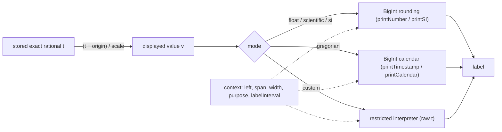

# Exact printers, parsers and rulers for calendars and units

Copyright (c) 2026 Athan Clark. SPDX-License-Identifier: GPL-3.0-only

OpenChronology stores every time as an exact reduced rational and never converts a stored time to binary floating point to show it. This document describes the presentation layer that sits on top of that storage: an affine unit transform with an exact scale and origin; decimal, scientific and SI printers that round to significant digits with integer (BigInt) arithmetic; a proleptic Gregorian calendar computed with BigInt over unbounded years, with BCE/CE numbering and deep-time ages; chart labels that leave out what the visible window already makes obvious and parse back against that window; a ruler planner that places marks at exact values (decimal powers of ten, real calendar fields, or a saved ladder of exact steps) with at most 512 marks and crossfades driven by zoom depth rather than time; and custom printers and parsers written in a small interpreted language with no ambient capabilities, which the server compiles to check but never runs. Disclosed at commit [`007091c`](https://github.com/openchronology/timeline-app/tree/007091ce62fdb402346c0712b0c420eac0a29dff); first public disclosure: see [First public disclosure](#first-public-disclosure).

## Field and problem

A timeline that spans from femtoseconds to billions of years, and that can be zoomed at any point to any depth, has to write times as text and read them back. Common approaches break at the edges:

- **Floating-point seconds or epoch milliseconds.** An IEEE double has 53 bits of mantissa. At 13.8 billion years (about 4.4 × 10¹⁷ s) one unit in the last place is 64 s; at the Unix epoch plus one year it is about 4 ns. Printing `x.toPrecision(6)` of a coordinate converted to a double rounds twice (once to binary, once to decimal) and can print a value that does not parse back to the same decimal. Epoch milliseconds cannot represent 1/3 s at all.
- **Host date libraries.** `Date` covers about ±273,790 years around 1970, uses the computer's local zone, and has millisecond resolution. Geological or cosmological times and sub-millisecond events fall outside it.
- **Fixed-format labels.** Printing every ruler label as a full ISO timestamp makes labels unreadably long; printing them all at the same fixed precision makes neighbouring labels identical when zoomed in (`1970-01-01T00:00:00Z` repeated across a one-microsecond view).
- **Rulers built by stepping from zero or from the screen's left pixel.** Stepping from zero costs time proportional to the coordinate's size; anchoring marks to pixels makes them slide and change value while panning. Approximating months or years as fixed lengths puts marks on the wrong days.
- **User-defined formatters as JavaScript.** Running user code with `eval`, `Function` or a plain Worker gives it network access (fetch, WebSockets, IndexedDB in workers), timers, and unbounded loops and memory. A saved timeline that carries such code would run it in every reader's browser and, if the server validated it by running it, on the server.

## Summary of the mechanism

1. **Exact affine units.** Settings hold a canonical exact `scale` and `origin` as rational strings. Displayed value = (stored − origin) / scale; parsing inverts it. Unit presets give seconds per unit (minute 60, day 86400, Julian year 31557600).
2. **BigInt rounding.** Significant-digit and fixed-decimal output is computed as `floor((2·|n|·10^p + d) / (2·d))` on the reduced numerator `n` and denominator `d`: rounding half away from zero with integers only. The decimal exponent is found from digit-string lengths with one BigInt comparison.
3. **Unbounded Gregorian arithmetic.** Day numbers and civil dates are computed with the 400-year-era algorithm entirely in BigInt, so any integer year works. Fractions of a second print as a terminating decimal when the denominator has only factors 2 and 5, and as an exact `{+n/d}` suffix otherwise.
4. **Context-dependent labels.** Every print and parse may receive a transient context: exact `left`, exact `span`, pixel width and purpose (`axis`, `event`, `input`, `tooltip`). Chart labels show only the fields the label spacing resolves and omit the fields the whole window shares; parsers restore omitted fields from the window's left edge, never the host clock. Inputs and tooltips always print the full exact value.
5. **Ruler planning anchored to values.** A plan is a sorted list of ticks at exact times. Levels are chosen from pixel targets, ticks of a level are enumerated starting at the first one at or after the left edge (found by floor division or by month/year arithmetic), coincident marks of different levels merge by exact key, and two neighbouring plans crossfade by smoothstep of the zoom depth. The plan holds at most 512 ticks.
6. **Restricted custom language.** Custom printers and parsers are tokenized and compiled by the application's own recursive-descent compiler into a small expression tree, then evaluated by the application's own tree-walking evaluator with step, depth, call, text and bit budgets. There are no loops, no property access, no globals and no function calls other than whitelisted `api.*` methods. Settings validation, including on the server, compiles the source to check it but never evaluates it.

## Detailed description

### Data structures

**Saved settings** (`TimePresentation`, persisted in `.ochx` JSON, `.och` SQLite `timeline_settings`, and PostgreSQL `oc_timelines.presentation` JSONB):

| Field               | Type                                                                      | Invariant                                                          |
| ------------------- | ------------------------------------------------------------------------- | ------------------------------------------------------------------ |
| `version`           | `1`                                                                       |                                                                    |
| `mode`              | `rational` \| `float` \| `scientific` \| `si` \| `gregorian` \| `custom`  | `custom` requires `source`                                         |
| `significantDigits` | integer                                                                   | 1–30                                                               |
| `unit`              | string                                                                    | ≤ 80 characters, no control characters                             |
| `scale`, `origin`   | exact number text                                                         | parsed and stored as canonical `n/d`; scale > 0; ≤ 8,192 chars     |
| `offsetMinutes`     | integer                                                                   | −1439…1439 (fixed zone offset, minutes east of UTC)                |
| `adaptiveLabels`    | boolean, optional                                                         | absent means true                                                  |
| `ruler`             | `{kind:'decimal'}` \| `{kind:'gregorian'}` \| `{kind:'steps', steps:[…]}` | steps: 2–32 positive, strictly increasing, ≤ 1,024 chars canonical |
| `source`            | string, optional                                                          | compiled (not run) on validation; kept when another mode is chosen |

The 8,192-character limit applies to the canonical form as well as the input, because `1e-300` written as a reduced fraction has a 301-digit denominator.

**Presentation context** (`PresentationContext`, never saved):

| Field           | Type                                      | Meaning                                                            |
| --------------- | ----------------------------------------- | ------------------------------------------------------------------ |
| `left`, `span`  | exact rationals, `span > 0`               | the visible window in stored coordinates                           |
| `widthPixels`   | number, 0 < w ≤ 10⁶                       | drawable width                                                     |
| `purpose`       | `axis` \| `event` \| `input` \| `tooltip` | what the text is for                                               |
| `spacingPixels` | number, optional                          | desired label spacing                                              |
| `labelInterval` | exact rational, optional                  | a ruler tick's exact interval; overrides `unitsPerPixel × spacing` |
| `textScale`     | number 0.1–10, optional                   | apparent text size, so smaller text fits more labels               |

Two derived quantities drive every decision: `unitsPerPixel = span / widthPixels` (the width is converted with `Q.parseDecimal(width.toString())`, so it enters exact arithmetic as the decimal it prints as) and `labelResolution = labelInterval ?? unitsPerPixel × (spacingPixels ?? (axis ? 115 : 6))`.

**Ruler plan** (`RulerPlan`): `ticks`, sorted by exact `time`, each with `level` (`minor` < `major` < `boundary`), a `label` flag, a nominal `interval`, four opacity weights (`opacity`, `majorOpacity`, `boundaryOpacity`, `labelOpacity`) and `labels: {interval, opacity}[]`; and `graduation`, the name of the labelled step (`hour`, `1/10`, `100 years` …).

### Exact numbers as text

`parseNumber(text)`:

1. If the text contains `/`, parse it as an exact fraction.
2. Otherwise match `[+-]?(digits[.digits]|.digits)([eE][+-]?digits)?`. The exponent must be a safe integer with |e| ≤ 10,000.
3. Parse the mantissa as an exact decimal and multiply or divide by the BigInt `10^|e|`.

`decimalExponent(q)` returns ⌊log₁₀ |q|⌋ without logarithms:

```
n = |numerator|, d = denominator
e = digits(n) − digits(d)
if (e ≥ 0 ? n < d·10^e : n·10^(−e) < d) then e = e − 1
return e
```

`rounded(q, p)` returns |q|·10^p rounded half away from zero as a BigInt:

```
N = |numerator| · 10^p        (or |numerator| when p < 0)
D = denominator               (or denominator · 10^(−p) when p < 0)
return (2N + D) div (2D)      // floor(N/D + 1/2)
```

Because the rounding is applied to the magnitude and the sign is reattached afterwards, halves round away from zero for both signs.

`printNumber(q, digits, scientific)`:

1. Zero prints as `0` (or `0e+0`).
2. `e = decimalExponent(q)`; `m = rounded(q, digits − 1 − e)` as a digit string.
3. If rounding carried into an extra digit (`999.9…` → `1000`), drop the last digit and increment `e`.
4. If `scientific`, or `e < −6`, or `e ≥ 21`, print `d.ddd…e±E` with trailing zeros removed; otherwise place the decimal point at `e + 1` and trim trailing fractional zeros. The −6/21 switch points match the thresholds at which JavaScript's own number formatting switches to exponent notation, so ordinary values look familiar.

`fixedDecimal(q, places)` uses the same `rounded` with 0–30 places and suppresses a minus sign on a result that rounds to zero.

`printSI(q, digits, unit)` chooses the SI prefix from `⌊decimalExponent/3⌋·3`, prints the quotient with `printNumber`, and moves up one prefix if rounding produced a quantity ≥ 1000 (so `999.9996 ms` with 6 digits becomes `1 s`, not `1000 ms`). Beyond quecto/quetta (|exponent| > 30) it falls back to scientific notation with the unit. `parseSI` accepts every printed prefix plus `da`, `h`, `d`, `c`, and `u`/`μ` for micro, and multiplies by the exact power of ten.

No step in printing or parsing converts a stored time to a JavaScript number. The only numbers that are JavaScript numbers are digit counts, pixel widths and fade weights.

### Unit transform and relative (Δ) labels

`createPresenter(settings)` builds `print`, `parse`, `alone`, `describe` and `rules`. For built-in modes it wraps the mode's printer and parser in the affine map:

```
print(t, ctx):  v = (t − origin) / scale ; format v
parse(s, ctx):  v = mode.parse(s) ; return origin + v · scale
rules(ctx):     plan in displayed units on ctx' = {left: (left − origin)/scale, span: span/scale}
                then map ticks back: time = origin + time'·scale, interval = interval'·scale
```

Times take the full affine map; intervals (differences) take only the scale. Custom mode receives raw stored coordinates with `scale = 1`, `origin = 0`.

**Δ labels when digits run out.** For adaptive `float`, `scientific` and `si` displays on `axis` or `event` labels, `relativeContext` compares one pixel, in displayed units, with the last significant digit of the left edge:

```
relative ⇔ v_left ≠ 0 ∧ unitsPerPixel/scale < 10^(decimalExponent(v_left) − significantDigits + 1)
```

When true, neighbouring labels would print identically, so each label prints as `Δ <difference from left>` and `describe` returns `Δ from <base>`. The base prints with just enough digits for the pixel size (`decimalExponent(base) − decimalExponent(pixel) + 3`, capped at 30) and is marked `≈` when that decimal is not exactly the base. Parsing a `Δ` label requires a context and adds the parsed offset to the same base.

**Finer units for large displayed units** (`finerUnit`). When the display's scale equals a unit preset and the view is shorter than one displayed unit, offsets are written in the largest preset the view spans at least once (days, hours, minutes), or in SI seconds below a minute. They count from a round base: `origin + ⌊(left − origin)/B⌋·B` where `B = step · 10^k` is the smallest power of ten of the finer step that covers the span. Labels therefore read `Δ 1 hour`, `Δ 2 hours` and do not change while panning within a block; the ruler plans in the finer step too.

### Gregorian calendar arithmetic with BigInt

Stored Gregorian times are seconds from 1970-01-01T00:00:00Z on the displayed scale (Unix time without leap seconds). `floorDiv(n, d) = n / d − (n < 0 ∧ n mod d ≠ 0 ? 1 : 0)` gives floor division for BigInt, whose `/` truncates.

`dayNumber(y, m, d)` (days since 1970-01-01), all BigInt:

```
y'  = y − (m ≤ 2 ? 1 : 0)              // years start in March
era = floorDiv(y', 400)
yoe = y' − 400·era                      // 0..399
mp  = m + (m > 2 ? −3 : 9)              // March = 0
doy = (153·mp + 2) div 5 + d − 1
doe = 365·yoe + yoe div 4 − yoe div 100 + doy
return 146097·era + doe − 719468
```

`dateParts(days)` inverts it with the same era decomposition (`yoe = (doe − doe div 1460 + doe div 36524 − doe div 146096) div 365`). This is the widely used civil-from-days formulation over 400-year cycles of 146,097 days; here every operand is a BigInt, so there is no year range. A year of 10³⁰ or −10³⁰ costs the same few BigInt operations as 1970.

`printTimestamp(t, offsetMinutes)`:

1. `shifted = t + 60·offsetMinutes`; `s = ⌊shifted⌋` (BigInt).
2. `days = floorDiv(s, 86400)`, `clock = s − 86400·days`, `(y, m, d) = dateParts(days)`.
3. Fraction `f = shifted − s`. Strip factors 2 and 5 from `f`'s denominator, counting them. If nothing else remains and the larger count `k ≤ 1000`, `f` is a terminating decimal of `k` digits: print `.` + `f.num·10^k div f.den` padded to `k` and trimmed. Otherwise print `{+n/d}` exactly.
4. Years print with at least four digits and a sign for negative astronomical years; the zone is `Z` or `±hh:mm`.

`parseTimestamp(text)` reverses this. It accepts years of four or more digits with an optional sign, `.digits` or `{+n/d}` fractions (< 1), and `Z` or `±hh:mm`. It rejects impossible dates by round-tripping `dateParts(dayNumber(y, m, d))` and comparing.

**BCE/CE and deep time.** Labels and full timestamps use historical numbering: astronomical year `y > 0` is `y CE`, `y ≤ 0` is `(1 − y) BCE`, so there is no year zero (`eraYear`, `eraTimestamp`; `normalizeEra` inverts it and rejects `0 BCE`). When the label resolution is at least 10,000 Julian years (315,576,000,000 s), `deepYear` writes years at or before −1,000,000 as an age before 2000 CE in the largest power-of-1000 unit that fits (`mya`, `bya`, `tya`, `pya`, `eya`, `zya`, `yya`, `rya`, `qya`, then `… years ago` in scientific notation), and years at or after 1,000,000 as SI years after 2000 CE (`3 Myr after 2000 CE`). The reference year is fixed; nothing depends on the current date. Parsing an age requires it to come to a whole number of years and returns 1 January 00:00 of that year in the configured offset.

**Calendar picker.** The date dialog (`calendarPicker`) works in displayed seconds, reads the local fields from `printTimestamp`, builds the month grid from `dayNumber` of the first day of this and the next month, and finds the weekday column from `((first + 3) mod 7 + 7) mod 7` (day 0 was a Thursday; weeks start on Monday). Year is a text field so years beyond a number input's exact range stay exact; Second is a text field so it accepts `1/3`. On commit every field is rebuilt into a timestamp, parsed exactly, and mapped back through scale and origin. Fields the view makes obvious (the date within a day's view, the year within a year's) move into a collapsed section but still count.

### Context-dependent label abbreviation

`printCalendar(t, offset, ctx)`:

1. Without a context, or for `input` and `tooltip`, return the full exact timestamp with its era.
2. If the view is at most one second and six pixels cover less than 1 ms (`relativeCalendar`), return `Δ <SI seconds from left>`.
3. `r = labelResolution(ctx)`. If `r < 1 s`, keep `min(6, max(0, −decimalExponent(r)))` decimals and round `t` to them exactly; only this subsecond rounding can carry into the next minute or day.
4. Choose fields from `r` (all thresholds exact rationals):
   - `r ≥ 10,000 Julian years`: `deepYear`;
   - `r ≥ 1 Julian year`: `NNNN CE`/`BCE`;
   - `r ≥ 28 days`: month name alone if the whole window lies in one year, else `yyyy-mm ERA`;
   - `r ≥ 1 day`: `mm-dd` if the year equals the left edge's year, else the full date;
   - otherwise a clock: `HHh` (r ≥ 1 h), `HH:MM` or `MMm` (r ≥ 1 min), seconds with the chosen decimals.
5. Choose omitted fields once for the whole window, from the span, not per label: a span ≤ 1 day drops the date, ≤ 1 hour drops the hour, ≤ 1 minute drops the minute. A view of twenty seconds that crosses midnight therefore prints seconds on both sides rather than expanding the labels after midnight into full dates.

`describeCalendar` returns the caption that supplies what labels omit: the dates spanned (`A → B` when they differ), the base hour or minute and its rollover (`23:59 → 00:00`) for short spans, the zone, the `Δ` origin when labels are relative, or the age range in deep time.

`parseCalendar(text, offset, ctx)` reads, in order: deep-time ages; without a context, a bare year, year-month or date (midnight in the offset); any full timestamp (with `T`); and with a context, every form `printCalendar` writes. Missing fields come from the left edge's local fields (`parts(ctx.left, offset)`), never from the host clock. Each clock form records the calendar unit it omits (`cycle`: a day for `14h` and `HH:MM`, an hour for `05m` and `MMm SSs`, a minute for `SSs`). If the reconstructed time falls before the left edge and `result + cycle` is still inside the window, the parser takes that next occurrence, so `03s` in a `23:59:59 → 00:00:19` view means three seconds after midnight. Explicit dates never roll. Seconds of 60 or more are rejected.

The contextual label `labelInterval` (#313) makes the choice of fields stable: the ruler passes each tick's exact nominal interval back to the printer instead of a floating-point pixel spacing, which could land a hair either side of a threshold and flip a label between `1997` and `1997-01` as the view moved.

`printCalendarAlone` writes a time with no view (reader pages, change lists) at its own precision: the start of a year is the year (or an age), the start of a month is `yyyy-mm ERA`, midnight is the date, anything else adds the exact clock and zone. `printTimeSpan` writes a whole timeline's first-to-last span at the precision the span's length calls for.

### Ruler planning anchored to values

`planRuler(ctx, policy, offsetMinutes)` works in displayed units; the presenter maps the result back to stored coordinates.

**Targets.** With `pixel = unitsPerPixel` and `text = textScale ?? 1`:

```
majorTarget = pixel · max(70·text (gregorian) or 90·text (otherwise), 40, width/32)
minorTarget = pixel · max(9·text, 6, width/192)
```

The `width/32` and `width/192` floors bound the number of labels and subdivisions on very wide screens.

**Levels.**

- _Decimal_: `major = decimalLevel(majorTarget)`, the smallest `10^k ≥ majorTarget`; `minor = major/10`. Neighbours for the crossfade are `major/10` and `major·10`.
- _Gregorian_ (`calendarLevels`): decimal fractions of a second down to the target's precision, then 1 s, 10 s, minute, 5/15/30 minutes, hour, 3/6/12 hours, day, week (anchored at day 4 = Monday 1970-01-05), month (1 month), quarter (3 months), year; and for targets beyond a year, `N` years where `N·year` is the smallest power of ten of Julian years ≥ target, plus `N/10` years when `N > 10`. Month and year levels carry `months`/`years` counts instead of a fixed step. Their `nominal` length (2,629,800 s per month, 31,557,600 s per year) is used only to choose a level and label detail, never to place a tick.
- _Steps_ (custom ladder): the saved exact steps. Below the first and above the last, `decimalLevel(target, endStep)` continues with `endStep·10^k`. Steps are aligned to displayed zero.

**Choosing the labelled level.** The first level whose nominal length ≥ `majorTarget` is major; the level before it is minor. For Gregorian, at 10 s and below the minor level is a tenth of the major step; above it the minor level is the first native unit (`1 s`, `10 s`, minute, hour, day, week, month, year) at least `minorTarget` long and shorter than major, and every level between that and major is drawn as a subdivision, so a year view can show weekly marks with monthly or quarterly labels. Coarser natural units (minute, hour, day, month, year) longer than major become `boundary` levels once the span is at least half of one.

**Enumerating a level's ticks** (`bounds`):

```
fixed step s, anchor a:
  first = a + ⌊(left − a)/s⌋·s ; if first < left: first += s
  for t = first; t ≤ right; t += s: emit t

months (step k):
  (y, m) = dateParts(⌊left/86400⌋)
  idx = floorDiv(12y + m − 1, k)·k            // month index from year 0
  at(i) = 86400 · dayNumber(floorDiv(i,12), i − 12·floorDiv(i,12) + 1, 1)
  if at(idx) < left: idx += k
  while at(idx) ≤ right: emit at(idx); idx += k

years (step k), in BCE/CE numbering:
  toEra(y) = y > 0 ? y : y − 1 ; fromEra(e) = e > 0 ? e : e + 1
  next(e) = smallest multiple of k ≥ e, except 1 when e ≤ 1 and that multiple ≥ 0
  e = next(toEra(year(left))) ; if at(e) < left: e = next(e + 1)
  while at(e) ≤ right: emit at(e); e = next(e + 1)
```

Every loop starts at the first visible tick, found by one floor division or one calendar conversion, so the cost depends on the number of visible ticks and not on the size of the coordinates. Each loop throws past 512 ticks (`MAX_TICKS`). Year steps are round in both eras: a view over ancient Egypt reads 3000 BCE, 2000 BCE, 1000 BCE, and the mark where the eras meet is 1 CE, since there is no year zero.

Gregorian levels are enumerated in local time: `left` is shifted by `60·offsetMinutes` before enumerating and each tick is shifted back, so midnights and month starts fall on local dates in the configured fixed offset.

**Exact deduplication of parent and child marks.** Within one layer, ticks are collected in a map keyed by the tick's exact canonical rational string, inserting levels from finest to coarsest. A later (coarser) level at an existing key overwrites the role (`minor` → `major` → `boundary`), keeps the maximum of each opacity, keeps the existing label interval if the tick was already labelled, and ORs the label flag. A month start that is also a week start and a day start becomes one tick with the strongest role. No tolerance is involved: two marks merge only when their exact values are equal.

**Fades.** `fade(value, start, finish)` is 0 at or below `start`, 1 at or above `finish`, and `smoothstep(t) = t²(3 − 2t)` of the exact ratio `(value − start)/(finish − start)` between them. That ratio is the only conversion of a time quantity to a JavaScript number, and it is a dimensionless value in [0, 1].

- Minor levels fade in by their nominal length from `minorTarget` to `2·minorTarget` (nine to eighteen pixels at normal text size).
- Boundary levels fade in by the span from half their nominal length to their full nominal length.
- **Layer crossfade by zoom depth.** Let `fine` be the plan at `majorTarget`, with major length `M` and previous level `P`. The crossfade starts at `max(P, M/2)` and ends at `M`: `blend = fade(majorTarget, max(P, M/2), M)`. If `blend > 0`, a second plan is made with `majorTarget = next` (the next level's length) and the two are merged tick by tick by exact key: opacities are weighted `1 − blend` and `blend` and summed, both layers' label versions are kept with their weights, and the stronger role wins.

Because `blend` is a function of the current view only (span and width), not of elapsed time, stopping a zoom freezes the fade, reversing the zoom reverses it, and panning, which leaves the span unchanged, only moves marks. No history of earlier plans is kept.

**One label per tick** (`tickLabel`, #241). While two layers crossfade a tick can carry two label versions whose text differs (`20:00` for half-hour steps, `20h` for hourly). The renderer prints each version with its own `labelInterval`, sums the weights of versions with identical text, draws the heaviest text alone, and gives it the total weight (capped at 1). The label switches over midway through the zoom instead of two texts overlapping.

**Rendering.** The editor positions each tick at `viewport.x(time, width)`, sets the guide's opacity from `majorOpacity`, the notch's height, width and colour mix from `opacity`, `majorOpacity` and `boundaryOpacity`, and the label from `tickLabel`. If the configured presentation throws while planning, the editor falls back to the default rational presenter so an invalid display configuration cannot prevent navigation.

### Custom printers and parsers in a restricted language

A custom presentation's `source` defines `print(time, api)` and `parse(text, api)` and optionally `printDifference` and `parseDifference`. The language and interpreter are in `src/custom-time.ts`; the same compiler and evaluator also run plugin `render` scripts with a different method table (see [Restricted interpreter for timeline plugins](plugin-sandbox.md)).

**Tokenizer** (`tokenize`). Skips whitespace and `//`/`/* */` comments. Strings use `'` or `"` with only `\n \r \t \\ \" \'` escapes, no raw newlines, at most 2,048 characters, and are tagged `literal` so a string that looks like a keyword is never one. Other tokens must match `=== !== <= >= identifier number { } ( ) , ; : . ? + < > =`. A sign directly after a value token is read as `+` (concatenation) for `+` and rejected for `-` ("there is no subtraction operator; use api.sub"). Numeric literals become JavaScript numbers of magnitude at most 10⁶; they are option values such as digit counts, and exact numbers are written as `api.rational("…")`. Limits: 16,384 characters, 4,096 tokens.

**Compiler** (`compile`). Recursive descent over the grammar:

```
program    := function+
function   := 'function' NAME '(' PARAM [':' T] ',' 'api' [':' API] ')' [':' T]
              '{' ('const' NAME [':' T] '=' expr ';')* 'return' expr ';' '}'
expr       := binary ['?' expr ':' expr]          // only at the outermost level
binary     := primary (OP binary_at_higher_precedence)*
primary    := literal | 'true' | 'false' | '(' expr ')' | NAME | 'api' '.' METHOD '(' args ')'
OP         := '===' | '!==' (1) | '<' | '>' | '<=' | '>=' (2) | '+' (3)
```

The function names must be exactly the role's names, each once. Each `api.METHOD` must be an own property of the method table and the argument count must be one of its allowed arities, so an unknown method or wrong arity is a compile error. A name must be the parameter or a previously declared `const`; locals cannot be redeclared, reassigned or named `api`, `true`, `false`. Annotations (`Rational`, `string`, `number`, `boolean`, `TimeAPI`, `PluginAPI`) are checked against the role and otherwise ignored. Limits: 1,024 expression nodes, 32 levels of syntactic nesting, 128 locals per function.

The output is a map from function name to `{parameter, locals: [{name, expr}], result: expr}` where `expr` is one of `literal`, `name`, `call`, `binary`, `choice`. There is no node kind for property access, indexing, assignment, function values, loops, `new`, `this`, or calls to anything but the method table, so those constructs cannot be represented, let alone run.

**Evaluator** (`run`). A tree walk over that structure:

```
locals = Map{parameter → bounded(argument)}
for each const: locals[name] = eval(expr)
return eval(result)

eval(node, depth):
  if ++steps > 4096 or depth > 64: fail
  literal → value; name → locals.get(name)
  call    → if ++calls > 128: fail; invoke(name, args.map(eval))
  choice  → test must be boolean; evaluate only the chosen branch
  binary  → '+' requires two strings; comparisons require two values of the same primitive type
            (rationals must use api.compare)
  after each node: bounded(result); add bit lengths of rational results to rationalCost (≤ 65,536)
                   and lengths of string results to textCost (≤ 32,768)
```

`bounded` refuses any single string over 2,048 characters and any rational whose numerator or denominator exceeds 4,096 bits, so repeated multiplication cannot grow numbers without limit. `api.parseNumber` additionally refuses exponents over ±1,000 before building a rational. These are operation budgets, not a wall-clock limit; each one throws a readable error.

Locals live in a `Map`, and method names are looked up with `Object.hasOwn` in a frozen table, so `__proto__`, `constructor` and other inherited names never resolve. Rationals are opaque objects to the language: the only operations on them are `api.*` methods.

**Time API.** `rational`, `parseNumber`, `exact`, `add`, `sub`, `mul`, `div`, `neg`, `abs`, `compare`, `decimal(q, places)`, `scientific(q, digits)`, `timestamp(q, offset)`, `parseTimestamp`, `trim`, `stripSuffix`, `slice` (integer indices within ±2,048), `replace` (first literal match, replacement through a function so `$&` is not interpreted), `upper`, `lower`, `startsWith`, `endsWith`, and the view helpers `hasView`, `viewLeft`, `viewRight`, `viewSpan`, `viewWidth`, `unitsPerPixel`, `labelResolution`, `purpose`. Each method checks its argument types at run time. The view helpers read the validated context; without a context they throw, and `hasView`/`purpose` let a script test first. The `print` result must be a string and the `parse` result a rational, or the call fails.

**Failure handling.** A failed printer, custom or built-in, shows the exact coordinate followed by `[display error: …]` (`presented` in the editor); a failed parser leaves the existing exact input untouched. `printTimeSpan` falls back to SI seconds. The difference functions run without a view context.

**Validation never executes.** `validatePresentation` calls `compileCustom(source)` for its compile errors and discards the result. The core's `validateDocument`, which the server uses for every incoming document, calls `validatePresentation`. Compiling is bounded by the tokenizer and compiler limits above, and builds only the expression tree; no `print` or `parse` is evaluated on the server.

### Edge cases

- `scale` must be positive; `origin` may be any rational. A unit preset with scale `31557600000000` displays millions of Julian years.
- The Modified Julian Date preset is origin `40587`, scale `1/86400`: coordinate 0 prints as 1858-11-17T00:00:00Z.
- `printTimestamp` prints fractions with more than 1,000 decimal digits as `{+n/d}` even when they terminate.
- Rounding a subsecond label can carry into the next minute, hour or day; the label fields come from the rounded value, so `23:59:59.9999996` rounded to six decimals takes its fields from the next day's midnight.
- `normalizeEra` rejects year 0 in BCE/CE text; signed ISO years (`-0043-03-15T…Z`) remain accepted.
- The ruler never positions a tick by a nominal month or year length; February, leap days and the century rules affect tick positions through `dayNumber`.
- A plan that would exceed 512 ticks throws; the pixel-based floors keep ordinary views well under it.

### Complexity

- Printing and parsing: O(1) BigInt operations on numbers whose size is that of the coordinate (digit counts for `decimalExponent`, multiplication by `10^p` for rounding). Calendar conversion is a constant number of BigInt operations for any year.
- Ruler planning: O(L + T log T) for L levels (at most about 25) and T visible ticks (T ≤ 512), plus one floor division or calendar conversion per level to find its first tick. Independent of the coordinate's magnitude and of the navigation history.
- Custom code: compile O(source length), bounded by 16,384 characters; evaluate at most 4,096 nodes and 128 API calls per invocation.

### Variations

- The decimal ladder generalizes to any base: the major level may be the smallest `b^k` at or above the target and the minor level `major/b`, for any integer base `b ≥ 2` (for example powers of two for binary time).
- The steps ladder accepts any increasing sequence of exact positive rationals and continues it by powers of ten of its end steps; any other geometric continuation (`end·r^k`) works the same way.
- The calendar levels may be any calendar whose month and year boundaries are computable from an integer day number (Julian, ISO week-date, or a lunisolar calendar with a table of month starts): `bounds` needs only "first boundary at or after `left`" and "next boundary".
- The fixed zone offset may be replaced by any rule that maps an instant to a local offset, provided the planner shifts by the offset in force at each tick.
- The deep-time age units may use any fixed reference year and any power-of-1000 unit names.
- The restricted language may expose other pure, bounded helpers through the method table without changing the compiler or evaluator.

## Implementation references

- `src/numeric.ts` — [`parseNumber`](https://github.com/openchronology/timeline-app/blob/007091ce62fdb402346c0712b0c420eac0a29dff/src/numeric.ts#L7-L19), [`decimalExponent`](https://github.com/openchronology/timeline-app/blob/007091ce62fdb402346c0712b0c420eac0a29dff/src/numeric.ts#L21-L29), [`rounded`, `fixedDecimal`, `printNumber`](https://github.com/openchronology/timeline-app/blob/007091ce62fdb402346c0712b0c420eac0a29dff/src/numeric.ts#L31-L74), [`printSI`, `parseSI`](https://github.com/openchronology/timeline-app/blob/007091ce62fdb402346c0712b0c420eac0a29dff/src/numeric.ts#L119-L140) — exact parsing, BigInt rounding to significant digits and decimal places, SI prefixes.
- `src/presentation.ts` — [`TimePresentation`](https://github.com/openchronology/timeline-app/blob/007091ce62fdb402346c0712b0c420eac0a29dff/src/presentation.ts#L35-L56), [`UNIT_PRESETS`](https://github.com/openchronology/timeline-app/blob/007091ce62fdb402346c0712b0c420eac0a29dff/src/presentation.ts#L68-L76), [`validatePresentation`](https://github.com/openchronology/timeline-app/blob/007091ce62fdb402346c0712b0c420eac0a29dff/src/presentation.ts#L84-L139) (compile-only check at [L125](https://github.com/openchronology/timeline-app/blob/007091ce62fdb402346c0712b0c420eac0a29dff/src/presentation.ts#L125)), [`printTimeSpan`](https://github.com/openchronology/timeline-app/blob/007091ce62fdb402346c0712b0c420eac0a29dff/src/presentation.ts#L149-L185), [`createPresenter`](https://github.com/openchronology/timeline-app/blob/007091ce62fdb402346c0712b0c420eac0a29dff/src/presentation.ts#L209-L375), [`finerUnit`](https://github.com/openchronology/timeline-app/blob/007091ce62fdb402346c0712b0c420eac0a29dff/src/presentation.ts#L385-L400), [`baseText`](https://github.com/openchronology/timeline-app/blob/007091ce62fdb402346c0712b0c420eac0a29dff/src/presentation.ts#L406-L414), [`relativeContext`](https://github.com/openchronology/timeline-app/blob/007091ce62fdb402346c0712b0c420eac0a29dff/src/presentation.ts#L422-L437) — settings, the affine transform, Δ labels and ruler mapping.
- `src/view-context.ts` — [`PresentationContext`](https://github.com/openchronology/timeline-app/blob/007091ce62fdb402346c0712b0c420eac0a29dff/src/view-context.ts#L7-L25), [`validateContext`](https://github.com/openchronology/timeline-app/blob/007091ce62fdb402346c0712b0c420eac0a29dff/src/view-context.ts#L26-L60), [`unitsPerPixel`, `labelResolution`](https://github.com/openchronology/timeline-app/blob/007091ce62fdb402346c0712b0c420eac0a29dff/src/view-context.ts#L61-L76) — the transient view context.
- `src/calendar.ts` — [`dayNumber`, `dateParts`](https://github.com/openchronology/timeline-app/blob/007091ce62fdb402346c0712b0c420eac0a29dff/src/calendar.ts#L5-L26), [`parseTimestamp`](https://github.com/openchronology/timeline-app/blob/007091ce62fdb402346c0712b0c420eac0a29dff/src/calendar.ts#L28-L60), [`printTimestamp`](https://github.com/openchronology/timeline-app/blob/007091ce62fdb402346c0712b0c420eac0a29dff/src/calendar.ts#L61-L104) — BigInt proleptic Gregorian arithmetic and exact ISO timestamps.
- `src/calendar-presentation.ts` — [`parts`](https://github.com/openchronology/timeline-app/blob/007091ce62fdb402346c0712b0c420eac0a29dff/src/calendar-presentation.ts#L27-L41), [`eraYear`, `eraTimestamp`, `normalizeEra`](https://github.com/openchronology/timeline-app/blob/007091ce62fdb402346c0712b0c420eac0a29dff/src/calendar-presentation.ts#L43-L72), [`deepYear`](https://github.com/openchronology/timeline-app/blob/007091ce62fdb402346c0712b0c420eac0a29dff/src/calendar-presentation.ts#L84-L106), [`printCalendar`](https://github.com/openchronology/timeline-app/blob/007091ce62fdb402346c0712b0c420eac0a29dff/src/calendar-presentation.ts#L129-L170), [`printCalendarSpan`](https://github.com/openchronology/timeline-app/blob/007091ce62fdb402346c0712b0c420eac0a29dff/src/calendar-presentation.ts#L179-L203), [`printCalendarAlone`](https://github.com/openchronology/timeline-app/blob/007091ce62fdb402346c0712b0c420eac0a29dff/src/calendar-presentation.ts#L212-L223), [`describeCalendar`](https://github.com/openchronology/timeline-app/blob/007091ce62fdb402346c0712b0c420eac0a29dff/src/calendar-presentation.ts#L230-L252), [`parseCalendar`](https://github.com/openchronology/timeline-app/blob/007091ce62fdb402346c0712b0c420eac0a29dff/src/calendar-presentation.ts#L264-L378), [`relativeCalendar`](https://github.com/openchronology/timeline-app/blob/007091ce62fdb402346c0712b0c420eac0a29dff/src/calendar-presentation.ts#L384-L389) — contextual labels, captions, eras, deep time and their parsers.
- `src/calendar-picker.ts` — [`calendarPicker`](https://github.com/openchronology/timeline-app/blob/007091ce62fdb402346c0712b0c420eac0a29dff/src/calendar-picker.ts#L20-L243) (weekday offset at [L163-L165](https://github.com/openchronology/timeline-app/blob/007091ce62fdb402346c0712b0c420eac0a29dff/src/calendar-picker.ts#L163-L165), exact commit at [L208-L242](https://github.com/openchronology/timeline-app/blob/007091ce62fdb402346c0712b0c420eac0a29dff/src/calendar-picker.ts#L208-L242)) — date and time fields with BigInt years and exact seconds.
- `src/ruler.ts` — [`RulerPolicy`, `RulerTick`, `RulerPlan`, `MAX_TICKS`](https://github.com/openchronology/timeline-app/blob/007091ce62fdb402346c0712b0c420eac0a29dff/src/ruler.ts#L15-L49), [`validateRulerPolicy`](https://github.com/openchronology/timeline-app/blob/007091ce62fdb402346c0712b0c420eac0a29dff/src/ruler.ts#L57-L82), [`decimalLevel`](https://github.com/openchronology/timeline-app/blob/007091ce62fdb402346c0712b0c420eac0a29dff/src/ruler.ts#L102-L107), [`bounds`](https://github.com/openchronology/timeline-app/blob/007091ce62fdb402346c0712b0c420eac0a29dff/src/ruler.ts#L114-L163), [`calendarLevels`](https://github.com/openchronology/timeline-app/blob/007091ce62fdb402346c0712b0c420eac0a29dff/src/ruler.ts#L171-L212), [`smooth`, `fade`](https://github.com/openchronology/timeline-app/blob/007091ce62fdb402346c0712b0c420eac0a29dff/src/ruler.ts#L221-L231), [`planLevel`](https://github.com/openchronology/timeline-app/blob/007091ce62fdb402346c0712b0c420eac0a29dff/src/ruler.ts#L241-L366), [`planRuler`](https://github.com/openchronology/timeline-app/blob/007091ce62fdb402346c0712b0c420eac0a29dff/src/ruler.ts#L380-L451), [`tickLabel`](https://github.com/openchronology/timeline-app/blob/007091ce62fdb402346c0712b0c420eac0a29dff/src/ruler.ts#L461-L477) — value-anchored tick planning, exact deduplication, zoom-depth crossfades.
- `src/app.ts` — [`presented`](https://github.com/openchronology/timeline-app/blob/007091ce62fdb402346c0712b0c420eac0a29dff/src/app.ts#L1241-L1258) (falls back to the exact coordinate when a printer throws), [ruler drawing](https://github.com/openchronology/timeline-app/blob/007091ce62fdb402346c0712b0c420eac0a29dff/src/app.ts#L1325-L1385) — positions ticks, applies the opacity weights and one label per tick, falls back to the default presenter on error.
- `src/custom-time.ts` — [`arities`](https://github.com/openchronology/timeline-app/blob/007091ce62fdb402346c0712b0c420eac0a29dff/src/custom-time.ts#L37-L68), [`tokenize`](https://github.com/openchronology/timeline-app/blob/007091ce62fdb402346c0712b0c420eac0a29dff/src/custom-time.ts#L76-L157), [`compile`](https://github.com/openchronology/timeline-app/blob/007091ce62fdb402346c0712b0c420eac0a29dff/src/custom-time.ts#L172-L315), [`bounded`](https://github.com/openchronology/timeline-app/blob/007091ce62fdb402346c0712b0c420eac0a29dff/src/custom-time.ts#L324-L335), [`call`](https://github.com/openchronology/timeline-app/blob/007091ce62fdb402346c0712b0c420eac0a29dff/src/custom-time.ts#L363-L456), [`run`](https://github.com/openchronology/timeline-app/blob/007091ce62fdb402346c0712b0c420eac0a29dff/src/custom-time.ts#L466-L538), [`compileCustom`](https://github.com/openchronology/timeline-app/blob/007091ce62fdb402346c0712b0c420eac0a29dff/src/custom-time.ts#L547-L556), [`compileCustomDifference`](https://github.com/openchronology/timeline-app/blob/007091ce62fdb402346c0712b0c420eac0a29dff/src/custom-time.ts#L563-L574) — the restricted language for custom printers and parsers.
- `src/core.ts` — [`validateDocument`](https://github.com/openchronology/timeline-app/blob/007091ce62fdb402346c0712b0c420eac0a29dff/src/core.ts#L256) validates `presentation` at [L316](https://github.com/openchronology/timeline-app/blob/007091ce62fdb402346c0712b0c420eac0a29dff/src/core.ts#L314-L316); `server/http.mjs` — [`document`](https://github.com/openchronology/timeline-app/blob/007091ce62fdb402346c0712b0c420eac0a29dff/server/http.mjs#L132-L140) applies it to every request document.
- Tests — [`test/ruler.test.mjs`](https://github.com/openchronology/timeline-app/blob/007091ce62fdb402346c0712b0c420eac0a29dff/test/ruler.test.mjs) (anchoring, calendar levels, BCE years, extreme views, crossfades, one label per tick), [`test/context.test.mjs`](https://github.com/openchronology/timeline-app/blob/007091ce62fdb402346c0712b0c420eac0a29dff/test/context.test.mjs) (contextual labels and parsing), [`test/presentation.test.mjs`](https://github.com/openchronology/timeline-app/blob/007091ce62fdb402346c0712b0c420eac0a29dff/test/presentation.test.mjs#L172-L284) (rejection of ambient authority, resource limits and budgets).

## Benchmarks

No benchmarks measure this mechanism directly. There is no timing test for printing, parsing or ruler planning, and the budget tests in `test/presentation.test.mjs` count operations (steps, calls, bits, characters), not time.

The closest measurements are the interaction benchmarks in [`bench/ui.mjs`](https://github.com/openchronology/timeline-app/blob/007091ce62fdb402346c0712b0c420eac0a29dff/bench/ui.mjs), described in [docs/benchmarks.md](../benchmarks.md#interactions). They time zooming and panning from the input event to the painted frame, which includes planning and drawing the ruler but also everything else drawn in that frame, against a 150 ms `view`/`frame` budget. They do not isolate the ruler or the printers.

## First public disclosure

The repository has been public since its creation on 2026-10-05, so commit dates on `main` are public dates.

| Component                                                                                                       | First commit         | First release |
| --------------------------------------------------------------------------------------------------------------- | -------------------- | ------------- |
| Exact presentation settings, BigInt rounding, Gregorian arithmetic, ruler with 512-tick cap, custom interpreter | `88aea8c` 2026-10-05 | v0.1.0        |
| Ruler crossfade between layers by zoom depth (`fade`, layer `blend`)                                            | `5929cca` 2026-10-06 | v0.1.0        |
| BCE/CE labels and deep-time ages (`eraYear`, `deepYear`)                                                        | `6530edf` 2026-10-07 | v0.1.0        |
| Contextual calendar Δ labels (`relativeCalendar`) and the calendar picker                                       | `e067a17` 2026-10-07 | v0.1.0        |
| Text-scale-aware ruler targets (`textScale`)                                                                    | `83195c5` 2026-10-09 | v0.1.0        |
| Custom difference functions (`printDifference`, `parseDifference`)                                              | `527a32e` 2026-10-11 | v0.1.0        |
| One label per crossfading tick (`tickLabel`, #241)                                                              | `e8ebfb1` 2026-10-23 | v0.5.0        |
| Δ offsets in a finer unit from a round base (`finerUnit`, #242)                                                 | `f4f39da` 2026-10-23 | v0.5.0        |
| Exact label interval passed back to the printer (`labelInterval`, #313)                                         | `572f152` 2026-10-25 | v0.9.3        |
| Year marks round in BCE/CE numbering, meeting at 1 CE (#340)                                                    | `a27a0ea` 2026-10-26 | v0.11.0       |
| Time written on its own (`printCalendarAlone`, #344)                                                            | `9153aaf` 2026-10-26 | v0.11.0       |
| Timeline span at the precision its length calls for (`printTimeSpan`, #338)                                     | `a3f288b` 2026-10-26 | v0.12.0       |

Note on the documentation: [docs/time-presentation.md](../time-presentation.md) (ruler section, line 71) says that at a common coordinate "differing calendar detail crossfades as two plain-text labels". Since `e8ebfb1` (#241) the code draws only the heaviest label text at a tick, with the combined weight ([`tickLabel`](https://github.com/openchronology/timeline-app/blob/007091ce62fdb402346c0712b0c420eac0a29dff/src/ruler.ts#L453-L477), used in [`src/app.ts`](https://github.com/openchronology/timeline-app/blob/007091ce62fdb402346c0712b0c420eac0a29dff/src/app.ts#L1365-L1377)). This document follows the code.

## Figures

Ruler layers near a breakpoint (decimal ruler, zooming out):

```
majorTarget:   M/2 ─────────────── M
blend:          0 ── smoothstep ── 1
fine layer:    major = M, minor = M/10      weight 1 − blend
next layer:    major = 10M, minor = M       weight blend
merged by exact time key: a tick at k·10M is major in both; a tick at k·M is
major in the fine layer and minor in the next, so it fades from major to minor.
```

Contextual Gregorian labels for one window, 2026-10-30 23:59:45 → 2026-10-31 00:00:05 UTC (span 20 s):

```
caption:  2026-10-30 CE → 2026-10-31 CE · base 23:59 → 00:00 · UTC
labels:   50s   55s   00s   05s
parse "05s":  fields from the left edge → 2026-10-30 23:59:05, which is before left
              the label omits the minute, so cycle = 60 s
              23:59:05 + 60 s = 2026-10-31 00:00:05 ≤ right → result 00:00:05
```


